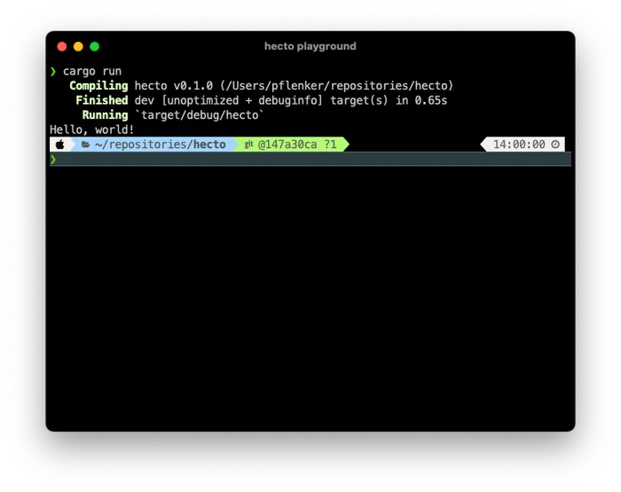

## 目录

- [介绍](hecto.md)
- [第 1 章：环境搭建](hecto-chapter-1.md) 📍 你在这里
- [第 2 章：进入原始模式](hecto-chapter-2.md)
- [第 3 章：原始输入与输出](hecto-chapter-3.md)
- [第 4 章：文本查看器](hecto-chapter-4.md)
- [第 5 章：文本编辑器](hecto-chapter-5.md)
- [第 6 章：搜索](hecto-chapter-6.md)
- [第 7 章：语法高亮](hecto-chapter-7.md)
- [附录](hecto-appendices.md)
- [变更日志](hecto-change-log.md)

## 第 1 章：环境搭建



啊，第 1 步。谁不喜欢在一张白纸上重新开始呢？然后选定那块唯一的砖，你将在它之上建造整座宏伟庄园？

不幸的是，当你构建一个**计算机程序**时，第 1 步可能会变得……复杂。而且令人沮丧。你必须确保你的环境已经为你使用的编程语言设置好，并且你必须弄清楚如何在该环境中编译和运行你的程序。

幸运的是，Rust 自带的开发环境为我们完成了大部分事情，所以你除了一个文本编辑器[^1]和 `rust` 之外不需要任何东西。本教程是在 Mac 上编写的，不过它*应该*也能在 Windows 和 Linux 上运行。

## 如何安装 Rust

为了安装 Rust，我们将使用 `rustup`，它负责管理已安装的 Rust 版本及相关工具。  
Rust 附带了一本极好的免费书籍：[《Rust 程序设计语言》](https://doc.rust-lang.org/book/title-page.html)。每当我认为这本书解释得比我更好时，我就会经常链接到这本书以获取更深入的知识。要安装 `rustup`，只需按照你所在平台的[第 1.1 章：安装](https://doc.rust-lang.org/book/ch01-01-installation.html)进行操作。在撰写本文时，在 Mac 上的操作方式如下：打开终端（在 Spotlight 中输入“Terminal”即可找到），然后输入以下命令：

```
curl --proto '=https' --tlsv1.2 https://sh.rustup.rs -sSf | sh
```

安装程序会向你展示一些选项，并提议按 `Enter` 直接采用默认设置。安装结束时会出现以下鼓励性的话语：

```
Rust is installed now. Great!
```

重启终端，然后输入以下命令：

```
rustc --version
```

你应该会看到一些关于你所安装版本的信息。如果没有看到，请前往[安装指南进行故障排除](https://doc.rust-lang.org/book/ch01-01-installation.html)。

顺便说一句，本教程中我们会大量使用终端，所以让它一直开着就好。

## main() 函数

创建一个名为 `hecto.rs` 的新文件，并给它一个 `main()` 函数。（`hecto` 是我们正在构建的文本编辑器的名称）。

```rust
fn main() {
    return;
}
```

在 Rust 中，你必须把所有可执行代码放在函数内部。Rust 中的 `main()` 函数很特殊。它是你运行程序时的默认起点。当你从 `main()` 函数返回时，程序退出并将控制权交还给操作系统。[^2]

Rust 是一种编译型语言。这意味着我们需要通过 Rust 编译器运行我们的程序，将其转换为可执行文件。然后我们像在命令行上运行任何其他程序一样运行该可执行文件。

要编译 `hecto.rs`，请在终端中运行 `rustc hecto.rs`。如果没有发生错误，这将生成一个名为 `hecto` 的可执行文件。要运行 `hecto`，请输入 `./hecto` 并按 `Enter`。该程序不会打印任何输出。[^3]

## 使用 cargo 编译

理论上，`rustc` 就是构建 `hecto` 所需的全部。在实践中，Rust 附带了一些方便的东西，将使开发更容易，并且正如你稍后将看到的，也更安全。

Rust 附带了一个名为 `cargo` 的程序。如果你习惯了 `JavaScript` 生态系统，那么 `cargo` 最好被描述为 Rust 中相当于 `npm` 的东西。它帮助你管理依赖、编译代码以及做其他事情。在 Rust 正确安装后，你可以输入以下命令来调用 cargo：

```
cargo --version
```

我们将使用这个程序来开始 hecto。通过输入 `rm hecto.rs hecto` 再次删除你之前的 `hecto.rs` 和可执行文件 `hecto`。

在你希望 `hecto` 诞生的目录中，输入以下命令：

```
cargo init hecto --vcs none
```

使用 `--vcs none` 部分确保你在没有 `git` 支持的情况下初始化 `hecto`。如果你想在这个项目中使用 `git`，请省略这个标志（但那样你需要安装 `git`）

`cargo` 通过告诉你以下内容来宣告成功：

```
Created binary (application) package
```

它创建了一个名为 `hecto` 的新文件夹，里面填充了一些文件。我们稍后会浏览其中大部分文件，最有趣的是一个位于 `src` 文件夹中名为 `main.rs` 的文件。

让我们看看那个文件。当你打开它时，你会发现它已经包含了一个 `main()`。仅仅通过观察它，我们就可以推断出这个程序[遵循了古人的仪式](https://en.wikipedia.org/wiki/%22Hello,_World!%22_program)，打印出“Hello, World!”然后退出。

要使用 `cargo` 编译这个程序，请确保你在 `hecto` 文件夹中（在 `cargo init hecto` 之后运行 `cd hecto`），然后在 shell 中运行 `cargo build`。`cargo` 不像 `rustc` 那样沉默，它会产生看起来有点像这样的输出：

```
Compiling hecto v0.1.0 (/Users/pflenker/repositories/hecto)
 Finished dev [unoptimized + debuginfo] target(s) in 12.36s
```

运行这个命令会添加更多文件（我们稍后会看看），并将一个名为 `hecto` 的可执行文件放入 `target/debug` 文件夹中。让我们执行 `./target/debug/hecto` 来让自己确信这个程序确实会打印出 `Hello, World!` 然后退出。

## 理解 cargo 的额外文件（和特性）

我们的 `hecto` 目录现在包含了一大堆东西（其中一些是隐藏的，具体内容在你的机器上可能看起来不同）：

1. 一个名为 `src` 的文件夹，包含 `main.rs`。
2. 两个名为 `Cargo.toml` 和 `Cargo.lock` 的文件
3. 一个名为 `target` 的文件夹，里面有一些隐藏文件和一个名为 `debug` 的文件夹。那个文件夹包含更多文件和文件夹以及我们的可执行文件 `hecto`。  
	所有这些额外的东西有什么用？让我们来学习一下。

### src 文件夹

`src` 文件夹是我们所有源文件将存放的地方。现在，我们只有一个。很快，会有更多。

### Cargo.toml 和 Cargo.lock

这个文件遵循一种名为 [TOML](https://toml.io/en/) 的配置格式，用于告诉编译器一些关于它应该编译的代码的信息。我们将在几段之后更仔细地查看默认的那个文件。

`cargo` 还为我们做依赖管理，`Cargo.toml` 将为我们保存这些依赖。`Cargo.lock` 是依赖管理的一部分，确保依赖在不同环境中保持一致。现在不用担心这个——我们将在下一章深入探讨。

### 构建目标

让我们看看 `target` 及其内容。  
`cargo` 支持多个所谓的*构建目标*。用作默认的是 `debug`，意味着最终可执行文件主要面向我们，即开发者，而不是实际的、真正的最终客户。

另一个有效的目标是 `release`，它正好相反：是交到客户手中的东西，而不仅仅是为开发者准备的。

要构建 release 版本，请运行：

```
cargo build --release
```

一旦你这样做，你会注意到 `target` 文件夹中出现了另一个文件夹，恰如其分地命名为 `release`。

等等，“可执行文件面向某人”是什么意思，它不都只打印“Hello World”吗，不管谁使用它？[^4]

嗯，确实如此。  
首先，Rust 编译器试图对开发者和最终用户都非常友好，因此它区别对待 `debug` 和 `release` 构建。我们稍后会遇到一个具体的例子，但有好几种编程错误，Rust 会假设你确实、真的不是故意这样做的。如果 `debug` 构建遇到这种错误，程序会崩溃，这是 Rust 能告诉你你错得有多离谱的最极端方式。但 Rust *确实*有一种从这些错误中恢复的方法，并且可以继续。虽然结果错误，但它*可以*继续，并且假设对于最终用户来说，错误的结果很糟糕，但崩溃更糟糕，同样的错误不会使 `release` 构建崩溃。

其次，编译器可以在底层执行各种优化，使结果更快。但这些优化需要时间，并使编译变慢。谁一直在编译？开发者。谁从不编译？用户。因此，`debug` 构建禁用优化以优先考虑开发速度，而 `release` 构建启用优化以优先考虑执行速度。

最后，可执行文件确实包含“Hello, World”之外的代码，Rust 在 `debug` 构建中添加了信息，这将帮助你更快地调试任何问题。这些信息对客户来说不需要，因此可以从 release 构建中排除。

`cargo` 在编译期间也告诉了我们这么多，`debug` 版本的最终行如下所示：

```
Finished dev [unoptimized + debuginfo] target(s) in 0.04s
```

这告诉我们该构建未优化，并包含调试信息。

另一方面，`release` 构建的编译结束于：

```
Finished release [optimized] target(s) in 0.04s
```

这告诉我们不包含调试信息，并且这是一个优化的构建。

让我们更仔细地看看调试信息，但不要乱动我们新的、已经心爱的文本编辑器代码。相反，前往 [Rust Playground](https://play.rust-lang.org/?version=stable&mode=debug&edition=2021)，它很有帮助地已经包含了我们的 hello world 函数。在左上角，你会看到一些按钮 Debug，然后是 Stable，然后是 `...`。点击这 3 个点并启用 `backtrace`。

然后修改 playground 中的代码如下：

```rust
fn main() {
   panic!("Hello, World");
}
```

`panic!` 触发崩溃，简单明了。点击“Run”来运行它。然后点击“Debug”，将其改为“Release”，再次运行。

你会注意到 `release` 构建生成以下输出：

```
Running \`target/release/playground\`
thread 'main' panicked at src/main.rs:2:4:
Hello, World
stack backtrace:
   0: rust_begin_unwind
   1: core::panicking::panic_fmt
   2: playground::main
```

`debug` 输出看起来像这样：

```
Running \`target/debug/playground\`
thread 'main' panicked at src/main.rs:2:4:
Hello, World
stack backtrace:
   0: rust_begin_unwind
             at /rustc/7cf61ebde7b22796c69757901dd346d0fe70bd97/library/std/src/panicking.rs:647:5
   1: core::panicking::panic_fmt
             at /rustc/7cf61ebde7b22796c69757901dd346d0fe70bd97/library/core/src/panicking.rs:72:14
   2: playground::main
             at ./src/main.rs:2:4
   3: core::ops::function::FnOnce::call_once
             at /rustc/7cf61ebde7b22796c69757901dd346d0fe70bd97/library/core/src/ops/function.rs:250:5
```

我们还没有详细讨论栈回溯，但即使没有这些知识，你也可以立即看到 debug 输出包含比 release 版本更多的信息。理解*调用栈*，即函数调用其他函数，然后再调用一些其他函数，直到其中一个崩溃的顺序，可能非常有用。

### 构建产物

这就解释了那些文件夹，但里面不是 `hecto` 的东西呢？让我们调查一些东西以加深我们的理解。

回到终端，按顺序运行以下命令：

```
cargo clean
cargo build
cargo build
```

（是的，我们运行了两次 `cargo build`）

第一个命令清理 `target` 目录。第二个命令像之前一样运行。然而在第三个命令期间，`cargo` 没有像之前那样输出以 `Compiling` 开头的行。这是因为 `cargo` 可以判断当前版本的 `main.rs` 已经被编译过了。如果 `main.rs` 自上次编译以来没有被修改，那么 `cargo` 就不会费心再次运行编译。如果 `main.rs` 被更改了，那么 `cargo` 会重新编译 `main.rs`。一旦你的代码库增长，这将变得更有用，因为当你只对一个组件的源代码进行更改时，大多数组件不应该需要一遍又一遍地重新编译。

`target` 目录中所有（好吧：大多数）额外文件都是*构建产物*，它们使 `cargo` 能够更快地进行后续编译。[在  `cargo` 的文档中了解更多信息。](https://doc.rust-lang.org/cargo/guide/build-cache.html)

## 编译和运行

由于编译并运行程序非常常见，`cargo` 用命令 `cargo run` 将两个步骤结合起来。

尝试将 `main.rs` 中的返回值改为 `Hello, World` 以外的字符串。然后运行 `cargo run`，你应该会看到它编译。检查结果，看看你是否得到了你更改成的字符串。然后将其改回 `Hello, World`，重新编译，并确保它恢复为返回 `Hello, World`。

## 代码审查

让我们一起看看代码。

[在 GitHub 上打开这一步](https://github.com/pflenker/hecto-tutorial/commit/147a30cac80412b739808b864b1831c2fca182a8)

如果你点击上面的链接，你会看到一个*带注释的提交*。它向你展示了上一步和当前步骤之间代码中发生的所有更改，并在相关代码行上直接添加了一些注释。

在这种情况下，我在那个提交中描述了 `Cargo.toml` 的内容。

像这样处理提交有很多好处：

- 你可以直接在我所指的代码上看到解释，这使得理解代码更改容易得多。
- 你可以直接提问（需要 GitHub 账户）或评论你不理解的代码片段

一开始，在本教程和 GitHub 之间来回切换对你来说可能会很累。然而，一旦我们学会了基础知识，我就不再事先向你展示我做了什么以便你可以重复——相反，我会先告诉你任务，然后再向你展示我做了什么来解决它，这样你就会更少地切换到 GitHub。

我将在本教程中链接大量额外材料。以下是我将坚持的约定：对理解教程至关重要的信息将出现在 GitHub 提交中或直接在本文中。任何其他不能明确标识为 GitHub 上某一步骤的链接都包含可选信息，如果你不感兴趣可以跳过。

## 总结与展望

在本章中，我们安装了 Rust，初始化了一个骨架项目并熟悉了它。我们现在知道如何手动以及使用 `cargo` 编译代码，并且对 `cargo` 及其生成的文件有了初步的良好理解。最重要的是，我们可以构建东西，并在需要时清理身后的东西。我们还遇到了 Rust Playground，当我们需要在将新事物付诸实践之前孤立地研究它们时，它肯定会派上用场。

在[第 2 章](hecto-chapter-2.md)中，我们将构建一个读取用户输入、将其打印在屏幕上并在按下 `q` 时退出的程序。仅这一点就会为我们带来大量初学者的学习内容。

---

[^1]: 在某个时候，你将能够用 `hecto` 编辑 `hecto`，所以你甚至不再需要文本编辑器了。

[^2]: Rust 支持*异步*代码，我们不会在本教程中涵盖。在这种情况下，`main` 完全可能结束但尚未将控制权交还给操作系统。

[^3]: 不确定你怎么样，但创建一个实际的、真实世界的、成熟的可执行文件对我来说曾经是，并且不知何故仍然是，一个神奇的时刻。

[^4]: 根据你的背景，你甚至可能觉得*问*这个问题很奇怪，因为构建变体的概念在当今已经相当普遍。过去并非如此。