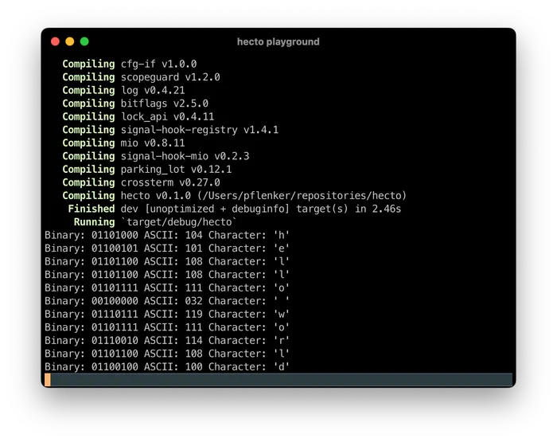

## 目录

- [介绍](hecto.md)
- [第 1 章：环境搭建](hecto-chapter-1.md)
- [第 2 章：进入原始模式](hecto-chapter-2.md) 📍 你在这里
- [第 3 章：原始输入与输出](hecto-chapter-3.md)
- [第 4 章：文本查看器](hecto-chapter-4.md)
- [第 5 章：文本编辑器](hecto-chapter-5.md)
- [第 6 章：搜索](hecto-chapter-6.md)
- [第 7 章：语法高亮](hecto-chapter-7.md)
- [附录](hecto-appendices.md)
- [变更日志](hecto-change-log.md)

## 第 2 章：进入原始模式

  
让我们试着读取用户的按键输入。  
删除 `main.rs` 中的所有内容，替换为以下代码：

```rust
use std::io::{self, Read};

fn main() {
    for b in io::stdin().bytes() {
        let c = b.unwrap() as char;
        println!("{}", c);
    }
}
```

玩一玩这个程序，试着弄清楚它是如何工作的。要停止它，请按 `Ctrl-C` 或 `Ctrl-D`。

一旦你认为自己已经充分理解了程序，请前往 [GitHub 上的这一步](https://github.com/pflenker/hecto-tutorial/commit/73c0e2acd8767953b469102b1fd8ff99d8c979c4) 查看代码和语法的深入解释。

如果你猜测上面的代码会把你输入的每个字符都打印到新的一行，那你就错了。或者对了一半——这就是程序所做的事情，但它并不会立即从终端获取字符进行处理。

当你运行 `./hecto` 时，你的终端连接到标准输入，因此你的键盘输入被读入 `b` 变量。然而，默认情况下你的终端以**规范模式**启动，也称为**熟模式**。在这种模式下，只有当用户按下 `Enter` 时，键盘输入才会发送给你的程序。

这意味着我们的程序会让你输入任意文本，一旦你按下回车，它就会输出相同的文本，每个字符占一行，然后等待新的输入。如果你按下 `CTRL-D`，你就是在告诉 `io::stdin().bytes()` 它应该读取的文件已经结束了。`CTRL-C` 会立即终止程序。

这种行为对许多程序来说很有用：它让用户输入一行文本，使用 `Backspace` 修正错误，直到输入完全符合他们的意愿，最后按下 `Enter` 将其发送给程序。这是终端的工作方式，与 Rust 无关。但这对于具有更复杂用户界面的程序（如文本编辑器）来说效果不佳。我们希望每次按键输入时都能立即处理，以便能够立即响应。

## 按 q 退出？

为了演示规范模式的工作原理，我们将让程序在读取到用户按下的 `q` 键时退出。为此，在 `println` 下方添加以下代码：

```rust
if c == 'q' {
    break;
}
```

`break` 语句将结束 `for-each` 循环，当读取到的字符是 `q` 时就会执行。

要退出这个程序，你需要输入一行包含 `q` 的文本，然后按回车。程序会快速逐字符读取这行文本，直到读到 `q`，此时 `for..in` 循环将停止，程序退出。程序*既不会*在你按下 `q` 时立即结束（你必须在之后的某个时刻按下 `Enter`），*也不会*处理 `q` 之后的任何内容——Rust 在退出时会丢弃额外的字符。

## 进入原始模式

我们想要的是**原始模式**，我们将使用一个依赖来将终端切换到该模式。[^1] Rust 中的外部依赖被称为 Crate（`cargo`，Crate……懂了吧？），我们要使用的这个叫做 [crossterm](https://docs.rs/crossterm/latest/crossterm/)。

我们通过运行以下命令来添加 `crossterm`：

```
cargo add crossterm
```

这会产生以下输出：

```
Updating crates.io index
  Adding crossterm v0.27.0 to dependencies.
         Features:
         + bracketed-paste
         + events
         + windows
         - event-stream
         - filedescriptor
         - serde
         - use-dev-tty
Updating crates.io index
```

`cargo` 从 [crates.io](https://crates.io/) 更新其索引，然后将 `crossterm` 添加到 `Cargo.toml` 中之前为空的 `dependencies` 部分。接下来是一个为该依赖启用（+）或禁用（-）的特性列表。特性超出了本教程的范围，但你可以在[这里](https://doc.rust-lang.org/cargo/reference/features.html)阅读所有相关内容。

下次你运行 `cargo build` 时，你会看到 `cargo` 构建的不仅仅是 `hecto`，因为它现在还要构建 `crossterm` 及其使用的依赖。

现在，让我们用以下代码替换 `main.rs` 的内容，来使用我们崭新的依赖：

```rust
use std::io::{self, Read};
use crossterm::terminal::enable_raw_mode;
use crossterm::terminal::disable_raw_mode;

fn main() {
    enable_raw_mode().unwrap();
    for b in io::stdin().bytes() {
        let c = b.unwrap() as char;
        println!("{}", c);
        if c == 'q' {
            disable_raw_mode().unwrap();
            break;
        }
    }
}
```

试一试，你会注意到你输入的每个字符都会立即打印出来，一旦你输入 `q`，程序就会结束。

[让我们在 GitHub 上研究代码更改。](https://github.com/pflenker/hecto-tutorial/commit/0d30c3d9ea77beda16d19149b8720608378dd029)

## 依赖管理

现在也是更详细地讨论依赖管理的好时机，并将我们在这里看到的内容与第 1 章的一些内容联系起来。

使用依赖意味着我们可以专注于我们的编码任务，而不必一遍又一遍地重新发明轮子（以及重新引入相同的 bug）。

`Cargo.toml` 在这方面扮演着重要角色。我们不仅在那里列出依赖，而且如果我们自己构建一个库函数，我们可以使用 `Cargo.toml` 来提供关于我们包的额外信息，如果我们决定发布它的话。依赖有其它依赖，而这些其它依赖也依赖于其他东西，这是正常的，有时也是不幸的。这意味着我们本质上需要信任库的作者 a) 是个好人，并且 b) 已经信任或检查了*他们*的依赖的作者*也*是好人，以此类推。这可能是一个严重的问题。[^2]

此时，`cargo` 选择性地重新编译已更改部分代码的能力就派上用场了，因为重新编译整个东西可能需要一点时间。编译时间还不算*糟糕*——在只添加了一个依赖之后就开始担心就太过了——但全新 `cargo build` 和后续构建之间的差异已经很明显了。

如果你像我们在第 1 章那样在 `target` 目录中翻找，你现在还会注意到恰如其名的 `deps` 文件夹现在已经被填满了。你还可以注意到，`release` 构建生成的可执行文件比 `debug` 构建生成的可执行文件*小得多*！

让我们也试着理解最后一块拼图，这是我们在第 1 章中省略的：`Cargo.lock`。那个文件也包含关于依赖的信息——甚至比 `Cargo.toml` 更深入。但它有什么用呢？

正如上面的 GitHub 步骤中所描述的，`cargo` 很贴心地升级不包含破坏性更改的版本。假设 `crossterm` 引入了一个 bug 修复但除此之外没有变化，那么这种行为意味着我们只需要通过运行 `cargo update` 来请求 `cargo` 更新其索引，然后后续构建就会使用更新后的版本。你只会注意到构建时间变长，因为 `cargo` 要下载它。

这带来了一个问题。假设你已经成功发布了 `hecto`，并且它在全世界范围内被使用。然后有人提交了一个 bug 报告，你尝试复现它。你打开旧的 `hecto` 代码库，重新构建它，却找不到错误。  
这意味着以下情况之一：

- 你没有正确复现它
- 你的机器与另一台不同，错误就来源于此
- 这个 bug 是由于一个有问题的依赖造成的，但那个依赖已经修复了 bug，`cargo` 下载了它，这意味着你的新版本没有这个 bug

这相当烦人。`Cargo.lock` 试图通过为你提供构建中所有依赖的非常具体的“指纹”来解决这些问题之一。你可以使用以下命令基于 `Cargo.lock` 中的依赖进行构建：

```
$ cargo build --locked
```

然后 `cargo` 会检查 `Cargo.lock` 是否仍然匹配 `Cargo.toml`（因此在 `.toml` 中定义新的依赖或版本，而该版本尚未出现在 `.lock` 中，会产生错误），但它不会使用与之前不同的版本，即使在此期间有更新。

## 以硬核方式进入原始模式

要进入原始模式，我们只需要调用我们的依赖来为我们完成。真 neat！

`crossterm` 为我们做的是：它在底层首先*获取*我们终端的属性，禁用其中许多属性，然后*设置*这些新属性。`crossterm` 使用 `libc` 中的方法，这些方法代表了[对平台系统库的原始绑定](https://docs.rs/libc/latest/libc/index.html)。在这个阶段直接使用它们将需要我们使用我们此时还不理解的 Rust 功能和概念，来修改我们*也*还不理解的晦涩终端设置，所以还是用库函数吧！

如果这不能满足你，也许以下内容可以：

1. 我们将在本教程后面学习所需的 Rust 概念。所以一旦你完成它，你应该能够自己设置原始模式。
2. 原始模式所需的底层终端属性在[原始的 `kilo` 教程](https://viewsourcecode.org/snaptoken/kilo/02.enteringRawMode.html)中有深入解释。Rust 的做法并没有太大不同。
3. 如果你想理解理论而不深入研究实现细节，你可以使用 `crossterm` 的[实现](https://github.com/crossterm-rs/crossterm/blob/99fe255f33f774f04c09755572503349c915112b/src/terminal/sys/unix.rs#L71)作为起点。

## 显示按键

为了更好地了解原始模式下的输入工作方式，让我们打印出我们读取的每个字节。我们将打印每个字符的二进制表示、其数值 ASCII 值，以及如果它是可打印字符时它所代表的字符。我们通过如下修改 `main()` 来实现：

```rust
fn main() {
    enable_raw_mode().unwrap();
    for b in io::stdin().bytes() {
        let b = b.unwrap();
        let c = b as char;
        if c.is_control() {
            println!("Binary: {0:08b} ASCII: {0:#03} \r", b);
        } else {
            println!("Binary: {0:08b} ASCII: {0:#03} Character: {1:#?}\r", b, c);
        }
        if c == 'q' {
            disable_raw_mode().unwrap();
            break;
        }
    }
}
```

前往 [GitHub 上的这一步](https://github.com/pflenker/hecto-tutorial/commit/8121519e5cb32b7a49fa3f8a80720daa0ed28f6d) 了解更多关于代码细节的内容。

在我们一起玩这个之前，让我快速告诉你一些关于在终端中打印东西的有趣事实。但首先：打字机。

[打字机](https://en.wikipedia.org/wiki/Typewriter)的工作原理是这样的：一张纸固定在滚筒上，滚筒又固定在一个托架上。每次你敲击一个带有字符的键，一个机械压印机构就会将相应的字符压印到纸上，并将托架向左移动一点。当你接近纸的末端时，你会听到一声“叮”的提示音，告诉你现在应该注意换行了，因为纸的末端即将到来。然后你需要将一个手柄向右推。那个手柄做两件事：它移动托架，以便你可以从最左边开始新的一行；它还转动滚筒，这样你就不会覆盖上一行，而是开始新的一行。

这三个概念——铃声、转动滚筒和移动托架——在计算机中仍然存在，尽管历史上这些概念是通过[电传打字机](https://en.wikipedia.org/wiki/Teleprinter)进入计算机的。[^3] 回到 `hecto`：你可能已经注意到在上面的代码中，`println!` *确实*开始了新的一行，但它并没有从*左边*开始，就好像在打字机上我们只旋转了滚筒但没有移动托架。我们通过在上面的输出中添加回车信号（实际上仍然叫这个名字）`\r` 来修复这个问题。

顺便说一句，我们的代码在哪些部分希望 Rust 处理（比如 `println!` 为我们添加的换行符）以及哪些部分希望自己处理（比如回车）上有点犹豫不决。我们稍后会修复这个问题。

现在，让我们用我们的新程序来学习一些东西。

在底层，字符只是数字，而数字在内存中内部表示为 `0` 和 `1`（我们称之为“位”）。假设我们的内存中有 `01100001`（我们称 8 位为一个*字节*，所以这是一个字节）。[将二进制数转换为十进制数很容易](https://www.rapidtables.com/convert/number/binary-to-decimal.html)，如果我们对 `01100001` 进行转换，得到数字 `97`。存在一个标准，将这样的数字映射到字符。这个标准叫做 ASCII，当你[在 ASCII 表中查找 97](https://www.asciitable.com/) 时，结果是小写字母 `a`。果然，如果我们在新程序中输入 `a`，我们会看到三样东西都被打印出来：`a`、`097` 和 `01100001`。  
这也是为什么我们可以轻松地教我们的程序将从键盘读取的二进制数当作字符来处理。基本上我们只是告诉计算机“请把这个数字当作字符来处理”。底层的二进制数字保持不变，但 Rust 理解我们希望遵循 ASCII 的约定，每当我们要求它时就会打印出 `a`。

ASCII 码 0-31 都是不可打印字符（你会在其中找到上面提到的铃声、回车和换行），127 也是一个控制字符。ASCII 码 32-126 都是可打印的。因此 `is_control()` 简单地查看代码的范围。[^4]

这是一个非常有用的程序，让我们再多玩一玩。它向我们展示了各种按键如何转换为我们读取的字符。大多数普通键直接转换为其所代表的字符。但试试看会发生什么

- 当你按下方向键时，
- 或者 `Escape`，
- 或者 `Page Up`、`Page Down`、`Home`、`End`（在 MacBook 上是 `fn` 加上方向键上、下、左、右），
- 或者 `Backspace`、`Delete`、`Enter`。
- 确保你也尝试了 `Ctrl` 的组合键，比如 `Ctrl-A`、`Ctrl-B` 等。

你会注意到一些有趣的事情：

- 按下 `Escape` 会发送一个 `27` 字节作为输入。
- 方向键、`Page Up`、`Page Down`、`Home` 和 `End` 都会向终端输入 3 或 4 个字节：`27`（与 Escape 键相同）、`[`，然后是一个或两个其他字符。这被称为**转义序列**，该键也因此得名。
- `Backspace` 是字节 `127`。
- `Enter` 是字节 `13`。如果你在 ASCII 表中查找这个，你会发现这是一个回车字符，我们在上面使用了 `'\r'`——而不是你可能期望的换行符 `'\n'`
- 特殊字符如德语变音符号也会产生多个字节。
- `Ctrl-A` 是 `1`，`Ctrl-B` 是 `2`，`Ctrl-C` 是……`3`，并且不会像你可能预期的那样终止程序（原始模式为我们禁用了这个）。其余的 `Ctrl` 组合键似乎将字母 A-Z 映射到代码 1-26。  
	更仔细地观察字节表示，你会注意到 ASCII 的设计方式使得你可以通过仅操作几个字节就从字符得到其小写对应物，或者得到 `CTRL` 加上该字符。例如，`CTRL` 似乎将高 3 位设置为 0。

## 错误处理

让我们通过改进处理错误的方式来结束这一章（也就是说：我们之前没有处理它们，但现在我们想处理了）。这也是我兑现承诺的地方，解释我们沿途遇到的偶尔出现的 `unwrap()`。

首先，一些简短的理论。在许多其他编程语言中，如果函数遇到错误，它不会返回，而是“抛出异常”，你可以在上层捕获并尝试恢复。这意味着我们实际上有两种函数将控制权返回给调用者的方式：要么返回一个值，要么抛出一个异常，而这两种情况需要不同的代码来处理，使得推理代码变得更加困难。

在 Rust 中，你可以像任何其他返回值一样从函数返回错误，从而允许以更清晰的方式处理异常情况。为了干净地做到这一点，Rust 有 [Result](https://doc.rust-lang.org/book/ch09-02-recoverable-errors-with-result.html) 的概念，它有两种变体：`Ok` 和 `Err`。这里有一个我们将使用一段时间的比喻：

假设我欠你钱，你向我索要那笔钱。那么要么我给你钱，要么我告诉你不行，我没有任何东西可以给你。这是我告诉你“索要欠款”是一个要么返回给你一些钱，要么抛出异常的函数的方式。请注意，如果我真的欠你钱，那么在我没有钱的情况下返回 0 欧元是无效的，所以在这里抛出异常更接近获得欠款的心智模型。

现在，不是钱，我还给你一个盒子，无论我有钱还是没钱，我都这样做。如果我有你的钱，那是一个标有 `Ok` 的粉色盒子。里面包着你需要的钱。否则那是一个标有 `Err` 的黑色盒子。那个盒子包含关于我为什么没有给你任何东西的信息（我没有钱，或者也许*你*欠*我*钱？！）

现在——`.unwrap()` 所做的是，继续用这个比喻来说，就是假设盒子是粉色的，并从中取出结果。如果盒子是黑色的，你的程序就会当场停止。

我们想要的行为是尽可能地将错误向上传递——让*他们*去处理上面那个黑盒子！——而在最高层，当除了我们自己之外没有人可以传递错误时，我们最终会中止程序。

[让我们在 GitHub 上的这一步中构建这个。](https://github.com/pflenker/hecto-tutorial/commit/23f1c0f6c54d794a8794fa40432c8e52103cc188)

## 总结与展望

在本章中，我们学习了 Rust 中的依赖、读取用户输入、错误处理的基础知识，以及关于终端和打字机工作原理的惊人信息量。  
如果你觉得这一章在编码方面有点少，那么你有值得期待的东西：在[下一章](hecto-chapter-3.md)中，我们将构建文本编辑器的基础。

---

[^1]: 为了尽可能贴近基础，本教程尽可能避免依赖。然而，使用依赖是使用 Rust 的关键部分，因此完全省略它们将毫无意义。

[^2]: [这个链接](https://www.openwall.com/lists/oss-security/2024/03/29/4)告诉你所有你需要知道的关于递归依赖信任可能有多糟糕的事情。

[^3]: 铃声用于引起附近操作员的注意。

[^4]: 我们在这里回避了一个问题：到目前为止我所说的关于 ASCII 的一切都是真的，但 Rust 对 `char` 使用的是 ASCII 的超集。我们将在本教程后面讨论文本编码的乐趣。