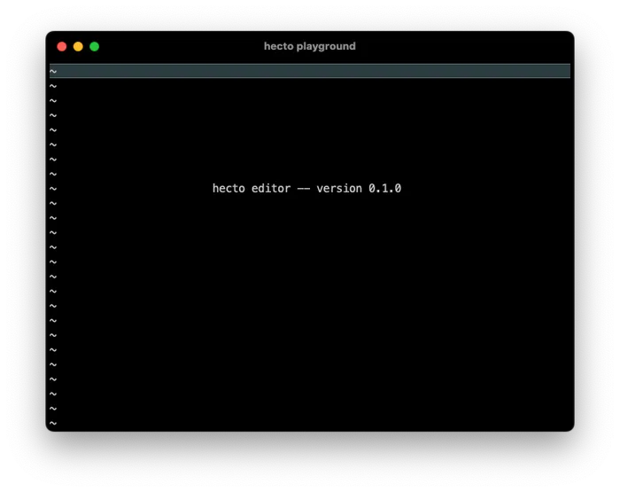

## 目录

- [介绍](hecto.md)
- [第 1 章：环境搭建](hecto-chapter-1.md)
- [第 2 章：进入原始模式](hecto-chapter-2.md)
- [第 3 章：原始输入与输出](hecto-chapter-3.md) 📍 你在这里
- [第 4 章：文本查看器](hecto-chapter-4.md)
- [第 5 章：文本编辑器](hecto-chapter-5.md)
- [第 6 章：搜索](hecto-chapter-6.md)
- [第 7 章：语法高亮](hecto-chapter-7.md)
- [附录](hecto-appendices.md)
- [变更日志](hecto-change-log.md)

## 第 3 章：原始输入与输出

  
欢迎来到第 3 章，我们将探索从终端读取和向终端写入的方方面面。但在深入之前，让我们先打磨一下代码，使其更符合标准实践。

## 认识符合语言习惯的代码

在使用像 Rust 这样的较新语言时，你可能听说过**符合语言习惯的**（idiomatic）代码。这不仅仅是让你的代码能工作；而是让它符合该语言中通常的做法。但为什么这很重要呢？

让我们这样想：想象我告诉你，通过跟随本教程，你可以“用一个苍蝇拍拍死两只苍蝇”——同时学习 Rust 并构建自己的编辑器。你能理解我的意思吗？

对于一些人来说，比如德语使用者，这可能会让他们产生共鸣，因为它类似于一句常见的德语谚语。其他人可能会用不同的方式表达，比如葡萄牙语中的“用一根棍子打死两只兔子”。但对于不熟悉这些说法的人来说，可能需要解释一下。在英语中，我们通常说“一石二鸟”（To kill two birds with one stone），强调使用每个人都能理解的表达方式的重要性。虽然不符合语言习惯的短语仍然可以传达意思，但它们往往导致人们不必要地关注措辞而非信息本身。

编写符合语言习惯的代码有点像这样。它关乎遵循语言中的常规规则和实践，使你的代码易于他人阅读和理解。通常，人们只会在出问题时才深入研究你的代码——要么是因为有 bug，要么是他们想添加新功能。因此，让你的代码易于理解不仅有助于你当前的合作者，也有助于未来的你自己在调试或添加更多功能时。

我们将分三步来解决这个问题：优化代码以符合常规风格，以 `crossterm` 预期的方式使用它，以及从 90 年代某个熟悉的回形针那里获得一些指导以保持正轨。[^1]

在不改变代码工作方式的情况下优化代码被称为*重构*。我们的目标不是一开始就追求完美；而是持续改进，使我们的代码更易于使用和构建。为了确保我们的更改不会破坏任何东西，我们暂时会手动测试。虽然自动化测试很好，但它们超出了本教程的范围。

### 将代码拆分为多个文件

在 Rust 中，像许多编程语言一样，主方法通常只是通过提供应用的入口点来启动事情，而不做更多。我们的目标是将代码放在逻辑上合理的位置，使其在我们前进的过程中更容易查找和维护。这种方法还有许多其他好处，我会在遇到时指出来。

现在，我们的代码有点难以理解。要真正理解它做什么，你必须通读整个东西。简而言之，它回显用户按下的每个键，并在按下 'q' 时退出。让我们通过用一种武器杀死两只动物来简化我们的生活：我们将为我们的编辑器引入一个新的结构体，名为 `Editor`，它将驻留在自己的文件中。这将使代码更容易推理，也更符合语言习惯。

`struct` 基本上是一组变量——有时还有函数——它们组合在一起形成一个有意义的整体。这正是我们保持事物整洁有序所需要的。

[前往 GitHub 查看此更改及其注释。](https://github.com/pflenker/hecto-tutorial/commit/020820189e4e92a9848203b406b7c5691839f129)

现在，我们可以让 `main.rs` 保持不变，同时专注于 `editor.rs`。

在这次更改和我们新学到的关于结构体和函数的知识之后，让我们关注 `crossterm`。到目前为止，我们只用它来进入和离开 `raw mode`，但它能做更多事情。现在，我们应该用它来正确地从终端读取。

[这是我们如何做到的](https://github.com/pflenker/hecto-tutorial/commit/fc28b24fb72bb669fa74b86001c661864e3da36f)。

现在，这个代码更改确实扩展了我们使用 `match` 的方式，所以是时候更好地理解 `match` 以及一些其他概念了。

让我们从内部的 `match` 开始。它看起来像这样：

```rust
match (event.code) {
    Char(c) => {
        if c == 'q' {
            break;
        }
    },
    _ => (),   
}
```

外部的 `match` 语句（我们稍后将讨论）确保此时我们知道 `event` 是一个 `KeyEvent`，其文档在[这里](https://docs.rs/crossterm/latest/crossterm/event/struct.KeyEvent.html)：

```rust
pub struct KeyEvent {
    pub code: KeyCode,
    pub modifiers: KeyModifiers,
    pub kind: KeyEventKind,
    pub state: KeyEventState,
}
```

那么，我们是如何从这个结构中提取字符的呢？回想一下我们关于错误处理的讨论，我描述了两种比喻性的盒子：一个粉色的盒子装着我们需要的东西，一个黑色的盒子装着错误。我们在这里扩展这个比喻。

让我们看看 `KeyCode` 的细节：

```rust
pub enum KeyCode {
    Backspace,
    Enter,
   // 更多 KeyCode
    Char(char),
   // 还有一些 KeyCode
}
```

如果你感兴趣，[这里是完整列表](https://docs.rs/crossterm/latest/crossterm/event/enum.KeyCode.html)。所以 `KeyCode` 可以表示：

- 一个 `Backspace`
- 一个 `Enter`
- 各种其他东西（大概是键）
- 一个装着字符的盒子
- 额外的东西（大概是更多的键）

这*极其*有用，*远远*超出了通常的 if/then/else 结构。`match` 的第一个分支所做的工作可以描述为：“如果 `event.code` 看起来像一个装着字符的盒子，让我们把这个字符叫做 `c` 并执行以下代码块”。

关于 `match` 还有一点需要注意：匹配必须是穷尽的，意味着每个可能的情况都必须被处理。你必须自觉地决定在没有装着字符的盒子而是其他东西时该怎么做。我们指示 `match` 如下处理：`_ => ()`。这意味着：对于所有不匹配的情况（由 `_` 表示），什么都不做（由 `()` 表示）。

这难道不矛盾吗？我听到你在问。如果一个 `match` 被设计为显式覆盖每个情况，那么仅仅匹配“一切”的目的是什么？这是一个非常好的观点，你实际上可以教 `clippy`（我们很快会见到它）将其标记为潜在问题。

现在我们可以更容易地理解外部的 `match`，它看起来像这样：

```rust
match read() {
    Ok(Key(event)) => {
        // ... 内部 match
        }   
    },
    Err(err) => println!("Error: {}", err),
    _ => ()
}
```

第一个分支使用了两次盒子概念。它说：如果 `read()` 返回一个标有 `Ok` 的粉色盒子，并且那个粉色盒子里有另一个标有 `Key` 的盒子，那么把那个盒子里的东西叫做 `event` 并继续。  
第二个分支直接处理错误：如果有一个黑色盒子，把 `err` 取出来并显示它。  
最后一个分支处理所有其他组合：对于所有不包含标有 `Key` 的盒子的粉色 `Ok` 盒子，什么都不做。

## “看起来你正在编写一个程序。需要帮助吗？”

代码现在符合语言习惯了吗？看起来是的。但它是否出色？不完全是。知道所有习语并不能让人成为诗人。在某种程度上，这是可以接受的，如前所述。然而，我们可以请一个[30 岁的烦人回形针](https://en.wikipedia.org/wiki/Office_Assistant)来进一步优化我们的代码：`clippy`。

`clippy` 既是一个烦人的 Microsoft Office 97 功能的名称，也是一个指出我们代码中可能改进之处的工具——一个 linter。你可以从命令行运行它：

```
cargo clippy
```

`clippy` 已经突出显示了一些故意的[^2]问题。这里有一个例子：

```
warning: unnecessary parentheses around `match` scrutinee expression
  --> src/editor.rs:19:27
   |
19 |                     match (event.code) {
   |                           ^          ^
   |
   = note: `#[warn(unused_parens)]` on by default
help: remove these parentheses
   |
19 -                     match (event.code) {
19 +                     match event.code {
   |
```

花点时间欣赏一下这个反馈有多么精确和有用！它具体指出了代码中有问题的部分。我们很快就会解决这个问题，但首先让 `clippy` 进行更广泛的检查。`clippy` 有各种设置或标志，对于我们初学者来说最合适的是 `pedantic`，它使 `clippy` 建议所有可能的符合语言习惯的改进。

我们这样运行它：

```
cargo clippy -- -W clippy::all  -W clippy::pedantic
```

这个命令现在会触发几个警告。  
`clippy` 不仅指出我们代码中的弱点，还提供了文档链接以供进一步阅读。太棒了！

`clippy` 还可以继续为我们修复某些问题：

```
cargo clippy --fix -- -W clippy::all  -W clippy::pedantic
```

我们可以告诉 `clippy` 我们希望默认使用哪些标志，例如通过将以下代码添加到 `main.rs` 的顶部：

```rust
#![warn(clippy::all, clippy::pedantic)]
```

这个指令为 `all` 和 `pedantic` 两个类别激活警告。尽管名字叫 `all`，但它并不包括*所有东西*，而是包括 `correctness`、`suspicious`、`style`、`complexity` 和 `perf` 等类别。查看[文档](https://doc.rust-lang.org/nightly/clippy/)，似乎 `style` 正是我们需要的，但其他的也不会伤害我们。

[让我们在这个提交中应用这些更改，包括 clippy 的自动修复和手动修正。](https://github.com/pflenker/hecto-tutorial/commit/4a7df66f1103b318b28b8d5374aa172e0bf3ac8a)。

通过这个过程，`clippy` 教了我们两件事：如何优化格式字符串以及使用 `if let` 进行更清晰的模式匹配。

`clippy` 仍然正确地指出我们的 `run()` 函数不依赖于 Editor 的特定实例。我们这样构建是有意为了同时介绍不同类型的函数，我们很快就会改变这一点。

最终，我们的目标应该是在没有任何警告的情况下编译代码，向未来的开发者表明我们已经努力生产尽可能最好的代码。每当教程步骤涉及 `clippy` 会皱眉的做法时，我会确保在文中澄清。

## 偏执的 clippy

我们可以把 `clippy` 调到 11 档，让它变得极其警觉。文档描述了各种可以启用的额外标志，以最大化 `clippy` 的审查力度。以下命令包含了所有对 `hecto` 看起来有用的选项：

```
cargo clippy -- -W clippy::all -W clippy::pedantic  -W clippy::nursery -W clippy::cargo -W clippy::restriction
```

这种方法很严格，但有代价：`clippy` 变得越偏执，它就越可能标记一些在特定情况下实际上可以接受的代码。更糟糕的是，我们启用的一些规则可能会指出完全有效的代码的问题，或者与其他规则矛盾。  
在我们目前的经验水平下，完全理解这些细微差别可能很有挑战性，我们可能会掉进错误的兔子洞。对于我们这些 Rust 新手来说，`pedantic` 设置已经很有野心了。因此，我们暂时就停在这里。

## 改进的错误处理

让我们通过兑现关于错误处理的承诺来结束对符合语言习惯代码的讨论。我们的目标是：

- **本地处理：** 如果我们能在错误发生的地方解决它，我们就会处理它。
- **向上传递：** 对于我们无法直接修复的错误，我们将它们向上传递以进一步处理。
- **顶层处理：** 如果错误到达最高层，我们将尽可能优雅地管理它。

作为其中的一部分，我们将把错误处理逻辑从主循环中分离出来，并打印一条简单的告别消息。

要了解这是如何工作的，[请查看这里的代码](https://github.com/pflenker/hecto-tutorial/commit/ce8bed0ce9efc7d03e6e822b47b235ad3cdbc8f4)。

## 按 Ctrl-Q 退出

现在，我们的文本编辑器在有人输入 `q` 时就会退出，这并不理想。让我们改变一下，让它只在你按下 `Ctrl-Q` 时才退出。  
此外，随着我们的代码变得更复杂、函数变得更多，我们需要一种更流畅的方式来关闭程序，而不必到处手动中断循环。  
我们将通过调整 `Editor` 结构体来包含一个名为 `should_quit` 的布尔值来解决这个问题。这个修复也将消除 Clippy 的最后一个警告。

你可以[在这里](https://github.com/pflenker/hecto-tutorial/commit/3134980bc6b3ca898545d65c31890b6ebe87e452)查看我们是如何进行这些更改的。

深入这些更新意味着我们也将体验 Rust 如何使用一种叫做所有权的机制来处理内存安全。Rust 对谁可以读写数据非常严格，它希望我们通过使用 `mut` 关键字来明确表达我们更改（或\_mut\_ate）任何东西的意图。我们稍后将更深入地探讨 Rust 的所有权模型。

## 清除屏幕

我们即将深入探讨每次按键时如何渲染编辑器的用户界面。这发生在三个关键时刻：

- **启动时：** 我们为用户搭建舞台。
- **每次按键后：** 以响应用户的操作。
- **退出前：** 清理我们的工作区并留下一条整洁的告别消息。

首先，让我们清除屏幕。我们将暂停 Rust 编程片刻，将注意力转向终端命令。我们将先处理概念，将实际实现留到后面。  
现在，只需将这行代码放到你的代码中你认为需要刷新屏幕的地方：

```rust
print!("\x1b[2J");
```

Rust 中的 `print!` 宏让我们直接将数据发送到终端。与以换行符结尾的 `println!` 不同，`print!` 只输出我们告诉它的内容。我们从 `\x1b` 开始，这是转义字符，或十进制的 27。  
让我们分解 `\x1b`：

- `\x` 表示后面的内容应被读取为十六进制数字。
- `1b` 转换为十进制是 27（你可以在[这里](https://www.rapidtables.com/convert/number/hex-to-decimal.html)查看转换）。

剩下的部分 `[2J` 构成了**转义序列**的一部分。如果你回想我们之前关于转义序列的讨论，比如方向键的那些，那么它们也可以指示终端执行各种操作——比如清除屏幕——应该不会让你感到惊讶。

这里，我们使用 J 命令（[Erase In Display](http://vt100.net/docs/vt100-ug/chapter3.html#ED)）来将屏幕擦干净。\[2J 中的 2 告诉终端清除整个屏幕。不同的参数调整范围：

- `\x1b[1J` 清除到光标处。
- `\x1b[0J` 从光标处清除到屏幕末尾。
- 简单地 `\x1b[J` 默认从光标处清除到末尾。

要深入了解终端命令的魔力，请探索现代终端广泛支持的 [VT100](https://en.wikipedia.org/wiki/VT100) 转义序列。完整细节在 [VT100 用户指南](http://vt100.net/docs/vt100-ug/chapter3.html)中。

查看[这份关于虚拟终端的文档](https://learn.microsoft.com/en-us/windows/console/console-virtual-terminal-sequences)，并尝试制作你自己的转义序列，用上面的命令写出来。

虽然 `crossterm` 在很大程度上使我们免于手动输入这些序列，但理解它们可能相当有趣。然而，接下来我们不需要自己写它们了。

现在让我们使代码更干净、更有结构：

- 首先，我们启用原始模式并清除屏幕，设置我们的编辑器。
- 最后，我们清理：禁用原始模式，再次清除屏幕，处理任何错误，并向用户告别。
- 在这之间，我们的循环读取输入、评估它、更新屏幕并重复——为我们未来的自己保持事物整洁可控。趁代码还可控的时候现在就开始清理吧。  
	从现在起，我们将停止回显每次按键，保持屏幕干净和专注。

[查看这个更新的实际效果。](https://github.com/pflenker/hecto-tutorial/commit/ba50855df0d40a34ce373db95027ef6e213b8283)  
试验一下结果，你会发现屏幕如预期般清除，按键回显消失了，退出也很流畅。我们离将 hecto 转变为功能齐全的文本编辑器又近了一步！

最后，请记住每次清除屏幕可能会掩盖编译器提示。要捕获任何警告，请单独运行 `cargo build`。请记住，Rust 不会重新编译未更改的代码，所以要获得一组新的警告，请先运行 `cargo clean`，然后运行 `cargo build`。

## 任务 1：波浪号

现在是我们交换位置的时候了。到目前为止，我一直坐在驾驶座上，向你展示我做了什么以及为什么。现在，你已经看到了足够的 Rust 来自己握住方向盘。`clippy` 和我仍然在那里帮助你。如果你不自己做任务而是立即看解决方案，那也没关系。

我通常会稍微解释一下任务，并给你一些解决它们的提示。有些任务包含一个*加分项*。这里的想法是，你应该能够仅凭目前教程中呈现的知识自己弄清楚核心任务，但*加分项*可能有点难达到。然而，我的解决方案有时会使用替代方法来解决问题，或指出解决问题的不同方式，所以请务必查看我的解决方案以学习新东西。

是时候开始绘制了。你的第一个任务是在屏幕左侧绘制一列波浪号（`~`），就像 [vim](http://www.vim.org/) 那样。在我们的文本编辑器中，我们会在正在编辑的文件末尾之后的任何行的开头绘制一个波浪号。

“绘制”意味着：我们将光标移动到我们想绘制东西的任何地方，然后打印出我们想绘制的任何东西。我们之前没有移动光标，导致我们的告别消息被打印在终端的某个地方，而不是左上角。所以我们计划将光标定位到左上角，开始一个接一个地绘制波浪号，一旦到达底部，我们将光标定位回左上角。

看看 Rust Playground 中的以下代码并试验一下——它包含一些你可能觉得对任务有用的东西。

```rust
fn main() {
    let somesize = (10,20);
    dbg!(somesize);
    dbg!(somesize.0);
    dbg!(somesize.1);
    for number in 0..10 {
        dbg!(number);
    }
}
```

[Rust Playground 链接](https://play.rust-lang.org/?version=stable&mode=debug&edition=2021&gist=7a63b4a737f91a26ad0e68142aa50912)

这是任务：

- 实现一个名为 `draw_rows()` 的函数。这个函数应该在每一行打印一个 `~`。
	- [`crossterm::cursor::MoveTo`](https://docs.rs/crossterm/latest/crossterm/cursor/struct.MoveTo.html) 移动光标。
		- [`crossterm::terminal::size`](https://docs.rs/crossterm/latest/crossterm/terminal/fn.size.html) 为你提供大小。
- 重构：你会注意到我们在与 `crossterm` 交互时做了很多类似的事情。是时候至少将终端的一部分封装到它自己的文件中了。
	- 如果你在将新文件导入编辑器时遇到困难，试试在 `main.rs` 中使用 `mod`。我们稍后将一起研究这个。

这不应该产生任何 `clippy` 警告。

## 任务 1：代码审查

[GitHub 上任务 1 的解决方案。](https://github.com/pflenker/hecto-tutorial/commit/a63b417ebf74199cd16c3bd46445873b0498088a?diff=unified&w=0)

在底层，`crossterm` 使用了转义序列 `\x1b[H`，即 `H` 命令（[Cursor Position](http://vt100.net/docs/vt100-ug/chapter3.html#CUP)），来定位光标。`H` 命令实际上接受两个参数：行号和列号，用于定位光标。所以如果你有一个 80×24 大小的终端，并且你想让光标位于屏幕中央，你可以使用命令 `\x1b[12;40H.`（多个参数用 `;` 字符分隔。）`H` 的默认参数恰好都是 1，所以我们可以省略两个参数，它会将光标定位在第一行第一列，就像我们发送了 `\x1b[1;1H` 命令一样。（行和列的编号从 1 开始，而不是 0——`crossterm` 不遵循这一点，使用 0 作为起始。）

## Rust 中的类型

现在让我们开始讨论*类型*。直观地说，*类型*是我们用来更好地推理我们所谈论的任何东西的东西。在第 2 章中，我们看到内存中数据点的*类型*决定了 Rust 是将 `01100001` 视为整数 `97` 还是字符 `a`。  
因此我们遇到的第一个类型是 `Char`，代表单个字符。你可能记得，即使这个看似无辜的基本类型也已经是模糊的，因为我们对字符的直观理解与 Rust 的理解不同（例如，我在学校从未学过如何写回车符！）。在第 4 章中，我们将更详细地探索字符，并发现 Rust 中的 `Char` 实际上是 UTF-32 编码的。

到目前为止，我们遇到了一些类型，但从未真正评论过它们：

- `Char`，如上所述。
- `Editor` 和 `Terminal` 是我们自己定义的类型。
- `Result` 是一个类型，代表标有 `Ok` 的粉色盒子或标有 `Err` 的黑色盒子。
- `std::io::Error` 是一个特定的错误类型，用于在输入或输出操作期间可能发生的错误——在我们的情况下，是从终端读取或向终端写入时。
- 然后我们看到了各种所谓的枚举。枚举是某事物可以具有的不同变体的列表。`crossterm` 的 `KeyCode` 是一个枚举，代表所有可能按下的键。

有一个光谱定义了编程语言对类型的严格程度。在光谱的一边，你有像 `JavaScript` 这样的语言，它们真的根本不关心类型。如果你想对任何东西调用方法 `foobar()`，它不会抱怨，它只在到达那段代码时才检查这个“任何东西”是否甚至有一个叫 `foobar()` 的方法。这被称为“弱类型”。

在光谱的另一边，你有像 `Java` 这样的语言，它们要求你对类型非常谨慎，并试图保护你不被在无效类型上调用方法。这被称为“强类型”。

还有一个中间地带，有一些奇怪的东西，比如 `TypeScript`，它为 `JavaScript` 带来了强类型，或者 `Groovy`，它为 `Java` 带来了弱类型。[^3]

Rust 坚定地站在光谱的“强类型”一侧。但如果这是真的，为什么我们直到第 3 章的后三分之一才完全遇到它们？例如，为什么我们之前允许在 `main()` 中写以下内容？

```rust
let editor = Editor::default();
```

这里没有 `editor` 类型的痕迹，但这可以编译。

Rust 试图在这里对开发者非常友好。它在任何可以的地方推断类型，并且由于 `Editor::default()` 不可能返回 `Editor` 以外的任何东西，我们不需要在这个赋值中明确它。作为开发者，我们写的东西必须更简洁，而且如果我们改变 `default()` 的返回值，我们在这个更新中需要触及的代码片段就少了一个。我们可以（有时必须）明确类型。如果我们想使上面的赋值显式，我们会写：

```rust
let editor: Editor = Editor::default();
```

这样，如果我们改变 `default()` 的返回类型，编译器会要求我们也改变 `editor` 的类型。

这被称为*类型推断*，Rust 可以做到这一点，因为我们明确需要在重要的地方提及类型，即在*函数签名*中。例如，我们移动鼠标光标的函数签名看起来像这样：

```rust
pub fn move_cursor_to(x: u16, y: u16) -> Result<(), std::io::Error>
```

这可以读作：

- `pub`：后面的内容可以在这个文件外部访问。
- `fn`：后面的内容是一个函数。
- `move_cursor_to`：这个函数此后被称为 `move_cursor_to`。
	- `(`：后面是这个函数在被调用时预期作为输入的所有内容的定义。
		- `x: u16`：这个函数预期的第一个东西必须是 `u16` 类型。它此后被称为 `x`。
				- `y: u16`：这个函数预期的第二个东西必须是 `u16` 类型。它此后被称为 `y`。
		- `)`：这结束了此函数输入的定义。
- `->` 后面是关于此函数将向调用者返回什么的描述。
- `Result`：此函数返回一个 `Result`，它是标有 `Ok` 或 `Err` 的两个可能盒子之一。
	- `<`：后面是此函数返回的两个盒子的定义。
		- `()`：一个 `Ok` 盒子将包含空，它将是空的。
				- `std::io::Error`：一个 `Err` 盒子将包含一个 `std::io::Error`。
		- `>`：这结束了盒子的定义。

## 整数类型

让我们看看新类型 `u16`，我们看到 `crossterm` 使用了它，然后在我们自己的代码中利用了它。这是表示数字的多种类型之一。正如你可能从 `Char` 周围隐藏的复杂性中猜到的那样（我们还没有看到终点，更多内容在第 4 章），数字也不容易处理。首先，我们需要将整数与其他数字（如分数）分开。记住，在存储中一切都是 0 和 1，所以如果你处理的是分数，你必须考虑如何在内存中实际表示它们，这并不简单。  
幸运的是，我们在这里处理的是整数。它们比分数更容易处理，但仍然——它们也有多种口味。让我们先在 Rust Playground 中认识它们，这样你可以试验。

```rust
fn main() {

    let small_u: u8 = std::u8::MAX;  
    let medium_u: u16 = std::u16::MAX;  
    let large_u: u32 = std::u32::MAX;  
    let extra_large_u: u64 = std::u64::MAX;  
    
    let small_i_min: i8 = std::i8::MIN;  
    let small_i_max: i8 = std::i8::MAX;  
    let medium_i_min: i16 = std::i16::MIN;  
    let medium_i_max: i16 = std::i16::MAX;  
    let large_i_min: i32 = std::i32::MIN;  
    let large_i_max: i32 = std::i32::MAX;  
    let extra_large_i_min: i64 = std::i64::MIN;  
    let extra_large_i_max: i64 = std::i64::MAX;  

    println!("Unsigned integers:");
    println!("u8 max: {}", small_u);
    println!("u16 max: {}", medium_u);
    println!("u32 max: {}", large_u);
    println!("u64 max: {}", extra_large_u);

    println!("Signed integers:");
    println!("i8 min: {}, max: {}", small_i_min, small_i_max);
    println!("i16 min: {}, max: {}", medium_i_min, medium_i_max);
    println!("i32 min: {}, max: {}", large_i_min, large_i_max);
    println!("i64 min: {}, max: {}", extra_large_i_min, extra_large_i_max);
}
```

[Rust Playground 链接](https://play.rust-lang.org/?version=stable&mode=debug&edition=2021&gist=d9ab1c4613e62957ed2a759c48c2d892)

让我们从 8、16、32 和 64 之间的区别开始：宽度。

这里的宽度是指用多少位来表示那个数字。这个宽度决定了我可以表示的不同组合的数量。一个假设的 2 位整数有以下组合：`00`、`01`、`10` 和 `11`。我可以在那个小整数中存储 4 个不同的值。`u16` 中的 `16` 意味着 16 位的宽度，这给我们带来了更令人印象深刻的 65 536 个不同的值。Rust 甚至有宽达 128 位的整数，产生 340 000 000 000 000 000 000 000 000 000 000 000 000 个不同的组合。这介于一个 undecillion 和一个 duodecillion 之间。

那么为什么不安全起见，总是使用最宽的整数类型呢？答案是：性能。更小的单元可以被你的机器更迅速地处理。32 位机器之所以被称为 32 位，是因为它可以高效地处理 32 位操作。任何更大的数据类型都必须在底层以不同的方式处理，从而降低性能。因此，你有时可能想使用机器上可用的最宽类型——例如，在 32 位机器上使用 u32，在 64 位机器上使用 u64。这就是另一种类型所代表的：分别是 `usize` 和 `isize`。我们稍后将讨论和使用这些。

整数类型之间的另一个区别用字母 i（表示有符号整数）或 u（表示无符号整数）表示。这里的*符号*指的是它前面的减号，即整数是否允许为负数。让我们回到我那个了不起的 2 位整数。正如我告诉你的，它可以表示 4 个不同的值，但哪些呢？如果我决定使用*有符号整数*，它将表示 -2、-1、0 和 1（按照惯例，范围在负数侧稍宽）。如果我决定使用*无符号整数*，我将能够表示 0、1、2 和 3。[^4]

这意味着在我预计不会有负数的场景中，无符号数据类型给我大约两倍的数字量。

`crossterm` 使用 `u16` 类型来放置鼠标，即无符号 16 位整数。“无符号”是合理的——坐标 `(0,0)` 在终端的左上角，所以我们永远不会期望负坐标。16 位无符号意味着我们可以表示的最高数字是 65 535。所以我们可以推断，通过从 `crossterm` 接管 `u16`，`hecto` 在比这更大的终端中无法正常运行。我们暂时可以接受这一点。

## 更好地绘制波浪号

下一个任务是几个底层改进。首先，我对我们写入终端的方式不满意。我们过去使用 `println!` 宏，并在上一步切换到 `print!`。但我们也使用 `crossterm`，在那里我们使用了一个叫做 `execute!` 的宏构造。这很糟糕，原因有三：

第一——我们混合了两个概念——直接打印和 `crossterm`，这让我感到不快。对我来说，这种不快就像你进入一个房间时闻到的东西。这通常被称为[代码异味](https://en.wikipedia.org/wiki/Code_smell)：可能表明更深层次问题的东西。

第二——我们还不理解 `execute!`，我们只是因为它文档告诉我们要用它。在我看来，这也有点可疑。

第三——打印有时很奇怪，我们的代码没有考虑到这一点。

让我们从最后一部分开始，打印有多奇怪。向屏幕打印是一个昂贵的操作，为了使其更高效，有一个缓冲区的概念。每当你尝试在屏幕上写入时，你实际上写入的是这个缓冲区，这个缓冲区要么在你手动操作时被清空（并写入屏幕），要么在缓冲区满时被清空。我们还没有遇到这个问题，因为通常缓冲区是*行*缓冲的，所以如果缓冲区中有一整行，它最迟会自动写出。到目前为止我们所有的打印都包含换行符，所以我们没有看到那个问题。但写入转义序列不一定打印出换行符，这意味着在那个时候我们可能会受到缓冲问题的影响。

这就引出了第二部分，我们不理解我们正在使用的东西。`execute!` 实际上是一个宏，确保你传递给它的任何东西立即被打印出来。这……一半好？这几乎是我们想要的，但正如我上面提到的，写入是一个昂贵的操作，我们真的只需要在完成对按键的评估后完全写入屏幕。我们不需要为每个光标放置、清除屏幕或写入进行完整写入，可以把它留给缓冲机制，让系统为每个这些东西找出最佳写入时机。如果我们总是写出每一个小的变化，这甚至可能导致奇怪的闪烁效果。

这就引出了第一点，代码异味。调查那个代码异味导致我们阅读了 `execute!` 并发现了打印可以有多奇怪。结果是，我们现在明白我们的代码之所以能工作只是幸运的巧合，而且它的工作效率不高。

## 任务 2：改进绘制

还有另一个可能产生烦人闪烁效果的来源，我们现在应该处理它。终端在绘制到屏幕时，光标可能会在屏幕中间的某个地方显示一瞬间。为了确保这不会发生，让我们在刷新屏幕之前隐藏光标，并在刷新完成后立即再次显示它。

然后，与其在每次刷新前清除整个屏幕，不如在我们重绘每一行时清除它，这似乎更优。

现在是完整的任务：

- 在刷新屏幕之前使用 [Hide](https://docs.rs/crossterm/latest/crossterm/cursor/struct.Hide.html) 隐藏光标。
- 在完成刷新后使用 [Show](https://docs.rs/crossterm/latest/crossterm/cursor/struct.Show.html) 显示光标。
- 只清除你打算重绘的内容，使用适当的 [ClearType](https://docs.rs/crossterm/latest/crossterm/terminal/enum.ClearType.html)。
- 重构当前实现，不再直接使用 `print!`，而是使用 `crossterm` 的 [Print](https://docs.rs/crossterm/latest/crossterm/style/struct.Print.html#)。
- 重构当前实现，不再使用 `execute!`。改用 `queue!`，你可以完全一样地使用它。你需要通过调用 `stdout.flush();` 在适当的时候手动确保写入。提示：要调用这个，你需要 `use std::io::Write;`。
- 加分重构：`size()` 返回一对有序的两个值，称为元组。如果我们以某种方式使用 `struct`，以便更明确地表明两个值中哪个是 `height`、哪个是 `width`，不是更好吗？
- 加分重构 2：`MoveTo` 使用两个参数来表示 x 和 y 位置。如果我们以某种方式使用 `struct`，以便更明确地表明这两个值中哪个是 x、哪个是 y 位置，不是更好吗？

## 任务 2：代码审查

[GitHub 上任务 2 的解决方案。](https://github.com/pflenker/hecto-tutorial/commit/bc0a1ac66ed65dd7fcffebd8140d4c4d575dc0ab)

`crossterm` 使用转义序列告诉终端隐藏和显示光标。`h` 和 `l` 命令（[Set Mode](http://vt100.net/docs/vt100-ug/chapter3.html#SM)、[Reset Mode](http://vt100.net/docs/vt100-ug/chapter3.html#RM)）用于打开和关闭各种终端功能或[“模式”](http://vt100.net/docs/vt100-ug/chapter3.html#S3.3.4)。光标隐藏/显示功能似乎出现在[后来的 VT 型号](http://vt100.net/docs/vt510-rm/DECTCEM.html)中。所以一些终端可能不支持隐藏/显示光标，但如果他们不支持，他们只会忽略那些转义序列，这不是什么大问题。无论如何，我们相信 `crossterm` 会为我们使用正确的转义序列。

`K` 命令（[Erase In Line](http://vt100.net/docs/vt100-ug/chapter3.html#EL)）擦除当前行的一部分。它的参数类似于 `J` 命令的参数：`2` 擦除整行，`1` 擦除光标左侧的行部分，`0` 擦除光标右侧的行部分。`0` 是默认参数，既然这就是我们想要的，`crossterm` 在底层就使用了它。

## 意外的障碍

这个任务以及加分项包含了两个意外的陷阱。让我们先一起理解这些问题。  
第一个陷阱是，我们不知何故不允许使用 `flush()` 而不导入我们甚至不需要的东西。

以下是孤立的问题：

```rust
use std::io::stdout;
use std::io::Write; //移除此行将无法工作

fn main() {
    print!("Testing!");
    stdout().flush().unwrap();
}
```

[在 Rust Playground 上查看此代码](https://play.rust-lang.org/?version=stable&mode=debug&edition=2021&gist=e5e343e5e9cf5ac5b17f2d4e34de8c26)

第二个问题是，我们不能自由地传递我们的新结构体，而编译器在某个时候会抱怨。

以下是孤立的问题：

```rust
struct Size {
    height:u16
}

fn get_size() -> Size {
    Size{height:2}
}

fn print_size(size:Size) {
    let Size{height} = size;
    println!("The height is {}", height);
}
fn print_size_assessment(size:Size) {
    let Size{height} = size;
    if height < 5 {
        println!("It's small");
    } else {
        println!("It's tall");
    }
}

fn main() {
    let size = get_size();
    print_size(size);
    print_size_assessment(size);
}
```

[在 Rust Playground 上查看此内容](https://play.rust-lang.org/?version=stable&mode=debug&edition=2021&gist=db9eb0af30a8a1477b507821acb0107e)

要解决这个问题，你可以改变两个函数的参数，或者你可以像我代码中那样做一些神秘的事情。

我现在要给你这两个问题的神秘解释。然后我会解释一些东西，然后我会重复解释，那时应该就不那么神秘了。

这两个问题都与特质有关。我们需要为 `stdout` 导入另一个特质，以便我们可以访问 `flush()`。而我是在告诉 Rust 为我创建某些特质的实现。

让我们一起学习这一切意味着什么。

## 移动语义与所有权

突击测验！以下内容的结果是什么：

```rust
#[derive(Debug)]
struct Hecto;
fn main() {
    let x = Hecto{};
    println!("x is {:?}",x); // 这会打印出 "x is Hecto"
    let y = x;
    println!("x is {:?}, and y is {:?}",x, y); // ... 这个呢？
}
```

（暂时忽略 `derive`，它对这里的理解不重要）

[在 Rust Playground 上试试](https://play.rust-lang.org/?version=stable&mode=debug&edition=2021&gist=74136d711e93c1c4caf4d919ba369798)。

答案是：什么都没有，它不工作。看起来很奇怪？  
那么再来一个突击测验！

以下内容的结果是什么：

- 我把一个苹果放在你的左手里
- 你咬了一口苹果
- 我把这个苹果移到你的右手里
- 你咬了一口你左手的苹果，然后你咬了一口你右手的苹果。

答案是：什么都没有，它不工作。让我们来学习。

Rust 非常、非常努力地确保内存安全。让我们看看以下比喻来说明这个问题：

如果你是一大笔钱的骄傲所有者，随身携带它并不总是实用的，因为它很重。你把它放在某个地方，带一张地图，或者多张地图指向你财富的不同部分。那些地图代表你的财富。[^5]

如果你是一个巨大数据结构（比如说：一个文件）的骄傲所有者，在内存中移动这个文件并不总是实用的，因为它很重。你把它放在某个地方，带一个指向它的指针（我们称之为*解引用*）。那个指针代表你的文件。

如果你把你的一张地图递给我，然后我不仅能访问你藏在那里的钱，还能访问你藏在其他地方的钱，那么突然你的一张本以为指向钱的地图，变成了指向我的欠条。同样，如果你复制你的地图，把一张给我，一张给你的朋友，然后我取出了钱，你的朋友会在他们期望钱的地方找到一张欠条。  
你的藏身之处不安全。

如果你把你文件的一个指针递给我，然后我可以删除你的其他文件，那么突然你的其他一些指针指向了别的东西。同样，如果你把一个指针递给我和某个其他函数，然后我可以改变你的文件，那么那个其他函数会发现一个被修改的文件，它可能没有预料到。  
你的内存不安全。

不同的编程语言使用不同的方法来解决这个问题。`C` 根本不解决它，把它留给你，开发者。`JavaScript` 随它去。让我们学习 Rust 如何做到这一点的几个方面。

Rust 非常严格地跟踪*谁*对每个值做*什么*。我们上面看到的是“移动语义”：Rust 将 `struct` 实例的所有权从 `x` 移动到 `y`，之后通过 `x` 访问就不再可能了。

为什么 Rust 不直接*复制*值，这样 `x` 和 `y` 就是分开的？  
当它可以的时候，Rust 会这样做。试试上面的例子不用结构体，而是用整数作为 `x` 和 `y`，你会看到它工作得很好。  
但对于更复杂的数据类型，比如 `struct`，Rust 真的不知道如何做。Rust 上面向我们提议的是，我们不传递真实的东西，而是传递一个指向它的指针，或者告诉 Rust 它如何能复制这个东西。它*可以*自己猜出来，我们稍后会看到，但让我们先完全理解特质的慨念。

## 特质

我们现在面临的情况是，为了实现某些事情，在这种情况下是复制一些东西，我们需要实现一些东西。

我们在这里和那里已经看到了这一点。考虑上面例子中的这一行：

```rust
println!("x is {:?}",x);
```

只有当 Rust 知道如何创建 `x` 的 `Debug` 表示时，这才能工作。Rust 知道如何为像 `u16` 这样的简单数据类型做到这一点，但不知道为 `struct` 做到这一点。

所以 Rust 需要一种方式来告诉我们：嘿，为了把这个作为调试东西打印出来，我需要你*告诉我怎么做*！  
我们需要一种方式来告诉 Rust：*这就是你这样做的方式！*

我们要找的东西叫做特质。一个*特质*就是这样：一个声明，说“你需要实现一些东西才能让这个工作”。

让我们写一些代码来深入探索这个。假设我们希望我们新的闪亮的测试结构体 `Hecto` 显示为调试字符串。让我们试试这个：

```rust
struct Hecto;
fn main() {
    let x = Hecto;
    println!("{:?}",x);
}
```

[在 Rust Playground 上查看此内容。](https://play.rust-lang.org/?version=stable&mode=debug&edition=2021&gist=fdb6fdf484af983f6a984f780dcf33f7)

这不能编译，编译器具体告诉我们为什么：

```
= help: the trait `Debug` is not implemented for `Hecto`
```

好的，明白了，“特质未实现”意味着类似“我们必须编写一些东西才能让这个工作”。[文档](https://doc.rust-lang.org/std/fmt/trait.Debug.html)告诉我们这个特质看起来像什么：

```rust
pub trait Debug {
    fn fmt(&self, f: &mut Formatter<'_>) -> Result<(), Error>;
}
```

这说的是：这是一个叫做 `Debug` 的特质，为了实现这个特质，你需要实现一个名为 `fmt` 的函数，具有那个特定的签名。

如果你上面试图耍聪明，把打印语句改成：

```rust
println!("x is {}",x);
```

那么这也会失败，这次是因为 Rust 希望你实现 `Display` 特质。

根据[文档](https://doc.rust-lang.org/std/fmt/trait.Display.html)，该特质看起来像这样：

```rust
pub trait Display {
    fn fmt(&self, f: &mut Formatter<'_>) -> Result<(), Error>;
}
```

所以这基本上是完全相同的函数签名。这意味着我们不能简单地实现那个函数，我们必须以一种让 Rust 理解哪个函数实现哪个特质的方式来做到这一点，以便实际的调试和显示表示不同。

好吧，那我们就这样做，但我们会对此表现得幼稚一点。我会作弊一下，直接跳到如何处理格式化器的解决方案，因为这里的重点不是格式化器如何工作，而是：我们如何告诉 Rust 我们想实现这个方法？

答案是我们在一个特殊的 `impl` 块中实现该函数，看起来像这样：

```rust
impl Debug for Hecto {
// 实现放在这里
}
```

这意味着：“这个实现块为数据类型 `Hecto` 实现 `Debug` 特质。

让我们试试这个。

```rust
use std::fmt::{Debug, Result, Formatter};
struct Hecto;
impl Debug for Hecto {
    fn fmt(&self, f: &mut Formatter<'_>) -> Result {
        write!(f, "Hecto is awesome.")
    }
}
fn main() {
    let x = Hecto;
    println!("{:?}",x);
}
```

[在 Rust Playground 上试试这个](https://play.rust-lang.org/?version=stable&mode=debug&edition=2021&gist=994e9410401d2acca5d573b75aa17927)

我们在这里做的是说：无论 `Hecto` 是什么，无论它包含什么，你永远需要的唯一调试信息就是“Hecto is awesome.”。

果然：这一次，代码编译了，调试信息正是我们实现的。

试着玩这个并实现 `Display` 特质，以便这一行能工作：

```rust
println!("{0:?} - {0}",x);
```

## 派生和使用特质

我们现在越来越接近理解上面的两个问题了。

`Stdout` 不直接实现 `flush()`。相反，它实现了一个叫做 [Write](https://doc.rust-lang.org/std/io/trait.Write.html) 的特质，而那个特质要求 `flush()`。原因是，在代码的某些地方，我们可能不想说“我们在这里期望一个 `Stdout`”。我们可能想说“我们不关心这里是什么，只要它实现了 `Write` 特质”。隐含地，这就是 `println!` 所做的。它不说“我想在这里得到一个 `Hecto`”。它不知道这个东西。所以它说“我想在这里有一个实现了 Debug 的东西”。

代码行 `use std::io::Write;` 将特质及其实现引入作用域，并使 `flush()` 对我们可用。你可以很容易地为 `Write` 编写自己的实现，包括你自己的 `flush()` 方式，并在这里使用它。

好了，这一件事现在解释清楚了。但另一件呢？

我在上面告诉你，Rust *可以*为我们猜测一些特质，但我们必须明确告诉它这样做，以避免自动实现我们永远不会使用的各种特质。这就是 `derive` 所做的。

如果，而不是为 hecto 实现 Debug 特质，我们派生它，我们之前的代码示例看起来像这样：

```rust
#[derive(Debug)]
struct Hecto;
fn main() {
    let x = Hecto;
    println!("{:?}",x);
}
```

[在 Rust Playground 上看看这是如何工作的。](https://play.rust-lang.org/?version=stable&mode=debug&edition=2021&gist=aaa47f47dd01888e94d484a8493b771c)

我们也可以要求 Rust 为我们派生复制东西所需的特质（`Copy` 和 `Clone`）。让我们扩展之前的突击测验到这个：

```rust
#[derive(Debug, Copy, Clone)]
struct Hecto;
fn main() {
    let x = Hecto{};
    println!("x is {:?}",x); // 这会打印出 "x is Hecto"
    let y = x;
    println!("x is {:?}, and y is {:?}",x, y); // ... 这个呢？
}
```

[在 Rust Playground 上看看这是如何工作的](https://play.rust-lang.org/?version=stable&mode=debug&edition=2021&gist=a790c796177b20a615cf21d6ca5e1867)

当然，这就能工作了。

现在，`Clone` 是怎么溜进来的？现在这不是特别重要，但既然你问了：`Copy` 被设计为廉价、隐式和快速。你不能自己实现那个，Rust 需要为你做。`Clone` 可以是重量级的，你可以自己实现它。

## 总结任务

有了这些知识，让我们回到我们在代码审查中问自己的两个问题：

- 为什么我们需要导入 `std::io::Write`，尽管我们并不使用它？
- 为什么我的代码必须使用类似 `derive` 的东西？  
	我在这里重复我的答案。现在应该不那么神秘了：

这两个问题都与特质有关。我们需要为 `stdout` 导入另一个特质，以便我们可以访问 `flush()`。而我是在告诉 Rust 为我创建某些特质的实现。

## 任务 3：欢迎消息

也许是时候显示一条欢迎消息了。让我们在屏幕下方三分之一处、终端中央显示我们编辑器的名称和版本号。

这里有一个 Rust Playground 供你玩耍，里面有你会有用的东西：

```rust
fn main() {
    let division = 9/3;
    dbg!(division);
    
    let longer = "hecto".repeat(3);
    dbg!(longer);
    
    let slicing = &"hecto"[..2];
    dbg!(slicing);
    
    let length = "123".len();
    dbg!(length);
    
    let x:u16 = 1;
    let result = (length as u16) - x;
    dbg!(result);
}
```

[Rust Playground 链接](https://play.rust-lang.org/?version=stable&mode=debug&edition=2021&gist=2e0abd7adcb23d30f32895bc510add97)

注意 `len()` 返回的数据类型不是 `u16`，你必须使用 `as` 来转换它。结果的数据类型是 `usize`。这个有点特别，因为它的大小取决于你的系统。如果你的系统是 32 位的，`usize` 是 32 位的，所以是 4 字节。如果你的系统是 64 位的，`usize` 是 64 位的，所以是 8 字节。同样的规则适用于有符号的对应物 `isize`。

这是任务：

- 在屏幕下方三分之一处、居中显示 `hecto` 和一个版本号。
- 加分重构：利用新学到的关于特质的知诀，进一步简化 `terminal.rs` 中的代码。

## 任务 3：代码审查

[GitHub 上任务 3 的解决方案。](https://github.com/pflenker/hecto-tutorial/commit/c234b6e648a97b2609070faa20d7cf2c12443b84)

如果你做了加分任务，你可能使用了类似以下的函数签名来表示你想要一个实现了 `Command` 特质的参数：

```rust
fn queue_command(command: impl Command) -> Result<(), Error>
```

在我的代码中，我使用了这个：

```rust
fn queue_command<T:Command>(command: T) -> Result<(), Error>
```

对于我们的目的来说，它们是等价的。我选择了更复杂的那个，因为我假设你会找到更简单的那个（在这个情况下可以说更合适）。

现在让我们讨论我的代码——它包含一个 bug。让我们看看你的代码是否也有它：让你的终端非常窄，然后尝试运行 `hecto`。它会崩溃吗？如果没有，恭喜你！学生已经超越了老师。

如果它确实崩溃了，请稍等片刻，让我们先探索一些边缘情况行为。按照我们的传统，这里有一个 Rust Playground 可以玩：

```rust
#[allow(arithmetic_overflow)]
fn main() {
    let huge : u32 = std::u32::MAX; 
    dbg!(huge);
    dbg!(huge as u16);
    let small: u16 = 0;
    dbg!(small-1);
    dbg!(9/3);
    dbg!(10/3);
}
```

[Rust Playground 链接](https://play.rust-lang.org/?version=stable&mode=release&edition=2021&gist=cced39a660546214d2bff4aac0f0e237)

玩一玩，看看会发生什么。然后把左上角“Run”旁边的开关从 `Debug` 改为 `Release`，看看会发生什么。

这里有几件事情在发生。

- 为什么这在 `Debug` 上崩溃，但在 `Release` 上工作？
- 为什么 `huge` 这么小？
- 为什么 `small` 这么大？
- 为什么最后两行有相同的结果？

让我们从底部开始，因为这可能是你最不关心的问题：我们处理的是整数，不是分数，所以 Rust 不返回分数只是有点令人惊讶。

现在，让我们到顶部——为什么 `Debug` 和 `Release` 的行为不同？  
我在第 1 章已经预示了这一点。原因是：这种 bug 产生的行为非常令人困惑，而且绝对不是你想要的大部分情况（这对于我们马上要研究的中间两个问题尤其如此），所以每当这种情况发生时，Rust 选择它能告诉你的最激烈的方式：它崩溃。

Rust *可以*继续，因为它*确实*得到一些值来工作。非常、非常错误的值，但仍然是值。假设对于最终用户来说，崩溃比疯狂错误的数据更糟糕，它继续。

但 `huge` 发生了什么，`small` 发生了什么？  
让我们回到我上面那个微小的数据结构，2 位整数。让我们也发明一个 3 位整数，并分别将无符号变体称为 `u2` 和 `u3`。这是它们能存储的内容：

| 数字 | `u2` | `u3`  |
| ---- | ---- | ----- |
| 0    | `00` | `000` |
| 1    | `01` | `001` |
| 2    | `10` | `010` |
| 3    | `11` | `011` |
| 4    |      | `100` |
| 5    |      | `101` |
| 6    |      | `110` |
| 7    |      | `111` |

如果你记得前面章节之一，`as` 运算符告诉 Rust：以不同的方式对待这个底层数字。我们用它来告诉 Rust 将二进制数字当作 `Char` 来处理。  
假设我们做类似 `let x: u2 = 3` 的事情。那么在底层，x 存储为 `11`。如果我们做 `let y = x as u3`，它就顺其自然，因为 `u3` 的 `011` 表示 3，与 `u2` 的 `11` 相同。

但如果我们做 `let x: u3 = 7`，然后 `let y = x as u2`，我们将底层表示为 `111` 的东西变成 `11`，即：3。7 变成了 3。

这就是 `huge` 变得如此小的原因。

让我们看看另一个奇怪之处。再次看看上面的表格，以及 `u2` 在每个递减时如何变化。从二进制数中减一的算法似乎是：

1. 从右边开始。
2. 如果当前数字是 1，将其减为 0。你完成了。
3. 如果当前数字是 0，将其翻转为 1 并向左移动一步。
4. 转到第 2 步。

如果你对 0（表示为 `00`）执行这个操作会怎样？算法会将你的数字翻转为 `11`，使其成为 3，然后结束。0-1 是 3。这被称为*下溢*。相反的情况也存在——它被称为*上溢*。

这就是 `small` 变得如此巨大的原因。

你可能会倾向于认为崩溃完全是因为我们在没有检查 `padding` 的情况下试图为波浪号腾出空间的那个地方。是的，这是真的，但问题的一部分也是我们在没有安全带的情况下驾驶。

让我修复这个。我不会把这作为修复我错误代码的任务，我会自己清理这个。

## 安全算术和类型转换

[这里是修复后的代码。](https://github.com/pflenker/hecto-tutorial/commit/93550f129bd3a13958e5659206032a02efc98200)

如你所见，我已经教 `clippy` 告诉我所有潜在的陷阱——但每当它们出现时，我又禁用了大部分。如果你认为这毫无意义，请听我说：

我认为一个人*故意*关闭安全措施，或者他们*错误地*这样做，是有很大区别的。*故意禁用 `clippy` 规则*告诉任何审查你代码的人（可能是你自己）“这里不是错误发生的，我是故意这样做的”。仅这一点就是我们发出的一个强烈信号。

但我在做更多：我留下了不同类型的注释，针对后来的人（可能是我）。我很啰嗦，我试图从最相关的事情开始（描述在什么情况下预期边缘情况）。这就是我所做的全部。

让我们也退一步：  
还有其他多种方法可以解决这个问题。

- 忽略它。任何人都不太可能遇到它，因为它只发生在极端边缘情况下。如果有的话。
- 崩溃。我们可以尝试将 `usize` 转换为 `u16` 或反之，如果不行就崩溃。
- 预防它。问题的一部分是我们无法控制人们传递给我们的 `Position`。我们可以重构代码来强制 `Position` 的边界。
- 记录它并继续。

我不认为这 4 个选项中的任何一个比另外 3 个更可取。但这不是重点——这里的重点是 `clippy` 让我们意识到了这个问题，并迫使我们做出明确的决定，而不是让事情随机发生在我们身上。这。太。棒。了。

在其他情况下，我会选择第 1 个解决方案，因为我碰巧假设在低位微控制器上工作的人可能不会在它们上使用 `hecto`。在这种情况下，我选择了第 4 个解决方案来阐明关于文档的观点。

但我写这个不仅仅是为了对你摇手指，而是（也）向你展示一些很酷的东西。如果你已经检查了我的代码或自己创建了一些 `///` 注释，请运行以下命令：

```
cargo doc --open
```

这会创建另一个构建目标：`doc`，并打开你的浏览器显示一些自动生成的文档。转到 `target/doc/hecto/` 找到所有文档文件。这非常棒。查看[文档](https://doc.rust-lang.org/rustdoc/what-is-rustdoc.html)（官方的）以获取更多信息。[^6]

## 一些与文本相关的概念

少摇手指，多写代码！在我们这样做之前，我需要你再暂停一秒钟。

作为一个文本编辑器，我们将能够编辑一些文本，对吧？我们要编辑的文本我们将称之为 `Document`。

我们需要能够谈论 `Document` 中的特定位置。这就是我们所说的 `Location`，取决于它所在的行以及它前面的可见字符数。

`hecto` 在屏幕上表示。你屏幕上那个闪亮的东西就是我们所说的 `Cursor`，也将其称为 `Caret`。当我们谈论光标时，我们永远不会谈论鼠标指针。Caret 在屏幕上的位置就是我们所说的它的 `Position`。它取决于它所在的 `Row` 和 `Column`。它与插入 `Point` 不同，后者是文本中的特定 Location。一旦我们的文本超出了单个屏幕，Point/Caret 和 Location/Position 对就会开始分歧。

在接下来的任务中，我们将多次体验一个复杂概念如何从更简单的、不同的概念中涌现出来。首先，文档中 `Location` 的概念将从屏幕上 `Position` 的概念演变而来。随着我们的前进，还会有更多概念涌现。

对于每个任务，我会指出我们即将开始演变的概念，以便你可以相应地做出设计决策。

## 任务 4：Caret 移动

现在让我们关注输入。我们希望用户能够移动 caret。  
我们还希望跟踪 caret 当前所在的位置，因为在接下来的章节中，我们将把 caret 位置演变为文档中 point 的 location。

这里有一个小的 Rust Playground 供一些概念：

```rust
use core::cmp::min;
fn main() {
    let what_is_this:u8 = min(4,8);
    dbg!(what_is_this);
    match what_is_this {
        4 | 8 => {
            println!("It's one of the two numbers!");
        }
       _ => {
            println!("It's something else!");
        }
    }
}
```

[Rust Playground 链接](https://play.rust-lang.org/?version=stable&mode=debug&edition=2021&gist=f821ffda3619e7dddffee34b1f1dbdd8)

这是任务：

- 跟踪光标在屏幕上的当前位置。你可以决定是已经将其实现为跟踪 `Location`（表示我们在文本中的位置）还是将其视为 `Position`（表示我们在屏幕上的位置）。
- 监听更多 `KeyCode` 以允许 `Up`、`Down`、`Left`、`Right` 移动。决定在什么时候将光标放到屏幕上的正确位置。
- 确保光标保持在屏幕边界内，例如在最后边的位置按 `Right` 什么都不做——要检查这一点，请确保如果你在最右边的位置按一次右键，那么只需要按一次左键就能向左移动一步。
- 处理 `PageUp`、`PageDown`、`Home` 和 `End`，分别将光标移动到屏幕的顶部、底部、左侧和右侧。
- 不需要正确处理调整终端大小。

**仅限 Windows 的补充**：为了确保你的代码在 Windows 机器上也能正常工作，你必须确保你只监听按键按下事件。为此，你需要像这样调整 `if..let`：

```rust
if let Key(KeyEvent {
            code, modifiers, ..
            code,
            modifiers,
            kind: KeyEventKind::Press, //这是新的
            ..

        }) = event {
            //...
}
```

[感谢 lv\_motong 指出这一点！](https://github.com/pflenker/hecto-tutorial/pull/22/commits/84072271fd858caed3db4f28f3526571ef39a4fb)

**代码审查：** [这是我如何解决的。](https://github.com/pflenker/hecto-tutorial/commit/c942416642df9c38e798df3ebf452573f688cc98)

## 总结与展望

这一章从关于符合语言习惯代码的思考开始，向我们介绍了 `clippy`、Rust 的类型系统和微妙的 bug，最终将我们正在处理的程序变成了类似文本编辑器的东西。

我希望这一章在你看到文本编辑器成形时给了你最初的自豪感。既然我们现在已经熟悉了 Rust，我们在接下来的章节中就不必太担心重构或新概念，可以专注于添加功能。

在[下一章](hecto-chapter-4.md)中，我们将让程序显示文件。

---

[^1]: 本教程的作者有很强的 JavaScript 背景，它基于一个用 C 编写的教程（而且，最重要的是，它的编写方式是使生成的编辑器少于 1000 行，因此也不符合语言习惯）。如果我们继续这样下去，我们很快就会手头有非常奇怪的代码。我曾经认识一个人，他专业学习 Perl，自学了 Java。他称自己的编码风格为“戴着 Perl 项链的 Java”。我可以确认这个评价的准确性。

[^2]: 我发誓这是故意的。

[^3]: 这两种语言都是其各自对应物的超集。纯 `Java` 代码是有效的 `Groovy` 代码，纯 `JavaScript` 代码是有效的 `TypeScript` 代码。

[^4]: 你问，如果你给数字 3 加 1 会发生什么？我们很快就会讲到。

[^5]: 看起来很荒谬？那么你钱包里那张有趣的印刷纸片，你用它来换食物的是什么？（在你回答之前：是的，我知道[法定货币](https://en.wikipedia.org/wiki/Fiat_money)是什么）。

[^6]: Rust 的一些小事情让我惊讶。如果你查看你的文档，你会看到我们之前创建的两个 `const` 都被自动文档化了。由于它们是 `const`，Rust *确切地*知道它们的值，并将其包含在文档中。