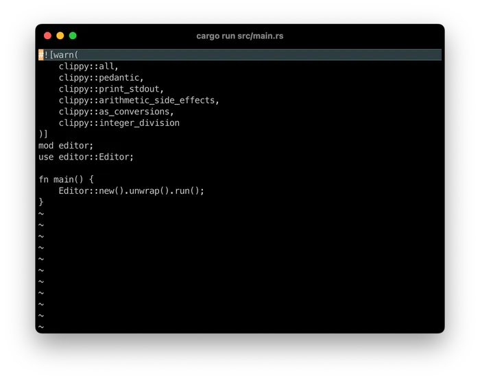

## 目录

- [介绍](hecto.md)
- [第 1 章：环境搭建](hecto-chapter-1.md)
- [第 2 章：进入原始模式](hecto-chapter-2.md)
- [第 3 章：原始输入与输出](hecto-chapter-3.md)
- [第 4 章：文本查看器](hecto-chapter-4.md) 📍 你在这里
- [第 5 章：文本编辑器](hecto-chapter-5.md)
- [第 6 章：搜索](hecto-chapter-6.md)
- [第 7 章：语法高亮](hecto-chapter-7.md)
- [附录](hecto-appendices.md)
- [变更日志](hecto-change-log.md)

## 第 4 章：文本查看器



让我们看看能否在本章中将 `hecto` 变成一个文本查看器。

## 表示文本

在程序中正确处理*文本*并不简单，本章会逐步展示其中的难点。这里先把*文本*理解为屏幕上可见字符组成的序列，例如 `Hello, World!`。日常交流中，我们通常把它称为字符串。

Rust 用两种类型表示这类文本：`str` 和 `String`。`str` 是字符串切片类型；实际使用时，我们通常通过 `&str` 来引用它。

[str](https://doc.rust-lang.org/std/primitive.str.html) 表示内存中的一段字节序列。我们更常使用 `&str`；你可能还记得，它是指向这段字节序列的引用。下文中，我们将 `str` 称为字符串，将 `&str` 称为字符串切片。

使用字符串切片时，我们掌握的信息其实很有限：

- 指向内存中字节序列起始位置的指针
- 该字节序列的长度（以字节为单位）
- 任何 `str` 值都保证是有效的 UTF-8
- 字节序列遵循 UTF-8 编码规则
	仅此而已。我们在[第 2 章](hecto-chapter-2.md)中已经了解了字节和字节序列，也认识了指针，并把它比作一张标明宝藏位置的地图。

让我们在以下 Rust Playground 中探索这一点：

```rust
fn main() {
    let slice: &str = "Hello, World";
    dbg!(slice.as_ptr());
    dbg!(slice.len());
    dbg!(slice.as_bytes());
}
```

[Rust Playground 链接](https://play.rust-lang.org/?version=stable&mode=debug&edition=2021&gist=9b33b1870f543d26da81125b436c5d40)

什么是 UTF-8？先回顾一下前面的内容。第 2 章从键盘上的符号讲到了 ASCII。ASCII 本质上建立了数字（存储在内存中）与字符（显示在屏幕上）之间的简单映射。但只要粗略看一眼 [ASCII 表](https://www.asciitable.com/)，就会发现它无法涵盖所有字符。例如，作为一名德国人，作者就需要 ASCII 表中没有收录的变音字母，如 ä、ö 和 ü。

因此，我们需要一套更全面的字符集合。[Unicode](https://home.unicode.org/) 就是其中之一。它涵盖的字符非常广泛，如今已成为事实上的通用标准。

Unicode 为字符建立了统一的编号体系；编码则负责把这些编号转换为二进制（0 和 1），使不同系统都能以一致的方式解释这些数据。

这个转换过程称为*编码*。Unicode 有多种编码方式，其中就包括 UTF-8。一个 Unicode 码点在 UTF-8 中最多占用 4 个字节。因此，`str` 中的单个字节未必能独立表示一个字符；它可能需要与另外最多 3 个字节组合，才能还原为一个 Unicode 码点。

UTF-8 有一个很重要的特性：它与 ASCII 完全兼容。ASCII 表中的字符，无论使用 ASCII 还是 UTF-8 编码，得到的字节表示都相同。因此，虽然 Rust 底层使用 UTF-8，我们在前几章仍然可以只讨论 ASCII 字符。

顺带一提，如果你觉得这里对文本的解释似乎有些*不对劲*，那你可能已经注意到了问题。我们稍后会再讨论它。

这种表示方式非常高效，但不适合直接修改。每次想要扩展一个 `str`，本质上都得重新创建它。

这时就需要 `String` 了。`String` 是一个真正的 `struct`，并为自身提供了相应的方法。它在底层使用一种可动态增长的数据结构（我们稍后就会介绍）来保存内容，因此修改 `String` 十分方便。换句话说，处理 `str` 时那些繁琐的工作都由 `String` 替我们完成了。

更方便的是，`String` 实现了一个特定的 trait（准确地说是 `Deref<Target = str>`）。借助这个 trait，我们只需通过解引用（通常表现为在变量前加上 `&`），就能把 `String` 当作 `&str` 使用。因此，编写函数时不必纠结参数应该接受 `&str` 还是 `&String`，也不必手动处理两者之间的转换。
这意味着我们通常可以统一使用 `&str`，只有在确实需要取得字符串所有权时，才让函数接收 `String`。

让我们看看实际效果。

```rust
fn prints_str(str: &str) {
    println!("I only print &strs, and the &str I got is: {str}");
}

fn main() {
    let slice: &str = "Hello!";
    prints_str(slice);

    let mut string: String = String::from("Hello!");
    string.pop();
    string.push_str(", World!");
    prints_str(&string);
}
```

[Rust Playground 链接](https://play.rust-lang.org/?version=stable&mode=debug&edition=2021&gist=6f5382263c70502f924fbfc6c117bb84)

## 任务 5：一个简陋的行查看器

本章先从扩展 `hecto` 开始，为它加入最基本的行渲染功能。

这是任务：

- 引入一个名为 `View` 的新 `struct`
- 该视图暴露一个名为 `render()` 的方法
- 将 `draw_rows` 的逻辑移入 `render()`。将必要的辅助函数从 `Editor` 移到 `View`。
- 调整逻辑，使第一行读取 `Hello, World!`（暂时不需要在屏幕中间隐藏包名和版本号）
- 应该调用此方法而不是 `draw_rows`。
- 利用关于 `String` 和 `str` 的知识，更改 `Terminal::print` 的签名，使其不再依赖 trait。

**代码审查：** [在这里找到我的代码。](https://github.com/pflenker/hecto-tutorial/commit/34f8fed4e34ef99a63ad85165a832a438c88d684)

## 引入缓冲区

本章接下来会逐步构建以下几个组件：

- `Editor`：负责协调不同的 UI 组件，在它们之间传递焦点和信息。目前，界面中只有一个占据整个屏幕的 `View`。
- `View`：接收 `Editor` 传来的所有文本相关事件，例如字符输入、换行等。它利用这些信息提高渲染效率，并把会修改文本的事件交给 `Buffer` 处理。
- `Buffer`：负责保存文本。我们先用最简单的纯文本结构表示内容，之后再根据需要逐步扩展，让它能够保存更多信息。

`Buffer` 是文本编辑器中常见的数据结构，用来保存编辑和显示文本文件所需的内容。`View` 通过与 `Buffer` 交互，将其中的文本渲染到屏幕上。许多文本编辑器还支持在多个 `Buffer` 之间切换，因此可以同时打开多个文件。

不同文本编辑器对 `Buffer` 的实现并不相同。例如，[Nano](https://www.nano-editor.org/) 使用了相对简单的 `Buffer`，没有为文档维护其他内部表示。保存文件时，`Buffer` 中的内容会写入磁盘，语法高亮等额外信息除外。[Vim](https://www.vim.org/) 则采用了更复杂的内部结构，即使面对大型文件，也能高效地执行各种操作；它还维护一个独立的 `Screen Buffer`，用于记录当前显示在屏幕上的内容。这些设计体现了两款编辑器不同的定位：`Nano` 小巧轻量，适合快速修改配置文件；`Vim` 功能完整，适合处理篇幅较长的文件。

在继续实现 `Buffer` 之前，我们还需要了解 Rust 中另一种常用的数据结构。

## “Vector 怎么了，Victor？”

我们的 `Buffer` 需要能够动态调整大小：添加元素时扩展，移除元素时缩小。因此，我们需要一种适合动态增删元素的数据结构。Rust 的 `String` 在内部就使用了这种结构，它叫作[向量](https://doc.rust-lang.org/std/vec/struct.Vec.html)，类型名为 `Vec`。具体来说，`String` 内部保存的是一个 `Vec<u8>`，也就是字节向量。正如第 3 章所介绍的，`u8` 是 8 位无符号整数，也就是一个字节。因此，操作 `String` 中的文本，本质上就是在操作一个字节向量。

`String` 使用 `Vec<u8>` 保存字节，同时保证这些字节始终构成有效的 UTF-8 数据，因此可以在需要时将内容作为 `&str` 借用。`Vec` 的设计也考虑了内存管理效率。比如，你创建一个 `Vec`，然后在循环中不断添加元素。如果每次添加元素时都重新分配内存，并把已有元素全部复制到新空间，效率就会很低。

我们需要一种能够随元素增减而动态扩缩的数据结构。`String` 正是通过在底层使用这种结构，来支持对字符串内容的修改。这种结构就是[向量](https://doc.rust-lang.org/std/vec/struct.Vec.html)，也就是 `Vec`。更准确地说，`String` 内部维护一个 `Vec<u8>`：`Vec` 是可动态扩展的数据结构，`u8` 则表示 8 位无符号整数。8 位就是一个字节，所以它本质上是一个字节向量。`String` 会确保其中保存的字节始终符合 UTF-8 编码规则，因此需要读取文本时，就能得到一个 `&str`。`&str` 同样指向内存中的字节，只不过这些字节保证组成有效的 UTF-8 序列。[^2]

`Vec` 会尽量高效地使用内存。假设你创建了一个空的 `Vec`，并在循环中不断向其中添加元素。简单的实现可能每次都为旧元素和新元素重新分配空间，再把旧元素复制过去；而 `Vec` 会采用更合理的分配策略，避免频繁复制数据。

## 理解编程中的内存管理

如果你之前使用的语言隐藏了内存管理细节，那么转向这类语言时，内存管理可能会显得很复杂。我们从一个简单的例子开始。

计算机中最小的信息单位是位（bit），取值为 0 或 1。例如，前面介绍过的 ASCII 字符 `a` 表示为 `01100001`。要表示两个 `a`（`aa`），只需把它们的位序列依次排列：`0110000101100001`。由于不同字符的数据可能紧挨着存放，我们必须知道每段数据从哪里开始，以及它占用多大空间。

这时就需要指针了。指针可以看作一张地图，告诉我们数据从哪里开始，以及如何定位它，从而高效地访问数据。以 `aa` 为例，只要知道起始地址和每个字符占用的空间，就能定位其中的两个 `a`。

继续添加字符（例如变成 `aaa`）就没那么简单了。如果最后一个 `a` 后面的内存已经被占用，就必须寻找更大的连续空间：向操作系统申请新的内存，把原有字符复制过去，再添加新字符。这个过程比直接使用紧邻的空闲空间要慢得多。
Rust 通过编译器机制帮助我们处理常见的内存管理问题：

- 防止程序访问已分配内存范围之外的位置。
- 约束指针和引用的使用，避免通过一个指针修改数据后，又通过另一个指针访问已经失效的数据等问题。
- 通过所有权模型（包括移动语义）跟踪和管理数据的所有权，减少因数据访问失效或冲突而产生的错误。

相比之下，C 等语言通常需要开发者手动管理内存；Objective-C 使用引用计数机制（`retain` 和 `release`）管理对象；Java 和 JavaScript 则通过垃圾回收器自动回收不再被引用的对象。

以 JavaScript 为例，它通过指针数组来管理字符串，并把底层细节隐藏起来。看起来我们操作的是字符串数组，实际上数组中保存的是指向字符串的指针。这与 Rust 的 `Vec<String>` 有些类似，只不过 JavaScript 不会把这些指针暴露给开发者。

继续讨论 `Vec`。如果每次添加元素时都把现有元素复制到新的内存区域，操作显然会很低效。为此，`Vec` 通常会预先分配比当前元素数量更多的空间。多出来的空间可以容纳后续添加的元素，因此不必每次添加时都复制整个数组。只有当预留容量用完后，`Vec` 才会再次分配更大的内存区域，并复制已有元素。因此，`Vec` 的元素数量并不等于它实际占用的内存量；为了提高性能，它通常会预留一部分尚未使用的容量。这种策略兼顾了内存使用和运行效率。

## 在 Buffer 中使用 Vec

每个文件可能包含任意数量的 `Line`，因此 `Vec` 很适合用来保存它们。要正确使用 `Vec`，还需要了解一个简单的概念和语法：`Vec` 并不是可以随意存放任意类型元素的容器。讨论一个 `Vec` 时，必须明确它保存的元素类型。我们用尖括号标注这个类型，所以 `String` 内部使用的数据结构写作 `Vec<u8>`。

让我们现在玩一玩 `Vec`：

```rust
fn main() {
    let mut vec: Vec<usize> = Vec::new();
    println!("The vec: {:?}",vec);
    for num in 0..100 {
        println!();
        println!("Step {}", num);
        vec.push(num);
        println!("The vec: {:?}", vec);
        println!("Its capacity: {}", vec.capacity());
        println!("Its length: {}", vec.len());
        println!("Item number {}: {}", num, vec.get(num).unwrap());
    }
}
```

[Rust Playground 链接](https://play.rust-lang.org/?version=stable&mode=debug&edition=2021&gist=29a07bd5c0844be3516c2e5d2c241dab)

## 任务 6：一个简单的缓冲区

现在来实现一个简单的缓冲区。我们将它定义为独立的 `struct`，命名为 `Buffer`。当前版本只需要保存一个 `Vec<String>`，也就是由字符串组成的向量。请先使用 `String::from("Hello, World!")`，手动向缓冲区添加一个字符串 `Hello, World!`。

在布置任务之前，先看一下如何访问 `Vec` 中的元素：

```rust
fn main() {
    let mut vec: Vec<String> = Vec::new();
    vec.push(String::from("Hello, World!"));
    vec.push(String::from("Hello, hecto!"));
    println!("{}",vec[0]); //变体 1
    if let Some(element) = vec.get(1) {
        println!("{}", element); //变体 2
    }
}
```

[Rust Playground 链接](https://play.rust-lang.org/?version=stable&mode=debug&edition=2021&gist=77c0be69c32fcf16685accf57e6ce5ce)
关于第二种写法以及其中的 `Some`，我们会在完成本任务后再详细讨论。

现在是任务：

- 创建一个名为 `Buffer` 的新 `struct`，它持有一个 `Vec<String>`。
- 确保在这一步中，`Buffer` 持有一个包含 `Hello, World!` 的 `String`。
- 扩展 `View` 以持有一个 Buffer。
- 对 `View` 进行此更改后，你需要使 `View` 成为 `Editor` 的一部分，并将 `render` 从关联函数改为方法（即改为 `render(&self)`）
- 这反过来可能需要你为 `View` 和 `Buffer` 实现或派生 `Default`。
- 更改 `render` 中的逻辑：对于缓冲区中的每个条目，都渲染对应内容；屏幕上没有对应内容的空行仍然渲染为 `~`。（你仍然可以保持欢迎消息不变，我们很快就会正确处理它）

## 任务 6：代码审查

[这是我的 GitHub 代码。](https://github.com/pflenker/hecto-tutorial/commit/83c71e67f06c7b6113d5560eaad1d2afe87cca8f)

先来比较访问 `Vec` 元素的两种方式。上面示例中的第一种方式要求索引必须有效；如果索引越界，程序就会 panic 并终止执行。第二种方式则不会因为索引无效而直接终止程序。我们来看看它在类型层面是如何实现的。

我们需要一种方式在代码中表达：函数可能返回一个值（这里指 `Vec` 中的元素），也可能什么都不返回。此前我们介绍过一个看起来很合适的类型：`Result`。它会用 `Ok` 包装成功取得的值；如果发生错误，则用 `Err` 包装错误信息。

但两者表达的语义不同。`Result` 表示“这里本应有一个值，如果没有得到它，就说明发生了错误”；而我们现在想表达的是“这里可能没有值，这种情况本身并不异常”。这正是 [Option](https://doc.rust-lang.org/std/option/) 的用途。它的结构与 `Result` 类似：从 `Vec` 中读取元素时，如果该位置存在元素，就得到包含该元素的 `Some`；如果不存在，就得到 `None`。

如果你想探索更多——这里有一个例子，这次直接取自文档：

```rust
#![allow(unused)]
fn main() {
    fn divide(numerator: f64, denominator: f64) -> Option<f64> {
        if denominator == 0.0 {
            None
        } else {
            Some(numerator / denominator)
        }
    }

    // 函数的返回值是一个 option
    let result = divide(2.0, 3.0);

    // 模式匹配来检索值
    match result {
        // 除法是有效的
        Some(x) => println!("Result: {x}"),
        // 除法是无效的
        None    => println!("Cannot divide by 0"),
    }
}
```

[Rust Playground 链接](https://play.rust-lang.org/?version=stable&mode=debug&edition=2021&gist=26c9366c897c1f9dd0b2fbc2c2a73195)

## 任务 7：基础行查看器

现在可以读取真实文件，并将文件内容加载到缓冲区中了。我们要让 `hecto` 接受一个命令行参数，用来指定文件名。例如，执行 `./hecto Cargo.toml` 就会打开 `Cargo.toml`。

下面的 Rust Playground 示例展示了如何从命令行参数中获取文件名：

```rust
fn main() {
 let args: Vec<String> = std::env::args().collect();
 if let Some(first_arg) = args.get(1) {
    println!("Do something with the argument");
 } else {
    println!("No arg given");
 }
}
```

[Rust Playground 链接](https://play.rust-lang.org/?version=stable&mode=debug&edition=2021&gist=75c2dbd7ef5bd0bb7e1154a18ebc6b31)

`collect()` 会把 `args()` 产生的值收集到我们需要的 `Vec` 中。完成本任务后，我们再详细讨论 `collect()` 的工作方式。

读取文件系统中的文本文件，可以使用 `std::fs::read_to_string`。顾名思义，这个函数会[打开文件并将内容读取为字符串](https://doc.rust-lang.org/std/fs/fn.read_to_string.html)。
`let file_contents = std::fs::read_to_string(filename)?;` 会读取 `filename` 指定的文件。
如果读取成功，`file_contents` 就会包含文件内容，并且保证是有效的 UTF-8 字符串。可以使用下面的代码遍历这个 `String`（实际上，任何 `String` 都可以）中的每一行：

```rust
for line in file_contents.lines() {
     // 对该行做些什么
}
```

这些知识应该足以帮助你完成接下来的任务。

这是任务：

- 如果 `hecto` 在没有任何命令行参数的情况下被调用，它应该显示之前的欢迎屏幕：左列填充 `~`，包名和版本号居中显示在屏幕上。
- `Editor` 应该检查文件名并将其传递给 `View`，例如传递给一个名为 `load` 的方法。此方法应打开文件并将其内容加载到 `Buffer` 中。（移除硬编码的“Hello, World!”）。
- 为 `Buffer` 提供一个名为 `is_empty` 的方法：缓冲区为空时返回 `true`，否则返回 `false`。
- 如果 `Buffer` 为空，就显示欢迎消息；否则隐藏欢迎消息。
- 空行仍应渲染为 `~`。

## 任务 7：代码审查

[这是我如何解决这个问题的。](https://github.com/pflenker/hecto-tutorial/commit/6e4164e07d760fef2357d4b4f6d004b6c299e536)

我们再来看一下保存命令行参数的 `Vec<String>` 是如何生成的。这里调用了 `env::args()`，再通过 `collect()` 将它产生的参数收集起来。

从教程一开始，我们就已经多次用到了*迭代器*。现在是时候正式介绍它了。和前面一样，我会先用一个日常生活中的例子说明，再解释它在技术上的含义。

我有两个孩子，他们总觉得糖果怎么也吃不够。他们的习惯是先吃一颗，再喊着要下一颗。假设我购物回来，手里提着一大袋东西，其中有不少糖果。每当他们喊“下一个！”时，我就从袋子里拿出一颗糖，直到袋子里再也没有糖果可拿，于是返回“没有了”。在这个例子里，我就相当于一个迭代器，负责依次取出袋子里的糖果。

执行 `for treat in dads_bag` 时，循环会调用迭代器 `dads_bag` 的 `next()` 方法，并把返回值赋给 `treat`，再执行循环体。如果 `next()` 返回 `None`，`for..in` 循环就会结束。

需要理解的一点是，迭代器具有*惰性*：通常只有调用 `next()` 时，它才会计算并产生下一个元素，而不会提前一次性计算所有元素。如果生成每个元素的成本较高，这种方式就很有用。比如，袋子里装的要是难以处理的东西（例如发怒的流浪猫——这个比喻可能已经不太贴切了），你就没必要提前把它们全部取出来，也不必预先知道袋子里究竟有多少个。

迭代器提供了一些方便的方法，`.collect()` 就是其中之一。它会持续从迭代器中取出元素，直到迭代结束，并把所有结果收集到一个 `Vec` 中。换成前面的例子，就相当于孩子们不停地喊 `next`，直到我把所有糖果都交给他们，让他们自己分配。

`Vec` 也可以被迭代，因为它实现了相应的迭代 trait。下面的 Rust Playground 可以帮助你进一步理解迭代器：

```rust
pub fn main() {
    let range = 1..10;

    println!("First range");
    println!("{:?}", range);
    for n in range {
        println!("{:?}", n);
    }

    let second_range = 1..10;
    println!("Second range");
    println!("{:?}", second_range);
    for n in second_range.take(3) {
        println!("{:?}", n);
    }

    let third_range = 1..10;
    println!("Third range");
    println!("{:?}", third_range);
    for n in third_range.skip(2) {
        println!("{:?}", n);
    }

    let fourth_range = 1..10;
    let vec: Vec<u8> = fourth_range.skip(2).take(3).collect();
    println!("Vector");
    println!("{:?}", vec);
    for n in vec {
        println!("{:?}", n);
    }
}
```

[Rust Playground 链接](https://play.rust-lang.org/?version=stable&mode=debug&edition=2021&gist=bb0c6c9270e1d1b085d4608725b47b86)

## 任务 8：更好的渲染

现在我们已经可以显示文档中的各行，但宽度超过终端的行仍然可能自动换行。
目前，我们通过输出 `\r\n` 将光标移动到下一行，再继续渲染。更合适的做法是直接把光标移动到下一行的行首。
此外，每次进入 `repl` 循环，我们都会重新渲染整个视图。实际上，视图内容并没有变化，变化的只有光标位置，因此没有必要每次都重绘。

我们将在本任务中修复所有这些问题：

- 调整渲染策略，正确移动光标，不再直接输出 `\r\n`。
- 只渲染当前行中实际可见的子字符串。可以使用切片（例如 `current_row[0..width]`），也可以利用 `get` 支持范围参数的特性（例如 `current_row.get(0..width)`）；还可以使用此前构造 `welcome_message` 时用过的 `String::truncate`。
- 在 `View` 中增加 `needs_redraw` 标志：值为 `true` 时需要重绘，值为 `false` 时则跳过渲染。在合适的位置更新这个标志，确保只在必要时重绘。
- 加分任务：为了正确处理终端尺寸变化，还需要响应 [Resize 事件](https://docs.rs/crossterm/latest/crossterm/event/enum.Event.html)，并让 `View` 在收到该事件后更新自身。

**代码审查：** [在这里找到我的代码。](https://github.com/pflenker/hecto-tutorial/commit/0f2c1a781e0ce8389a2a36dd05a79e1a2fff4a9c)

## 错误处理

接下来，我们会进入一个阶段：代码中的错误可能时不时地让 `hecto` 发生 panic。当前实现对此还有一个恼人的问题。你可以在代码任意位置插入 `panic!` 来模拟这种情况。`panic!` 是一个宏，用来让程序因无法继续执行的错误而崩溃。例如，对 `str` 进行越界切片，就可能触发 panic。

问题在于，panic 发生时，终端仍处于原始模式，界面可能因此变得一团糟。我们需要进一步了解错误处理、如何退出原始模式，以及 Rust 中结构体的生命周期管理。先从 panic 的含义说起。

## 理解 Rust 程序的执行过程与 panic

Rust 程序从 `main` 函数开始执行。每调用一个新函数，调用栈（*call stack*）就会增加一个条目。调用栈记录了当前正在执行的函数及其状态。你可以把它想象成一叠纸，每张纸记录一个函数的执行现场。先看一个简单的例子：

```rust
fn function_a() {
    function_b();
}

fn function_b() {
    function_c();
}

fn function_c() {
    println!("Inside function_c");
}

fn main() {
    function_a();
}
```

在这个例子中，`main` 调用 `function_a`，后者再调用 `function_b`，最终由 `function_c` 输出一条消息。每次函数调用都会在调用栈上创建一个新的*栈帧*；函数执行完毕后，对应的栈帧就会被移除，程序返回到调用它的函数。整个过程可以这样理解：从 `main()` 进入 `function_a()`、`function_b()`，再进入 `function_c()` 时，调用栈会依次记录这些函数的执行现场；`println!` 执行时也会产生相应的调用。消息输出完成后，各个栈帧依次退出，最终返回 `main()`，程序结束。

### 使用 panic! 处理不可恢复的错误

Rust 使用 `panic!` 处理程序无法继续执行的情况。默认情况下，Rust 会开始*栈展开*（stack unwinding）：沿着调用栈逐层返回，并在返回过程中执行清理操作。清理过程的一部分是输出调用栈信息，也就是我们看到的*栈回溯*（stack trace），并销毁相关变量和结构体。
你也可以配置 Rust 在发生 panic 时立即中止程序，而不执行栈展开。这样可以减小程序体积，因为它省去了展开过程。可以在 `Cargo.toml` 中设置 `panic = 'abort'`。这种方式执行得更快，但需要注意：程序可能来不及清理已经打开的文件、网络连接等资源。

### 自定义 panic 的处理方式

Rust 提供了几种自定义 panic 处理行为的方式：

- **捕获 panic：** 可以使用 `std::panic::catch_unwind` 在栈展开过程中捕获 panic，从而让程序有机会继续运行。
- **自定义 panic 处理器：** 如果你开发的软件无法简单地把控制权交还给操作系统（例如嵌入式系统），就可以自行定义发生 panic 时应执行的操作。
	下面是一个自定义 panic 处理器的示例：
	```rust
	#[panic_handler]
	fn panic(info: &PanicInfo) -> ! {
	    loop {}
	}
	```
	这段代码表示：一旦发生 panic，程序就会进入无限循环，相当于被冻结。返回类型 `-> !` 表示该函数永远不会正常返回。
- **panic hook：** 在 panic 处理流程开始时，可以先调用指定的函数执行整理工作，从而实现更可控的错误输出或清理过程。

## 何时应该触发 panic

如前所述，通常应该在错误发生的位置处理错误，或者通过返回值清晰地向上传播，而不是直接让程序 `panic!`。不过，在防御性编程中存在一个例外。

防御性编程要求我们提前考虑并防范意外情况。例如，当前的 `Buffer` 实现假定其中的 `String` 不会包含换行符。按照现有实现，这个假设成立；但未来的代码修改（甚至可能是我们自己做的修改）可能破坏这一约定，并引发未定义行为。

为避免这种问题，我们可以添加检查：在 Debug 构建中，如果约定被破坏就触发 panic；在 Release 构建中则不执行这些检查。这样既能在开发阶段尽早发现问题，也能避免把内部检查细节暴露到函数签名中，或给最终版本增加不必要的开销。

这里有一个可以试验的例子：

```rust
fn expensive_check() -> bool {
    println!("Performing expensive check!");
    return true;
}

#[cfg(debug_assertions)]
fn other_expensive_check() -> bool {
    println!("Thoroughly performing some other expensive check!");
    return true;
}

#[cfg(not(debug_assertions))]
fn other_expensive_check() -> bool {
    println!("Only superficially performing some other expensive  check!");
    return true;
}

fn main() {
    println!("Release Checks:");
    assert!(expensive_check());
    assert!(expensive_check(), "Expensive check failed in Release Build!");
    assert_eq!(expensive_check(), true);
    assert_ne!(expensive_check(), false);

    #[cfg(debug_assertions)]
    {
        println!("Debug Checks:");
    }

    debug_assert!(expensive_check());
    debug_assert!(expensive_check(), "Expensive check failed in Debug Build!");
    debug_assert_eq!(expensive_check(), true);
    debug_assert_ne!(expensive_check(), false);

    println!("Checks from conditional functions:");
    assert!(other_expensive_check());

    println!("All checks passed");
}
```

[Rust Playground 链接](https://play.rust-lang.org/?version=stable&mode=debug&edition=2021&gist=7469cd789a9d25760ce67f10b40c6639)

这里最重要的一点是：`#[cfg(debug_assertions)]` 标记的代码，以及 `debug_assert!` 中的检查，在编译 Release 构建时都会被完全移除，从而避免影响最终程序的性能。

## 结构体的生命周期管理

接下来具体看看 Rust 中结构体的生命周期管理。整个过程和预期一样，可以分为三个阶段：创建、使用和销毁。

### 创建

在 Rust 中创建变量和结构体并不复杂。前面我们已经多次使用 `default()`。`Default` trait 的作用是提供一个无需参数的默认值，相当于一种简单的默认构造方式。

更复杂的初始化操作，例如建立网络连接或将终端切换到原始模式，不应该放在 `Default` 中。Rust 中更常见的做法是提供一个名为 `new` 的方法；它可以按需接收参数，并执行使用该结构体前必须完成的初始化工作。

### 使用

本节会介绍一个重要的 Rust 概念，不过本教程几乎不会直接用到它。如果你只关心构建 `hecto` 所需的内容，可以跳过这一节。

到目前为止，我们使用的都是比较简单的模式：创建所需的数据，函数结束时，Rust 会清理不再需要的变量。之所以简单，部分原因在于我们还没有大量使用引用；目前，大多数情况下只需复制所需的数据就够了。引入引用后，情况就会复杂一些。正如前面所说，Rust 会保证*内存安全*，确保我们使用的引用始终有效。它也会帮助我们避免内存泄漏，也就是避免分配了内存，却再也没有程序部分能够使用它的情况。

Rust 会在编译时检查变量的生命周期，以确保引用始终处于有效范围内。先看一个无法通过编译的例子：

```rust
fn longest(x: &str, y: &str) -> &str {
    if x.len() > y.len() {
        x
    } else {
        y
    }
}
```

这段代码无法通过编译，因为 Rust 无法确定 `longest` 返回的 `&str` 应该具有怎样的生命周期。因此，编译器无法保证 `longest()` 返回的引用始终有效。一种解决方法是显式标注 `x` 和 `y` 的生命周期，让编译器知道它们具有相同的生命周期：

```rust
fn longest<'a>(x: &'a str, y: &'a str) -> &'a str {
    if x.len() > y.len() {
        x
    } else {
        y
    }
}
```

这里的 `'a` 是一个泛型生命周期参数。在当前例子中，它表示函数只接受两个生命周期相同的 `&str`，并返回一个生命周期同样为 `'a` 的 `&str`。因此，调用者必须确保传入的两个引用满足这个生命周期约束。

此外，还有生命周期参数 `'static`，表示相关数据在整个程序运行期间都有效；`'_` 则表示匿名生命周期。它不需要显式命名，因为编译器可以根据上下文推断。

### 销毁

当变量的生命周期结束时，Rust 会释放它占用的资源。不过，有时结构体在离开作用域时还需要执行额外的清理操作，例如关闭原始模式。这时就需要 `Drop` trait：只要结构体实现了它，在实例被销毁时，Rust 就会调用它的 `drop()` 方法。

这里还有一点需要特别注意：发生 panic 并进行栈展开时，`Drop` *也会*被调用。因此，即使程序因 panic 退出，清理操作仍然有机会执行。不过，`drop()` 中的代码本身也可能 panic；如果在处理另一个 panic 时再次发生 panic，就会出现“双重 panic”，最终导致 Rust 中止程序。因此，清理代码必须尽可能可靠，不能再引发 panic。

## 备用屏幕（Alternate Screen）

讨论完 `hecto` 中的生命周期管理，我们再来看看终端的初始化方式。还可以利用终端的“备用屏幕”（Alternate Screen）功能进一步改进 `hecto`。这是终端提供的一项历史悠久的功能：它先保存当前屏幕缓冲区，再切换到一个新的缓冲区供应用程序使用。退出备用屏幕后，原来的屏幕就会恢复。我们可以通过 [crossterm](https://docs.rs/crossterm/latest/crossterm/terminal/struct.EnterAlternateScreen.html#) 提供的 `EnterAlternateScreen` 和 `LeaveAlternateScreen` 来控制这一功能。对开发者来说，这样做有一个明显好处：终端中原本显示的 `clippy` 警告不会被 `hecto` 的界面覆盖，退出程序后仍然可以看到。

终端提供主屏幕和备用屏幕两个缓冲区。应用程序可以在备用屏幕中绘制自己的界面，而主屏幕保持原样。程序退出并离开备用屏幕后，用户原来的终端内容会恢复，不会受到影响。

备用屏幕还允许我们在不破坏 UI 的情况下输出日志。我们可以暂时退出备用屏幕，把必要的日志写到主屏幕，再切回备用屏幕。由于备用屏幕保留了之前的内容，因此无需重新渲染整个界面。不过，这种方式不适合输出高频日志；高频日志本来就应该写入文件，否则屏幕会出现明显闪烁。

## 任务 9：改进的生命周期管理和错误处理

这项任务会综合运用刚才学到的内容。我们需要实现一个自定义 panic hook，因为 panic 发生时，默认流程可能已经开始向终端输出信息，而 `Drop` 实现中的清理逻辑要到之后才会执行。下面的代码可以处理这个问题：

```rust
let current_hook = std::panic::take_hook();
std::panic::set_hook(Box::new(move |panic_info| {
    //做清理工作，例如 Terminal::terminate()
    current_hook(panic_info);
}));
```

这段代码的具体工作方式，我们会在代码审查环节进一步分析。

这是任务：

- 重新审视你代码中的生命周期管理：
	- 确保只为无副作用的默认值实现 `Default`，并为更复杂的设置工作实现 `new()` 函数。
		- 确保为结构体离开内存后的必要清理工作实现 `Drop`。确保它不会 panic。
- 重新审视错误处理：
	- 留意你当前正在向上传递的错误，但事实上你可以在本地处理的错误。
		- 留意应该在 Debug 构建中 `panic!` 但不在 Release 构建中 panic 的错误。
		- 留意代码中的隐式约定或假设。你能在 Debug 构建中显式检查它们并 panic 吗？
- 使用备用屏幕：
	- 在 `hecto` 启动时切换到备用屏幕，并在结束时干净地离开它。
		- 实现一个自定义 panic hook，以便即使在 panic 时也能正确离开备用屏幕和原始模式。

## 任务 9：代码审查

[这是我如何解决这个问题的。](https://github.com/pflenker/hecto-tutorial/commit/f04927719386af56d278afc02e074ab1c20df22e?diff=split&w=0)

接下来，我们通过上面的 panic hook 代码了解闭包。

前面我们介绍过 `usize`、`struct` 等类型。有时，我们还需要把*函数*作为参数传递。例如，这里需要向 `set_hook` 传入一个函数，让它在发生 `panic!` 时执行。闭包就是定义匿名函数（也就是没有名称的函数）的一种方式。顺便一提，闭包的这种语法[源自 Ruby](https://www.sitepoint.com/closures-ruby/)。

下面提供了一个 Rust Playground，供你动手尝试：

```rust
fn main() {
    let some_closure = |x| x+1;
    let some_value = some_closure(5);
    dbg!(some_value);
    let some_more_sophisticated_closure = |name| {
        println!("Hey, {}, how are you?", name);
    };
    some_more_sophisticated_closure("Philipp");
}
```

[Rust Playground 链接](https://play.rust-lang.org/?version=stable&mode=debug&edition=2021&gist=be2c5802fee314941a2d0d3ee67b74fc)

稍微动手尝试一下，你就能理解闭包与普通函数有哪些相似之处。

上面的代码定义了一个传给 `set_hook` 的函数。不过，闭包内部还访问了在外部定义的 `current_hook`。我们用一个更简单的例子看看这是如何实现的：

```rust
fn main() {
    let message = String::from("Hello");
    let greet = move |name| println!("{}, {}!", message, name);
    greet("Philipp"); // 这是我的名字，以防你忘了
}
```

[Rust Playground 链接](https://play.rust-lang.org/?version=stable&mode=debug&edition=2021&gist=65060827f19d5dbf0e83fa8cfa1b9fa7)

可以看到，闭包能够访问定义它时所在作用域中的变量。这很方便，但有时也会让 Rust 的所有权和引用规则变得不那么直观。如果变量的类型实现了 `Copy`，闭包会复制一份值来使用；如果没有，就可以使用 `move` 关键字，通过移动语义（第 3 章介绍过）把值转移到闭包中。在上面的例子里，`greet` 创建后，`message` 的所有权就被移入闭包，`main` 中不再能直接使用它。

回到最初的代码：我们先用 `take_hook` 取得当前的 panic hook，再通过 `move` 将它移动到闭包中。这样，闭包就能在完成清理操作后调用原来的 hook。为什么不直接在闭包内部调用 `take_hook`，而要使用 `move`？这个问题值得想一想，因为它有助于理解闭包的工作方式。答案见脚注。[^3]

最后，还有一个看起来有些奇怪的东西：`Box::new`。它的作用是什么？

这仍然与前面讨论的生命周期有关。这里必须确保交给*其他部分*使用的闭包，在它们需要时始终有效，即使创建闭包的结构体已经被销毁。

来看为什么设置 panic hook 时需要使用 `Box`。如果不使用它，我们可能只是定义一个闭包并把它传给 `set_hook`；但当代码不再持有这个闭包的引用时，它就可能被释放。这样会产生问题，因为 panic hook 必须在整个程序运行期间保持有效，其生命周期甚至可能比某个 `Editor` 实例更长。

为了让闭包持续存在，我们需要把它的所有权交给 `set_hook`。具体做法是将闭包放入 [Box](https://doc.rust-lang.org/std/boxed/struct.Box.html) 中。`Box` 会在堆上分配空间来存放闭包，并把这个装箱值的所有权交给 `set_hook`。这样，panic hook 就拥有了闭包，即使创建它的原始代码已经结束执行，闭包仍然能够继续存在。

这也进一步说明了为什么我们决定让 `Editor` 从程序启动一直存活到程序结束。[^1]

下面是同一段代码的注释版：

```rust
//检索当前 hook，默认情况下它会打印一些漂亮的 panic 信息
let current_hook = std::panic::take_hook();
// 定义一个接受 PanicInfo 引用的新闭包。
// 在这里移动闭包内需要的任何外部变量。
// 将闭包放入 Box 并将其设置为新的 panic hook。
std::panic::set_hook(Box::new(move |panic_info| {
    // 我们的自定义 panic hook 逻辑放在这里
    // 执行原始 hook 以保留默认的 panic 输出行为。
    current_hook(panic_info);
}));
```

## 任务 10：实现滚动

现在来实现滚动功能。这一步先不考虑文档边界，允许用户向任意方向滚动，理论上可以无限滚动。

我们的方案是同时记录两个位置：光标在文档中的位置，以及终端当前可见区域左上角对应的文档位置。每当光标移出屏幕可见范围，就更新 `scroll_offset`，让视图跟随光标滚动。要把文档中的坐标转换为屏幕坐标，只需用文档坐标减去相应方向上的滚动偏移量。

这是任务：

- 处理用户输入：
	- 将相关按键事件转发给 `View`。
		- 将位置跟踪逻辑从 `Editor` 移到 `View` 或 `Buffer`。
		- 取消目前对终端窗口边界的限制，允许光标继续向下、向左移动。
- 实现滚动：
	- 引入 `scroll_offset`，记录当前屏幕可见区域左上角在文档中的位置。
		- 每当光标即将移出屏幕时，更新 `scroll_offset`。例如：
		- 光标从右侧移出时，适当增加 `scroll_offset.x`。
				- 光标从左侧移出时，将 `scroll_offset.x` 更新为新位置的 `x`。
				- 光标从底部移出时，适当增加 `scroll_offset.y`。
				- 光标从顶部移出时，将 `scroll_offset.y` 更新为新位置的 `y`。
		- 每当光标可能移出屏幕时，都调用这套逻辑，包括终端窗口调整大小的情况。
		- 更新渲染逻辑：水平滚动时，根据 `scroll_offset` 只渲染每行中可见的部分；垂直滚动时，只渲染当前可见的行。
		- 让 `View` 向 `Editor` 提供光标的屏幕坐标，以便正确放置光标。屏幕坐标可以通过文档坐标减去 `scroll_offset` 得到。

## 任务 10：代码审查

[这是我的实现。](https://github.com/pflenker/hecto-tutorial/commit/6cbc0f000ee5c457de9cca5a6b973b9d2c58b22b?diff=split&w=0) 接下来讨论其中三个关键部分：两个与 Rust 有关，另一个与软件设计有关：

- 新增的命令分发结构
- `From` 和 `TryFrom` trait
- `Range` 参数

先看命令分发结构。`Editor` 没有继续直接响应 `crossterm` 的事件，而是引入了一套内部命令系统：`Editor` 根据收到的 `crossterm` 事件分发相应命令。这样做有两个好处：
第一，随着代码规模增长，程序会更容易理解和维护。后续还会加入插入、删除等各种文本操作命令，采用统一的命令结构后，扩展和调整这些功能会更清晰。
第二，这为后续功能预留了空间。最直接的例子就是撤销/重做：可以用一个命令栈来实现，每执行一个新命令（例如 `Insert(Char)`），就把对应的逆向命令（例如 `Delete`）压入栈中。撤销操作只需弹出栈顶的命令并执行即可。

### From 和 TryFrom

作者在代码中实现了两个 trait：[From](https://doc.rust-lang.org/std/convert/trait.From.html) 和 [TryFrom](https://doc.rust-lang.org/std/convert/trait.TryFrom.html)。两者最主要的区别在于：`TryFrom` 允许类型转换失败。它们还有两个值得注意的特点：
第一，实现 `from()` 后，相应的 `into()` 方法也可以直接使用。也就是说，如果实现了从类型 `A` 到类型 `B` 的转换，就既可以调用 `B::from(a)`，也可以调用 `a.into()`，把 `a` 转换为 `B` 的实例。
第二，Rust 可以利用这些 trait 自动完成某些隐式转换。下面的 Rust Playground 示例能更直观地说明这一点：

```rust
#[derive(Debug)]
struct ErrorA;
#[derive(Debug)]
struct ErrorB;

impl From<ErrorB> for ErrorA { //我们允许在这里将 ErrorB 转换为 ErrorA
    fn from(_: ErrorB) -> ErrorA {
        ErrorA{} // 我们通常会从 ErrorB 携带一些信息到 ErrorA。我们这里不这样做，因为我们想说明其他事情。
    }
}

fn do_something_else() -> Result<(), ErrorB> {
    Ok(())
}

fn do_something() -> Result<(), ErrorA> {
    do_something_else()?; // 这里是隐式转换发生的地方：即使这个函数在失败时返回 ErrorB，Rust 也会使用 from 实现将其转换为 ErrorA 并向上传播。
    Ok(())
}

fn main() {
    do_something().unwrap();
}
```

[Rust Playground 链接](https://play.rust-lang.org/?version=stable&mode=debug&edition=2021&gist=ec28acb0c9870e6a8617a8f46f3af427)

### 范围

再来看一下范围类型。代码中使用了 `Range<usize>` 作为参数类型，因此可以接收 `0..10` 这样的范围表达式。
Rust 提供了以下几种范围类型：

- `Range`（`start..end`）：从 `start` 开始，到 `end` 之前结束。
- `RangeInclusive`（`start..=end`）：包含范围的结束值 `end`。
- `RangeFrom`（`start..`）：从 `start` 开始，一直延伸下去。
- `RangeTo`（`..end`）：从起始位置到 `end` 之前，不包含 `end`。
- `RangeToInclusive`（`..=end`）：从起始位置到 `end`，包含 `end`。
- `RangeFull`（`..`）：表示该类型所允许的完整范围。

## 任务 11：将光标吸附到行尾

现在，代码已经能够明确区分光标在屏幕上的位置，以及插入位置在文档中的位置。
接下来要确保 `location` 始终指向文本中的有效位置。不过有两个例外：允许插入位置位于行尾最后一个字符之后，也允许它位于文档末尾的下一行。这样用户就能方便地继续输入新字符。

开始之前先说明一点：本任务只适用于 ASCII 文本。如果你在处理非 ASCII 文本时遇到问题，先不用担心，我们会在下一项任务中解决。

我们把任务分成三个部分：水平移动、垂直移动，以及更复杂的跨行移动。

这是任务：

- 水平移动：
	- 对于简单的箭头按键，确保你不能越过行尾最后一个字符的末尾，或行的开头。
		- `Home` 应该带你到行的开头，`End` 到行尾之后一个字符。
- 垂直移动：
	- 对于简单的箭头按键，确保你不能越过文档下方一行
		- 对于 `PgUp` 和 `PgDown`，将点向上或向下移动视图的高度，但最多到顶部或文档末尾下方一行。
		- 如果你从长行移动到较短的行，确保通过将点吸附到较短行的末尾来正确地垂直放置点。
- 复杂移动：
	- 在行首按左键应将点移动到上一行的末尾。
		- 在文档开头按左键应该什么都不做。
		- 在行尾按右键应将点移动到下一行的开头。
		- 在最后一行末尾按右键应将点移动到文档下方一行的开头。从那里，你应该只能向上移动，不能进一步向下。

**代码审查**：[这是我如何解决的。](https://github.com/pflenker/hecto-tutorial/commit/cb50da980a2287821f4a6e959c82acf895a64a1f?diff=unified&w=0)

## 初识字素簇

正如上一项任务中提到的，这段代码还无法正确处理非 ASCII 字符。你可以把下面的文本保存到文件中，再用 `hecto` 打开，观察滚动和光标移动到行尾时会发生什么：

```
hecto is great!
hecto is 𝒻𝒶𝓃𝒸𝓎!
hecto is ѕ¢αяу!
ʎzɐɹɔ sı oʇɔǝɥ
```

为了弄清楚原因，先看下面这个 Rust Playground 示例：

```rust
fn main() {
    let great = "hecto is great";
    let fancy = "hecto is 𝒻𝒶𝓃𝒸𝓎";
    let scary = "hecto is ѕ¢αяу";
    let crazy = "ʎzɐɹɔ sı oʇɔǝɥ";
    dbg!(great.len());
    dbg!(fancy.len());
    dbg!(scary.len());
    dbg!(crazy.len());
}
```

[Rust Playground 链接](https://play.rust-lang.org/?version=stable&mode=debug&edition=2021&gist=22b3dec61998a23f86040c756a4d1d07)

这里可以看到，我们对“字符”的直观理解，与 Rust 计算字符串长度的方式并不一致。按直觉，上面每个字符串都应该有 14 个字符，也就是每个可见字符算一个；但实际上，它们的长度各不相同。

原因之一是 UTF-8 的编码方式。前面已经介绍过，UTF-8 字符的长度并不固定，编码一个 Unicode 码点最多可能需要 4 个字节。ASCII 字符只占 1 个字节，而非 ASCII 字符通常会占用多个字节。字符串的 `len()` 返回的是字节数，而不是屏幕上可见字符的数量，因此结果与我们的直觉不同。

前面还简要提到过，Rust 的 `char` 总是占用 4 个字节。这是因为 Rust 内部使用 UTF-32 表示字符。UTF-32 与 UTF-8 一样，是一种字符编码，但它采用固定宽度，因此每个字符始终占用 4 个字节，可以容纳一个 Unicode 标量值。

前面章节介绍过的小写字母 `a`，在 ASCII 和 UTF-8 中都表示为 `01100001`；如果用 UTF-32 表示，则是 `00000000 00000000 00000000 01100001`。

既然 UTF-32 中每个字符都占 4 个字节，为什么不直接用它来编码字符串呢？这样似乎就能每次按 4 个字节处理一个字符。问题在于，普通 ASCII 文本也会因此占用更多内存。除此之外，实际情况还要复杂得多。

让我们再看看一个 Rust Playground，以更好地理解事情：

```rust
fn main() {
    let love = "We all love hecto 🧑🏿‍🤝‍🧑🏿";
    dbg!(love.len());
}
```

[Rust Playground 链接，它也遭受了我们在这里调查的问题](https://play.rust-lang.org/?version=stable&mode=debug&edition=2021&gist=2f0222abfa41a9fc8ec9ba120bc6d95e)

按照刚才的假设，我们会认为这个字符串最多占用 22 个字节：ASCII 文本占 18 个字节，emoji 最多占 4 个字节，因为我们把一个 emoji 当作一个字符，而 Rust 的 `char` 占 4 个字节。
但实际结果是 44 个字节！其中仅 emoji 就占了 26 个字节。

那么 emoji 中存储了什么？

看下面这个例子：

```rust
fn main() {
 let adult = "🧑";
    let skin_type = "🏿";
    let hand_shake = "🤝";
    let zero_width_joiner = "\u{200d}";

    println!("Output: {skin_type}  Len: {} - Skin Type",  skin_type.len());
    println!("Output: {hand_shake} Len: {} - Hand Shake",  hand_shake.len());
    println!("Output: {zero_width_joiner}   Len: {} - Zero Width Joiner", zero_width_joiner.len());
    println!("Output: {adult} Len: {} - Adult", adult.len());
    println!("Output: {adult}{skin_type} Len: {} - Adult, Skin Type", adult.len() + skin_type.len());
    println!("Output: {adult}{zero_width_joiner} Len: {} - Adult, Zero Width Joiner", adult.len() + zero_width_joiner.len());
    println!("Output: {adult}{zero_width_joiner}{hand_shake}{zero_width_joiner}{adult} Len: {} - Adult, Zero Width Joiner, Handshake, Zero Width Joiner, Adult",adult.len() + zero_width_joiner.len() + hand_shake.len() + zero_width_joiner.len() + adult.len());
    println!("Output: {adult}{skin_type}{zero_width_joiner}{hand_shake}{zero_width_joiner}{adult}{skin_type} Len: {} - Adult, Skin Type, Zero Width Joiner, Handshake, Zero Width Joiner, Adult, Skin Type", adult.len() + skin_type.len() +  zero_width_joiner.len() + hand_shake.len() + zero_width_joiner.len() + adult.len() + skin_type.len());
}
```

[Rust Playground 链接](https://play.rust-lang.org/?version=stable&mode=debug&edition=2021&gist=d5717672e32dfbfb7059b040fe088051) - 示例取自并改编自[这里](https://stackoverflow.com/questions/71163103/i-need-to-know-what-are-the-more-than-four-bytes-character-in-utf-16-and-what-is)。

`\u{200d}` 告诉 Rust 在这里插入 Unicode 码点 U+200D，也就是[零宽度连接符](https://unicode-explorer.com/c/200D)。结合上面的代码，你应该能看出它的用途。

emoji 很适合用来说明这个问题：屏幕上看起来只是一个字符的内容，在底层可能由多个码点组成。类似情况并不只发生在 emoji 上，处理阿拉伯文字或印度文字时也会遇到。

先明确几个术语。我们希望在屏幕上看到的一个独立文本单元，称为*字素*。正如前面所见，不能简单地通过字符串的字节数推算其中有多少个字素。*字素*也不等同于*字符*：Unicode 中的字符概念较为宽泛，而 Rust 的 `char` 并不表示字素，它表示一个 Unicode 标量值，也就是 Unicode 码点，例如零宽度连接符。上面的复合 emoji 在 Rust 中并没有对应的单个 `char`；多个 `char` 组合起来，才会形成一个*字素簇*，例如代码中的 🧑🏿‍🤝‍🧑🏿。

接下来要实现文本编辑，而字素簇会让这件事变得复杂。删除一个字节可能导致 Rust panic，因为剩余内容不再是有效的 UTF-8 字符串。为了避免这种情况而直接删除 4 个字节，也可能得到错误的结果。看下面的例子：

```rust
fn main() {
    let emoji = "🧑🏿";
    //let fragment = &emoji[0..emoji.len() - 1];  //删除一个字节会 panic
    let fragment = &emoji[0..emoji.len() - 4];    //假设 Char=Grapheme 并移除 4 个字节只移除肤色
    println!("{}", fragment);
}
```

[Rust Playground 链接](https://play.rust-lang.org/?version=stable&mode=debug&edition=2021&gist=c64f145ee3e93138b8b343001d731acc)

问题可以归结为一点：使用 Rust 的 `String` 时，`len()` 对我们想实现的文本视图帮助不大。它返回的是字节数，而不是字符串中字符或字素簇的数量。

## 使用 unicode-segmentation

我们将借助一个 crate 来处理字素簇：[unicode-segmentation](https://docs.rs/unicode-segmentation/latest/unicode_segmentation/index.html)。

先通过 Rust Playground 看看这个 crate 的用法：

```rust
use unicode_segmentation::UnicodeSegmentation;

fn main() {
    let text = "👋Hello, World🌍!";
    let graphemes = text.graphemes<Vec<&str>>(;
    println!("Graphemes: {:?}", graphemes);
    println!("Byte length: {}", text.len());
    println!("Grapheme length: {}", graphemes.len());
    println!("Slice-Based Substring: {}", &text[8..13]);
    println!("Grapheme-Based Substring: {:?}", graphemes[8..13].concat());
}
```

[Rust Playground 链接](https://play.rust-lang.org/?version=stable&mode=debug&edition=2021&gist=33b92ab22248acd5199fe02a4b486adf)

`unicode-segmentation` 提供了一个迭代器，用于遍历字符串中的字素簇。它还提供了一个 trait，让我们可以直接在 `str` 上调用 `graphemes()` 来取得这个迭代器（调用时必须传入 `true`，否则字素簇的识别不一定符合预期）。

## 任务 12：正确的字素处理（第 1 部分）

现在利用这些知识改进滚动逻辑，让它能够正确处理字素簇。这个阶段还不能彻底解决问题；要正确处理 emoji 等字素簇，还需要下一步改进。不过，当前这一步已经能明显改善行为。

这是任务：

- 将 `unicode_segmentation` 添加到你的项目中。
- 更改处理子字符串和行长度的逻辑，使其基于字素，而不是字节长度。
- 你可以使用[这个文本文件](https://raw.githubusercontent.com/pflenker/hecto-tutorial/a33a32990a4f7f75296431c358acb52bee0cc93b/test-graphemes-1.txt)来测试 `hecto`。

## 任务 12：代码审查

我的实现采用了一种非常直接、但效率不高的方法。这个问题真正棘手的地方，在于如何合理组合迭代器方法，以高效地得到所需结果。
先透露一点：下一步我会进一步优化这部分实现。

把 `unicode-segmentation` 添加到项目时，你可能注意到了关于 `#![no_std]` 的说明。[crate 文档](https://docs.rs/unicode-segmentation/latest/unicode_segmentation/index.html)提到，它可以在启用了这个属性的 crate 中使用。这意味着什么？

先从 `core` 说起。`core` 是 Rust 的核心库，包含 `Option`、`Result`、宏等基础功能。它可以用于各种 Rust 运行环境，并不假设底层一定有操作系统支持——毕竟，你也可能正在自己编写一个操作系统！

`std` 包含 `core` 的全部内容，并在此基础上提供许多依赖操作系统的功能，例如线程、网络、堆内存分配和文件 I/O。简单来说，`std` 就是在 `core` 之上增加了这些标准库功能。为了让开发者不必反复判断某个功能属于 `core` 还是 `std`，`std` 还重新导出了 `core` 中的所有内容。

在项目的主文件 `main.rs` 中设置 `#![no_std]`，就可以面向非标准环境（例如嵌入式系统）进行编译。不过，这也要求项目依赖的 crate 能够在不使用 `std` 的情况下运行。所以，如果你将来打算开发嵌入式软件，现在也知道如何在那里处理 emoji 了！

## 字素簇的显示宽度

说到 emoji：目前它们仍然无法被完全正确地处理。即使前面做了改进，只要一行中包含 emoji，滚动仍可能出错，你可能无法滚动到行尾。
其他一些字素簇也有同样的问题。现在，`hecto` 已经把行的“长度”按屏幕上可见的字素簇数量计算，但我们还没有考虑到不同字素簇可能占据不同的显示宽度。

Unicode 字符的显示宽度大致可以分为以下几类：

- **零宽度字符：** 例如零宽度连接符（ZWJ，前面已经介绍过），常用于文本格式控制，不占据可见空间。某些不可打印字符也属于这一类。
- **半角（窄）字符：** 常见的可打印字符，在终端等等宽环境中通常占用 1 个字符单元。这是日常文本处理中最常见的情况。
- **全角（宽）字符：** 包括中文、日文、韩文等文字中的字符。它们通常占据两个字符单元，这对正确对齐文本至关重要。下面是全角形式的拉丁字母：ＡＢＣＤＥＦＧＨＩＪＫＬＭＮＯＰＱＲＳＴＵＶＷＸＹＺ。
- **宽度模糊的字符：** 这类字符的显示宽度可能随上下文或字体而变化。例如，中点 `·` 和某些破折号 `-`，在不同字体中可能显示为窄字符，也可能显示为宽字符。
- **中性字符：** 这类字符的显示宽度同样取决于上下文或字体。emoji 通常属于这一类，空格和制表符也可能涉及类似情况。

我们还需要另一个 crate：`unicode-width`。先在 Rust Playground 中看看它的用法：

```rust
use unicode_width::UnicodeWidthStr;
fn main() {
    let zero = "\x1b";              // Esc，见第 3 章
    let half = "Ä";                 // 德语 A 带变音符号
    let full = "Ａ";                // 像一个 A，但更宽
    let neutral_1 = "👋";           // 普通 Emoji
    let neutral_2 = "🧑🏿‍🤝‍🧑🏿"; // 复合 Emoji
    let ambiguous = "·";            // 中点
    println!("Type\tChar\tWidth\tWidth (CJK)");
    println!("Zero\t{zero}\t{}\t{}", zero.width(), zero.width_cjk());
    println!("Half\t{half}\t{}\t{}", half.width(), half.width_cjk());
    println!("Full\t{full}\t{}\t{}", full.width(), full.width_cjk());
    println!("N(1)\t{neutral_1}\t{}\t{}", neutral_1.width(), neutral_1.width_cjk());
    println!("N(2)\t{neutral_2}\t{}\t{}", neutral_2.width(), neutral_2.width_cjk());
    println!("A \t{ambiguous}\t{}\t{}", ambiguous.width(), ambiguous.width_cjk());
}
```

[Rust Playground 链接](https://play.rust-lang.org/?version=stable&mode=debug&edition=2021&gist=8bc95a5948e062344c4030886c6424f3)
`cjk` 是 Chinese、Japanese、Korean 的缩写，分别指中文、日文和韩文。这些文字中可能包含显示宽度不确定的字符。

emoji 仍然是个麻烦。好消息是，普通 emoji 通常可以按全角字符处理；坏消息是，复合 emoji 的显示情况并不确定。这是因为 emoji 的渲染结果取决于字体：如果字体支持某个复合 emoji，就会把它显示成一个宽字符；如果不支持，就会分别显示组成它的各个部分。Rust Playground 很适合观察这一点：它的输入框和输出区域使用了不同字体，输入框不支持复合 emoji，而输出区域支持。

## hecto 中的字符显示宽度

`hecto` 只区分窄字符和宽字符。

**零宽度字符**会被替换成窄字符后再渲染。这样也更便于用户定位并与这些字符交互。

对于**宽度模糊的字符**，我们遵循 Unicode 的建议：在非 CJK 环境中，或者无法可靠判断上下文时，将它们视为窄字符。因此，接下来我会使用 `width`，而不是 `width_cjk`。

对于**中性字符**，`unicode-width` 会尽可能判断它们应当按窄字符、宽字符还是其他情况处理。如果计算结果为 0，就按前面介绍的方式处理；如果宽度大于 2，则将其视为宽字符。这也意味着：在不支持复合字符的终端字体中，`hecto` 仍可能出现显示异常。

## 任务 13：支持字符宽度

这项任务要让 `hecto` 正确处理不同宽度的字符。你此前的实现如果与作者的步骤不完全一致，具体修改方式可能会有所不同，但最终目标相同：正确支持不同显示宽度的字符。

我们的方案是：不再用一个 `String` 保存 `Line` 的全部文本，而是为每个字素簇使用自定义数据结构。这个结构记录字素簇本身、`hecto` 估算出的显示宽度，以及一个可选的替代字符。对于无法在屏幕上正确显示的内容，我们会尝试选择合适的替代字符；这类内容既包括零宽度字符，也包括 Bell 这样的控制字符。

这个结构看起来像这样：

```rust
enum GraphemeWidth {
    Half,
    Full
}

struct TextFragment {
    grapheme: String,
    rendered_width: GraphemeWidth,
    replacement: Option<char>
}
```

我们需要修改 `from`：遍历传入字符串中的字素簇，并生成内部使用的 `Vec<TextFragment>`。如果 `unicode-width` 判断某个字素簇的宽度为 0，就添加一个替代字符用于显示，而不直接显示原字素簇。在本任务中，所有零宽度字素簇都先替换为中点（`·`），更复杂的处理会留到后面实现。

`get` 函数需要返回指定范围内可见的字素簇。为此，我们要遍历向量，累计已经处理过的字素簇占用的宽度，并返回起点和终点都落在指定范围内的字素簇。还需要处理屏幕边缘的特殊情况：如果一个宽字符被屏幕边界截断，就输出水平省略号（`⋯`），表示该字符没有完整显示。

我们还需要调整 `Location`、`Position` 和偏移量的定义。现在，`Location` 指向某一行中的一个字素簇。另一方面，`scroll_offset` 不再表示文本中的位置，而是表示一个无限网格中的坐标。这个网格由一个个字符单元格组成，每个字素簇可能占据一个或两个单元格。换句话说，可以把终端想象成无限延伸的屏幕，而 `scroll_offset` 指向这个无限屏幕中的某一行、某一列。由此带来三个变化：a) `Position` 描述的是这个网格中的位置，而不再局限于当前可见屏幕；b) `scroll_offset` 的类型从 `Location` 改为 `Position`；c) 我们需要利用这两种结构，正确处理光标定位、文档内移动和滚动。

因此，我们需要实现从 `Location` 到 `Position` 的转换。具体做法是：把给定 `Location` 中当前 `x` 之前所有字素簇的显示宽度相加，得到它在网格中的正确列坐标。文档中的每一行在网格中对应一行，所以行坐标可以直接使用原来的 `y` 值。

完成这项调整后，滚动逻辑也要先把 `Location` 转换为 `Position`，再据此判断光标是否移出了屏幕，并相应更新 `scroll_offset`。要计算光标在当前屏幕中的位置，则用它在网格中的 `Position` 减去 `scroll_offset`。

文本遍历逻辑不需要修改。这也意味着，当相邻两行包含不同宽度的字符时，从一行移动到另一行可能无法保持完全相同的垂直位置。不过，我们预计大多数文本中的字符宽度比较一致，或者只偶尔出现 emoji，因此这种位置偏移在多数情况下可以接受。

这是任务：

- 将 `unicode-width` 添加到你的项目中。
- 如上所述重构你的代码。
- [用这个文件测试你的更改。](https://raw.githubusercontent.com/pflenker/hecto-tutorial/7a8f2a734518ad016e5ed7ea5e804a3a5d718ce8/test-graphemes-2.txt)
- 确保结构体、字段、函数和变量的命名都能准确反映这些调整。
	**代码审查：** [这是我如何做的。](https://github.com/pflenker/hecto-tutorial/commit/975c1dc8dfacff8ef2791d8ff0b47f0f6e8a42d8)

## 任务 14：一个文本查看器

最后，我们再做一些收尾工作，改进对不可见字符的处理。目前，我们只把其中一部分字符替换为中点，而且对某些零宽度字符的处理也不够理想：例如，一个由 10 个零宽度连接符组成的字符串，会被 `unicode-segmentation` 识别为*一个*字素簇，因此最终只会被替换成*一个*中点。
不过，`hecto` 的定位是文本编辑器，主要用于显示和编辑可见文本。如果有人需要编辑不可见文本，`hecto` 并不适合这种用途。

即便如此，把不可见字符直接输出到终端，也可能引发意想不到的问题。例如，制表符（`\t`）可能会在终端中展开成数量不固定的空格，从而造成显示错位。如果不替换转义字符（正如前面介绍的，它在 ASCII 和 Unicode 中都是合法字符），它就可能被直接发送到终端，并被解释为转义序列，改变终端的行为。顺带一提，这也是为什么把二进制文件误当作文本输出到终端时，终端界面往往会变得一团糟。

制表符之所以会有这些特殊行为，又要追溯到机械打字机。打字机上的制表位（Tab Stop）是机械挡块，用来限制带着纸张的滚筒移动到某些预设位置。它们对于保持文本对齐非常重要，例如打印简历时。制表符的历史很长，因此在不同环境下，它们的处理方式并不一致。

Unicode 提供了大量可用于替换不可见字符的符号。ASCII 表中所有“不可打印”字符都有对应表示，包括我们之前见过的 ␇ 和 ␛。[完整列表可以在这里查看](https://www.unicode.org/charts/PDF/U2400.pdf)。

不过，我们不打算穷举并替换所有不可见字符，而是采用更简单的处理方式。

这是任务：

- 普通空格仍然渲染为空格，不做替换。
- 将制表符（`\t`）替换为空格。
- 将其他可见空白字符（即宽度不为 0 的空白字符）替换为[空心方框](https://www.compart.com/en/unicode/U+2423)（`␣`）。判断一个字素簇是否为空白，可以对它调用 `trim()` 去掉空白，再检查 `is_empty()` 是否为 `true`。
- 对于 Bell、Null 等控制字符，如果它们属于零宽度字符，就将其替换为[白色竖矩形](https://www.compart.com/en/unicode/U+25AF)（`▯`）。可以对字符调用 `is_control()` 判断它是否为控制字符；调用 `.chars()` 则可以把 `String` 或 `str` 转换为字符迭代器。
- 其他零宽度字符仍然替换为中点。
- 可以使用[这个文件](https://raw.githubusercontent.com/pflenker/hecto-tutorial/ec2b6c025de70cbb8e40dc70db18fd3e0d415f00/test-character-replacement.txt)测试修改结果。

**代码审查：** [这是我如何做的。](https://github.com/pflenker/hecto-tutorial/commit/ec2b6c025de70cbb8e40dc70db18fd3e0d415f00)

## 总结与后续内容

从功能实现的角度看，本章的进展并不算快。不过，我们深入了解了不少 Rust 的内部机制，例如 `String`、`Vec` 和 `panic!` 的工作方式；也认识了文本处理中的诸多陷阱，以及 emoji 为什么如此难以正确支持。

现在，我们已经完成了一个可以正常工作的文本查看器。在[下一章](hecto-chapter-5.md)中，我们会继续扩展它，让它具备文本编辑功能。

---

[^1]: 更简洁的做法是在 `new` 中保存原来的 panic hook，并在 `drop` 中将其恢复。

[^2]: 你可能会问：为什么这里使用 `u8`，而不是 `char`？这是个好问题，先记下来；读完本章，你就能回答了。

[^3]: 等闭包执行时，`take_hook` 已经无法再取回原来的 hook，因为它早已被我们自己的闭包替换。这样一来就会不断递归调用，最终陷入无限递归。
