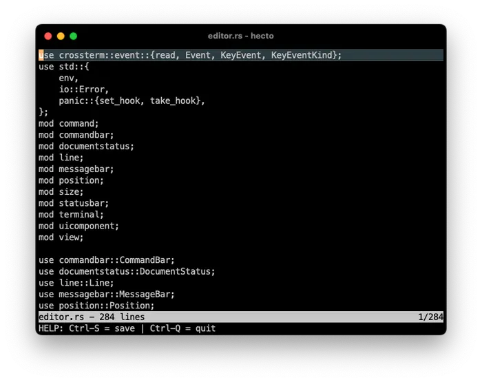

## 目录

- [介绍](hecto.md)
- [第 1 章：环境搭建](hecto-chapter-1.md)
- [第 2 章：进入原始模式](hecto-chapter-2.md)
- [第 3 章：原始输入与输出](hecto-chapter-3.md)
- [第 4 章：文本查看器](hecto-chapter-4.md)
- [第 5 章：文本编辑器](hecto-chapter-5.md) 📍 你在这里
- [第 6 章：搜索](hecto-chapter-6.md)
- [第 7 章：语法高亮](hecto-chapter-7.md)
- [附录](hecto-appendices.md)
- [变更日志](hecto-change-log.md)

## 第 5 章：文本编辑器



现在 `hecto` 可以读取文件了，让我们看看能否也教它编辑文件。本章新概念较少，任务较多，以扩展 `hecto` 为主。

## 任务 15：插入普通字符

让我们先聚焦于向文本中添加普通字符。由于我们无法预知该字符是否会触发新字素簇的形成，插入时需要重建 `Line` 的内部结构。

这里需要注意*移动*：用户感知到的插入实际上是插入后向右移动一步——否则我们就是在倒着打字。另一个要考虑的方面当然是字素和字素簇。插入的字符完全可能成为现有字素簇的一部分——这种情况下任何额外的移动都会导致 caret 向右移动过多。或者，新插入的字符可能导致左右两侧的字素合并——想象一下在 Adult Emoji 和零宽度连接符之间的正确位置添加一个 Handshake Emoji——它们会全部形成 Adults Holding Hands Emoji，从而实际上*移除*了字素。

我们处理这个问题的策略是检查编辑后字素数量是否发生变化：如果增加了，我们就移动；否则保持原地。对于插入新字符后字素数量未增加的其他情况，我们无法知道应该向哪个方向移动多远。这应该能覆盖 `hecto` 所针对的场景。

这是任务：

- 不再因不支持的按键而在调试模式下崩溃。我们希望静默忽略它们。
- 添加一个新命令来处理普通字符的按键。在[这里](https://docs.rs/crossterm/latest/crossterm/event/enum.KeyCode.html)找到 `crossterm` 发出的 `KeyCode` 列表。
- 向行中添加字符的方法是：首先基于 TextFragments 构建一个直到插入点的字符串，然后添加新字符，再追加剩余 TextFragments 中的剩余字素。然后重建 `Line` 的内部数据结构。
- 处理在文档最后一行下方尝试插入的情况：创建一个新的 `Line` 并将其追加到 `Buffer` 中。
- 如上所述，插入字符后需要移动。
- 提示：使用 `get_mut` 而不是 `get` 来获取向量成员的可变引用。

**代码审查：** [这是我的代码。](https://github.com/pflenker/hecto-tutorial/commit/33190fcbf820dd880025531755aa60de72b9d8cb)

## 任务 16：简单删除

现在我们希望 `Delete` 和 `Backspace` 能工作。`Backspace` 本质上是“向左移动，然后删除”。`Delete` 的工作方式与上面的插入非常相似，区别在于我们甚至更不需要担心字素宽度——删除一个字素簇在绝大多数情况下应该使字素数量减少 1。我们稍后处理行边缘的删除。

这是任务：

- 在行尾之前按 `Delete`，删除 caret 右侧的字素簇。
- 在行首之后按 `Backspace`，向左移动一步，然后删除 caret 右侧的字素簇。
- 本任务中忽略在行首/行尾的删除。

**代码审查：** [这是我如何做的。](https://github.com/pflenker/hecto-tutorial/commit/35abb1e905ebc0956583fc76e27a2c8ad9c22d6d)

## 任务 17：复杂删除

我们现在希望一些边缘情况能工作：

- 在文档左上角按 Backspace 应该什么都不做
- 在文档右下角按 Delete 应该什么都不做
- 在行首按 Backspace 应该将当前行追加到上一行
- 在行尾按 Delete 应该将下一行追加到当前行。

为此，我们需要创建一种将一行追加到另一行的方法。由于我们希望重新计算字素簇，将两行都转换为字符串，合并它们并重新创建内部的 `Vec<TextFragment>` 似乎是个好主意。从 `Vec` 中移除一个条目可以通过调用 `remove` 来实现，它也会返回被移除的元素。

这是任务：

- 如上所述实现复杂删除。

## 任务 17：代码审查

[这是我如何解决的。](https://github.com/pflenker/hecto-tutorial/commit/1c4d362533494bf02c3a18f9a98eaf042b18f4a1)

除了我现在开始修复自己引入的 bug（单元测试，有人吗？）之外，我的代码包含两个有趣的方面。一个围绕 Rust 的借用检查器，另一个围绕特质带来的副作用。让我们从第一个开始。

## Rust 借用检查器的实际运作

我们在前面的章节中已经接触过 Rust 的类型安全方法。在修改数据方面，Rust 施加了严格的规则，特别是关于可变引用和不可变引用的处理方式。

考虑我提交中的这个函数：

```rust
pub fn delete(&mut self, at: Location) {
      if let Some(line) = self.lines.get(at.line_index) {
          if at.grapheme_index >= line.grapheme_count()
              && self.lines.len() > at.line_index.saturating_add(1)
          {
              let next_line = self.lines.remove(at.line_index.saturating_add(1));
              self.lines[at.line_index].append(&next_line);
          } else if at.grapheme_index < line.grapheme_count() {
              self.lines[at.line_index].delete(at.grapheme_index);
          }
      }
  }
```

该函数访问当前行两次：一次在外层的 `if let Some(line)` 中，随后在调用 `append` 或 `delete` 时。不可能将此代码重构为对外的 `if let` 使用 `get_mut` 并消除那次额外访问。为什么？

### 内存安全与可变引用

Rust 通过强制对可变数据的独占访问来确保内存安全。函数签名中的 `&mut self` 意味着在 delete 执行期间，我们程序的任何其他部分都不能修改 self 结构体（这里是 `Line`）。这与借用物理对象相同：当它在你手中时，其他人不能使用它。  
除了最初的 `if let`，注意在任何对 `self.lines` 中元素的引用处于活动状态时，`self.lines`（以及 self）都没有被修改。移除 `next_line` 是一个修改 self 的独立操作，随后是 `append` 的调用。

### 为什么没有借用检查器错误

那么问题是：为什么从 `if let Some(line)` 派生的引用 `line` 不触发借用检查器错误？答案在于其使用的时机和范围。它只使用了一次，在任何修改操作发生之前。之后，这个引用就变得无效了。在可变操作开始后对 line 添加任何操作，即使是一个简单的读取，都会使代码无效并导致编译器错误。

## 特质与自动实现

让我们也讨论我提交中的另一个代码片段：

```rust
impl fmt::Display for Line {
    fn fmt(&self, formatter: &mut fmt::Formatter) -> fmt::Result {
        let result: String = self
            .fragments
            .iter()
            .map(|fragment| fragment.grapheme.clone())
            .collect();
        write!(formatter, "{result}")
    }
}
```

这个阶段的目标是实现一个 `to_string` 函数，将 `Line` 转换为 `String`，用于将一行 `Line` 追加到另一行。那么为什么我在这里实现了 `Display`？

在我解释之前，我想强调不像我这样做也是完全有效的方法。我选择这条路是为了突出 Rust 中一些更有趣的东西——只实现一个简单的 `to_string` 就很好。

我在这里实现的是 `Display` 特质。你可能从前面章节中记得，这个特质允许数据结构打印给用户，例如用 `println!("{my_struct}");`。将某物转换为字符串是如此常见的操作，以至于有一个为此存在的特质：[ToString](https://doc.rust-lang.org/std/string/trait.ToString.html)。还有一个对应的特质，我们*也*可以实现：[FromStr](https://doc.rust-lang.org/std/str/trait.FromStr.html)。正如你现在已经知道的，实现特质在某些上下文中给你带来好处。但我在这里想指出的是，以及我为什么实现 `Display` 而不是 `ToString` 的原因是，实现某些特质会自动给你另一个特质的实现。我们在实现 `From` 特质并免费获得 `into` 实现时顺便看到了这一点——在这个情况下，我们实现 `Display`，导致 `ToString` 特质的自动实现，它提供了 `to_string`。`Display` 通常被认为比实现 `ToString` 更通用。

底层概念叫做[*毯子实现*](https://doc.rust-lang.org/book/ch10-02-traits.html)：你可以为任何实现了特质 B 的类型写一个特质 A 的毯子实现，有效地使特质 B 也实现了特质 A。

## 任务 18：Tab 和 Enter

我们还需要支持两个额外的键：`Tab`，它应该简单地插入一个 `\t`，以及 `Enter`。

要处理 `Enter`，我们需要扩展 `Line`，以便能够在当前位置拆分该行——缩短当前行，并返回一个包含剩余部分的新 `Line`。除了使用 `push()` 在 `Vec` 末尾添加条目外，我们还可以使用 `insert(index: usize)` 在所需位置添加项目。所有后续条目将向右移动。`Vec` 还允许通过调用 `split_off` 来拆分。

这里有一个快速的 Rust Playground 来说明这一点：

```rust
pub fn main() {
    let mut first_vec = vec!["Entry #1".to_string(),"Entry #2".to_string()];
    println!("{first_vec:#?}");
    
    for num in 4..=10 {
        first_vec.push(format!("Entry #{num}"));

    }
    println!("{first_vec:#?}");
    // 哎呀，漏了什么！
    first_vec.insert(2, "Entry #3".to_string());
    println!("{first_vec:#?}");
    
    let second_vec = first_vec.split_off(5);
    println!("{first_vec:#?}");
    println!("{second_vec:#?}");
    
}
```

[Rust Playground 链接](https://play.rust-lang.org/?version=stable&mode=debug&edition=2021&gist=cd691d447d32866b1375aa357eec8b3e)

这是任务：

- 处理 `Tab`，将制表符视为插入 `\t`。
- 处理 `Enter`：
	- 如果在 `Line` 内部按下 `Enter`，拆分该行并从剩余部分创建一个新行。
		- 如果在行首按下 `Enter`，在当前行之前放置一个新的空 `Line`。
		- 类似地，如果在行尾按下 `Enter`，在当前行之后放置一个新的空行。
		- 如果在有效行之外按下 `Enter`（例如在文档底部，我们允许导航到那里），在文档末尾添加一个新的空 `Line`。
		- 确保相应地移动 caret，并在需要时滚动。

**代码审查：** [这是我的代码。](https://github.com/pflenker/hecto-tutorial/commit/bfa91016ebe9860d636634d5a677aee2f1c55137)

## 文本编辑器中的数据结构

我们现在已经建立了 `hecto` 的数据结构。剥去外层结构体，可以看到我们在一个 `vec` 中存储每个可见字素的元数据。这些 `vec` 每个代表一行，然后被分组在另一个 `vec` 中。这种安排在处理格式化文本的文本编辑器中相当典型。例如，[SlateJS](https://www.slatejs.org/examples/richtext)，一个基于 JavaScript 的富文本编辑器，使用节点来捕获应用于文本片段的格式属性，如下所示：

```json
[
      {
        "text": "Hello,",
        "bold": true
      },
      {
        "text": " World",
        "bold": true,
        "underline": true
      },
      {
        "text": "!",
        "underline": true
      }
]
```

正如你可能想象的那样，为文本编辑器找到和定义合适的数据结构现在是一个被充分理解的问题，包括对性能、插入类型（即插入通常发生在同一区域附近，还是随机分布在文本中？）和其他考虑的推理。一种常见的文本数据结构是 [Rope](https://en.wikipedia.org/wiki/Rope_%28data_structure%29)。Rope 将文本分解成更小的、可管理的片段，并将它们组织成二叉树结构。

Rope 的美妙之处在于它的效率——尤其是当你需要插入或删除文本时。使用 Rope，这些操作不需要移动大块文本，即使文档变长也能保持流畅运行。使用 Rope 导航文本也更高效，因为树中的每个节点都跟踪其下方的文本长度，使得跳转到文档的不同部分变得快速。

对于本教程，我们将坚持使用我们低效的内部数据结构，但如果你有兴趣学习如何在 Rust 中使用 rope，可以看看 [Ropey](https://docs.rs/ropey/latest/ropey/#)。

## 任务 19：保存到磁盘

编辑如果不保存就毫无用处，所以让我们为现有文件实现保存到磁盘。我们稍后将实现“另存为”。

为此，我们需要在 `Buffer` 中跟踪文件名。一旦用户按下 `Ctrl-S`，我们将把文件保存到磁盘。

这里有一个将字符串写入磁盘的小示例：

```rust
use std::fs::File;
use std::io::Write;

fn main() {
    let mut file = File::create("example.txt").expect("Could not create file");
    writeln!(file, "Hello, World!")
        .expect("Could not write to file");
}
```

[Rust Playground 链接](https://play.rust-lang.org/?version=stable&mode=debug&edition=2021&gist=7fa170a3d5c5ca98b408c9d6de61f6f1)

与 `println!` 类似，`writeln!` 确保写入该行并在末尾添加换行符。

这是任务：

- 从磁盘加载文件时跟踪文件名。
- 编辑现有文件时，实现命令 `Ctrl+S` 将文件保存到磁盘。
- 目前，你可以抑制保存期间可能发生的任何错误，我们将在本章后面正确处理它们。

## 任务 19：代码审查

[这是我的代码。](https://github.com/pflenker/hecto-tutorial/commit/459b8264067e67bdeecd88d9e6a37925e45d0f39)

我们在本教程前面讨论过换行符，但还有一些更有趣的方面需要学习。我们已经看到除了普通“空格”之外还有多种类型的空白——制表符、零宽度连接符等等——所以毫不奇怪，换行符也有多种类型。举几个例子，有行分隔符、段落分隔符、垂直制表符，甚至换页符，它用于指示打印机弹出当前纸张并在另一张纸上继续打印。

第二个需要注意的方面是，时至今日，操作系统对换行实际上*是什么*有不同的看法。Windows 将 `\r\n` 视为换行，而在 Linux 和 Mac 上，`\n` 就足够了。这通常被称为 Windows 情况下的“CRLF”（回车、换行），以及 Linux/Mac 情况下的“LF”（换行）。我们正在慢慢过渡到一个这种区别不再重要的状态，但在 Mac 上编写的文本文件用 Windows 上的旧文本编辑器打开会导致显示问题，而在 Windows 上编写的 shell 脚本在 Linux 系统上执行也可能导致问题。

`hecto` 优雅地回避了这个问题，原因有三：

- 我们读取文件的方式为我们正确处理了换行符
- 我们在文本编辑期间不直接处理换行符
- 我们保存文件的方式，使用 `writeln!`，也为我们正确处理了换行符。

## 用户界面

我们的文本查看器目前除了文本本身之外，没有办法向用户显示任何信息。因此：

- 我们无法通知用户文件打开或保存是否成功
- 我们无法通知用户保存是否成功
- 用户必须猜测如何保存文件
- 我们无法为用户提供保存新文件的方式，因为没有显示任何输入提示的方式，用户无法添加自己的文件名。

这不行，所以我们将构建一些用户界面来向用户显示有用的信息，然后再调整它来处理提示。更具体地说，我们将在编辑器底部添加两行：一个*状态栏*，用于保存文档信息，以及一个*消息栏*，用于向用户显示通知。稍后，我们还将使用消息栏来允许用户输入。

## 任务 20：简单状态栏

让我们从非常基础的开始：

- 调整 `hecto`，在底部为 2 个额外行留出空间。
- 添加一个状态栏作为这两行中的第一行。它应包含：
	- 文件名（如果存在）
		- 当前文件的行数
		- 一个行指示器，指示 caret 当前所在的行
		- 一个指示器，显示文件是否已被修改。  
		此时无需关心格式、对齐或处理任何字符串长度。我们将在下一步中使其美观。

要实现这一点，你需要实现一个新的 `struct`，它类似于 `View`，在屏幕的右侧部分渲染自身，并在每次需要时刷新自身。然后你需要从 `View` 向 `Editor` 暴露你想显示的信息，然后将其传递给新结构体，以便在下次刷新时可用。

**代码审查：** [这是我的代码。](https://github.com/pflenker/hecto-tutorial/commit/edb05e49078b7427125c47a757a2ee6cd8fde844)

## 任务 21：精致状态栏

让我们使状态栏精致起来。我们希望：

- 在状态栏上排列数据
- 正确处理尺寸奇怪的终端
- 使该行视觉上突出。

让我们从数据排列开始。这是我们想要显示的：

```
hecto.rs - 23 lines (modified)                                      2/23
```
- 我们从文件名（不含路径）开始，如果没有则为 `[No Name]`。
- 然后显示该文件的行数。
- 如果文档被修改，我们显示 `(modified)`
- 在最右边，我们显示当前行和总行数（在上面的例子中：第 2 行，共 23 行）。

为了使对齐更容易，这里有一个 Rust Playground 向你展示如何使用字符串格式化进行对齐：

```rust
fn main() {
    let left = "Left";
    let middle = "Middle";
    let right = "Right";
    
    println!("String Alignment with spaces:");
    println!("{:<15}{:^15}{:>15}", left,middle, right);  
    println!();
    
    println!("Right align with dots:");
    println!("{:.>10}", "dots"); 
    println!();
    
    println!("Alignment in detail with different characters:");
    println!("{:.<15}{:-^15}{:#>15}", left,middle, right);  
    println!();
    
    
    println!("Alignment where width < length:");
    println!("{:<3}{:^3}{:>3}", left,middle, right);
    println!();
     
    
    println!("Truncation:");
    println!("{:.5}", "Truncated");
    println!();
    
    println!("Truncation & Alignment:");
    println!("{:<15.3}{:^15.3}{:>15.3}", left, middle, right); 
}
```

[Rust Playground 链接](https://play.rust-lang.org/?version=stable&mode=debug&edition=2021&gist=0ae5054a448ff4a1ad0d1995fc89b026) / [文档链接](https://doc.rust-lang.org/std/fmt/)

现在让我们定义 `hecto` 在尺寸奇怪的终端上的行为：

- 如果终端高度小于 3 行，只有状态栏和消息栏可见。
- 如果只有 1 行高，只有消息栏可见。
- 我们假设我们的终端宽度至少为 100 列。对于任何比这更窄的终端，我们将截断或隐藏状态栏上的信息。
- 在典型文件上，我们预期文件名不超过 50 个字符。
- 由于我们还有 50 列可用，而硬编码字符串（包括空白）占用 22 列，行指示器最多可以占用 28 列。因此，如果打开一个标题长度为 50 个字符且包含超过一亿行的文件，并且当前行在一亿行以下，我们将开始出现显示问题。不为这种边缘情况优化是可以的。

最后，让我们研究如何使该行视觉上突出。[Crossterm 列出了几个我们可以使用的属性](https://docs.rs/crossterm/latest/crossterm/style/enum.Attribute.html)，以及一个有用的跨平台支持列表。我们将要做的是~~使状态栏快速闪烁~~反转状态栏的前景色和背景色。为此，我们必须：

- 在打印该行之前写出 `Attribute::Reverse`
- 打印整行直到屏幕边缘
- 写出 `Attribute::Reset` 以确保后续对终端的写操作不会以反转方式打印。  
	`crossterm` 为我们打印正确的转义码——该命令称为“Select Graphic Rendition”（SGR）。[维基百科有完整的参数列表。](https://en.wikipedia.org/wiki/ANSI_escape_code#SGR_%28Select_Graphic_Rendition%29_parameters)

现在是任务：

- 如上所述改进状态栏的显示。
- 在我们测试渲染时，让我们也在启动 hecto 时禁用自动换行，并在退出时启用它，使用 [DisableLineWrap](https://docs.rs/crossterm/latest/crossterm/terminal/struct.DisableLineWrap.html) 和 `EnableLineWrap`。这将消除调整大小时的伪影（因为我们不绘制到最后一行），并保护我们免于写入过长的行。
- 让我们也将终端标题设置为文件名。为此，我们可以使用 [SetTitle](https://docs.rs/crossterm/latest/crossterm/terminal/struct.SetTitle.html)。我们不必在离开时恢复旧标题，终端会为我们做这件事。

## 任务 21：代码审查

[这是代码。](https://github.com/pflenker/hecto-tutorial/commit/a3335e9c08dd7bd08585d838ddc7a864dab12673)

有一个代码片段我想讨论。如下：

```rust
let mut position_y = 0;
let mut is_visible = false;
if let Some(result) = size
        .height
        .checked_sub(self.margin_bottom)
        .and_then(|result| result.checked_sub(1))
{
        position_y = result;
        is_visible = true;
}
    self.position_y = position_y;
    self.is_visible = is_visible;
```

让我们剖析一下。我们之前见过 `and_then`——它只是允许我们链接两个操作。本质上，我们执行了两次 `checked_sub`。但它做什么？

这个逻辑来自 `StatusBar`，决定是否应该渲染它，以及在哪里渲染。在 `View` 中，我们做的方式不同：我们用 `saturating_sub` 确定高度，如果视图高度为 0，就不显示。然而，`StatusBar` 没有高度（或者说有一个隐式的高度 1，但没有名为 height 的内部字段），所以这里的逻辑不能使用。所以我们做的是从终端尺寸中减去边距和 1。如果结果会低于 0，`StatusBar` 可以被认为不可见，因为状态栏的起始点将在可见边界之外。

这就是 `checked_sub` 所做的：它尝试执行减法。如果成功，返回结果。如果不成功，在下溢的情况下，返回 None。

## 任务 22：简单消息栏

现在我们的状态栏已经就位，让我们用消息栏填充最后一行。这个消息栏将做几件事：

- 在打开 `hecto` 时显示默认文本/帮助
- 显示消息，如错误消息或其他通知
- 作为提示的输入区域，例如提示输入要保存的文件名。

我们像往常一样从简单开始：

- 实现一个消息栏，显示 `HELP: Ctrl-S = save | Ctrl-Q = quit`
- 由于我们现在有 3 个 UI 组件，我们面临相当多的代码重复。尽可能重构你的代码以减少代码重复。

**代码审查：** [这是我的代码。](https://github.com/pflenker/hecto-tutorial/commit/f89c5bc2251df3a154a63df9c6f37ac7b5068e6e)

## 任务 23：过期消息

我们现在希望消息在最多 5 秒后消失。为此，我们将跟踪消息首次渲染的时间，并在每次重新渲染时检查是否已过去 5 秒或更长时间。如果是，我们将隐藏消息。

为此，我们将使用 [Duration](https://doc.rust-lang.org/std/time/struct.Duration.html#method.new) 和 [Instant](https://doc.rust-lang.org/std/time/struct.Instant.html)。让我们在这个 Rust Playground 中认识它们：

```rust
use std::time::Duration;
use std::time::Instant;
use std::thread;

fn main() {

    let before_sleep = Instant::now();
    let five_seconds = Duration::new(5, 0);
    let seven_seconds = Duration::new(7, 0);
    let ten_seconds = Duration::new(10, 0);

    println!("Going to sleep now for seven seconds!");
    thread::sleep(seven_seconds); // 睡超过 5 秒，但少于 10 秒
    let after_sleep = Instant::now();
    
    if after_sleep - before_sleep > five_seconds {
        println!("Five seconds have passed!");
    }

    if after_sleep - before_sleep > ten_seconds {
        println!("Ten seconds have passed!");
    } 
    
    let elapsed = after_sleep.duration_since(before_sleep); // 计算已过去的时间
    println!("Actual sleep time: {} seconds and {} nanoseconds", elapsed.as_secs(), elapsed.subsec_nanos());

}
```

[Rust Playground 链接](https://play.rust-lang.org/?version=stable&mode=debug&edition=2021&gist=71de079bb615f15e6abcce8c6e8ccf27)

顺便说一句：Rust 保证*至少*睡眠指定的持续时间，但不能保证*恰好*睡眠给定的持续时间。

这是任务：

- 在至少过去 5 秒后隐藏消息。

**代码审查：** [这是我的代码。](https://github.com/pflenker/hecto-tutorial/commit/0249d1dde351c53ef985cbfb93480a0fe785d6a0)

## 任务 24：更好地与用户沟通

让我们更好地利用消息栏。我们希望使用消息栏向用户传达我们之前忽略的一些错误。为此，我们需要将错误向上传播到 Editor，然后向用户显示。我们也希望在一些非错误情况下发送消息，例如当我们成功将文件保存到磁盘时。

这里的挑战，至少如果你的代码看起来与我的相似的话，是以下内容：此时，我们将任何 `crossterm` 事件转换为 `EditorCommand`，并将其传递给 `View`，`View` 对其采取行动，例如保存。为了正确响应错误，我们可以调整 `handle_command` 以接收 `Result` 并使用 `MessageBar` 显示错误。但我们怎么知道文件是否已成功保存？嗯，例如，我们可以检查我们刚刚转发给 `View` 的命令是否是 `Save`，如果一切正常，打印成功消息。这完全可行。

然而，我们已经观察到我们从 `crossterm` 获得并传递给 `Editor` 的内容可以分为编辑命令——`Delete`、`Insert(char)` 等——以及其他命令，如 `Quit`、`Save` 或 `Resize`，它们需要不同的行为。考虑到这一点，重新审视 `EditorCommand` 并将不同类型的命令彼此分开是有意义的。

考虑到这一点，这是任务：

- 如果保存失败，显示消息 `Error writing file!`
- 如果打开文件失败，显示消息 `ERR: Could not open file: ` 后跟文件名。
- 成功保存后，显示消息 `File saved successfully.`
- 如果用户在文件被修改时尝试退出，显示以下消息：`WARNING! File has unsaved changes. Press Ctrl-Q {} more times to quit.`，其中 `{}` 从 3 开始递减到 0。因此，总共用户需要按 CTRL-Q 3 次才能在有未保存文件的情况下退出，放弃更改。
- 加分任务：
	- 将你的 EditorCommands 分成不同的命令类型，并相应地调整你的代码。

**代码审查：** [这是我的代码。](https://github.com/pflenker/hecto-tutorial/commit/88b697c35f4e147823ba653dd938ffdf465923c1)

## 任务 25：另存为……

目前，当用户运行 `hecto` 不带任何参数时，他们得到一个空白文件可以编辑，但无法保存。让我们在底部引入一个提示，代替消息栏，允许用户输入文件名。

我们在这里追求简单，所以我们不会构建任何异步消息传递或观察者模式或类似的东西。相反，我们的 `Editor` 结构体仍然负责查询状态并在需要时更新自身和其他组件。

这是任务：

- 创建一个新的 UI 组件，称为 CommandBar。
- 如果当前打开的文件没有文件名，在按下 `ctrl+s` 时它应替换消息栏。
- 它应显示字符串：`Save As: `
- 它应允许输入数据，类似于 `View` 允许输入数据的方式。
- 在长路径/文件名的情况下，它应在左侧截断显示的文件名。
- 它应向 `Editor` 暴露屏幕上当前的 caret 位置，类似于 `View` 的做法。
- 它应向 `Editor` 暴露输入的字符串。
- 按 `Esc` 应不保存而关闭提示。我们应显示 `Save aborted.`
- 如果输入了数据，按 `Enter` 尝试将当前文件保存到给定的文件名。
- 关闭 Command Bar 应再次显示消息栏。

代码审查：讨论 as_ref、Path 和 PathBuf

## 任务 25：代码审查

[这是我的代码。](https://github.com/pflenker/hecto-tutorial/commit/28658f8d43a9d51ff088502235dff1438919f5cb)

在我们结束本章之前，让我们更仔细地看看我所做的一个代码更改，因为它帮助我们更好地理解一些设计概念和 Rust 概念。  
这是关于我的 `FileInfo` 结构体。

以下是更新后的代码，相关更改在注释中提到：

```rust
#[derive(Default, Debug)]
pub struct FileInfo {
    path: Option<PathBuf>, // 不再是 pub
}

impl FileInfo {
    pub fn from(file_name: &str) -> Self {
        Self {
            path: Somefrom(file_name),
        }
    }
    // 新函数：
    pub fn get_path(&self) -> Option<&Path> {
        self.path.as_deref()
    }

    //新函数：
    pub const fn has_path(&self) -> bool {
        self.path.is_some()
    }
}
```

首先，让我们讨论代码更改背后的动机。

在我们引入 `save_as` 功能之前，只有一个 `FileInfo` 可用，它实际上是不可变的：一旦设置，`FileInfo` 就永远不会改变，它要么有一个 `PathBuf`（加载文件时），要么没有。

随着 `save_as` 的引入，我不得不决定：`FileInfo` 是可变的——意味着调用 `save_as` 需要 `FileInfo` 更新其 `path`——还是不可变的——意味着在文件保存时需要用另一个 `FileInfo` 替换一个 `FileInfo`？

我选择了后者。我认为对于 `hecto` 来说，现在把这个决定做得 100% 正确并不是特别重要，但上面的代码更改反映了我保持 `FileInfo` 不可变的愿望：不是允许直接访问 `path`，我创建了一个 getter 函数，我还暴露了 `has_path` 作为便利函数。

这解释了*为什么*，但没有解释*如何*——上面的代码更改做了两件令人惊讶的事情：

- 它返回 `Option<&Path>` 而不是 `Option<&PathBuf>`
- 它调用 `self.path` 上的 `as_deref` 来做到这一点。  
	为什么？

首先，`Path` 和 `PathBuf` 与 `String` 和 `str` 非常相似，这就是为什么我在上面的代码中使用了它们。这允许将代码转换为我们知道更好的东西——这将使我们更容易理解 `as_deref`。我们通过如下更改结构体中的 `path` 来做到这一点：

```rust
pub struct FileInfo {
    path: Option<String>,
}
```

我们返回 `path` 的第一次尝试可能看起来像这样：

```rust
pub fn get_path(&self) -> Option<String> {
    self.path
}
```

这不起作用，如果你记得我们之前讨论的移动语义，就会明白为什么：如果我们移出 `String`，我们就不能自己保留它——现有的 `Option` 将失效。`String` 没有实现 `copy` 特质，所以路径的副本不会自动返回。

没关系，我们不需要复制或克隆它，因为我们不打算修改它。那么这个呢？

```rust
pub fn get_path(&self) -> Option<&String> {
    self.path.as_ref()
}
```

这能工作！`as_ref` 将 option 中的项目转换为对该项目的引用，这就是我们想要的。使用 `&String` 而不是 `String` 可能很棘手，但这通常是一种有效的方法。但如果我们想返回 `&str` 呢，考虑到 `String` 中的开销没有必要，它本来就是只读的。这引导我们到：

```rust
pub fn get_path(&self) -> Option<&str> {
    self.path.as_deref()
}
```

`as_deref` 做了上面 `as_ref` 的相反操作，如果你记得解引用一个 `String` 会产生一个 `&str`，就很容易理解现在得到的是 `Option<&str>`，如我们所愿。

## 总结与展望

在本章中，`hecto` 获得了很多功能：我们不仅实现了编辑文件的能力，还实现了响应式用户界面，并允许用户保存他们的更改。我们学习了文本编辑器的数据结构，并在此过程中加深了对 Rust 所有权系统的理解。

在[下一章](hecto-chapter-6.md)中，我们将允许用户进行搜索。