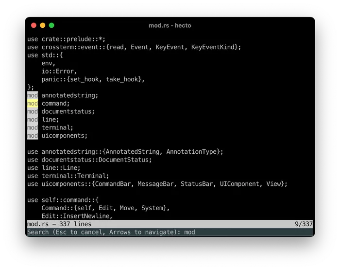

## 目录

- [介绍](hecto.md)
- [第 1 章：环境搭建](hecto-chapter-1.md)
- [第 2 章：进入原始模式](hecto-chapter-2.md)
- [第 3 章：原始输入与输出](hecto-chapter-3.md)
- [第 4 章：文本查看器](hecto-chapter-4.md)
- [第 5 章：文本编辑器](hecto-chapter-5.md)
- [第 6 章：搜索](hecto-chapter-6.md) 📍 你在这里
- [第 7 章：语法高亮](hecto-chapter-7.md)
- [附录](hecto-appendices.md)
- [变更日志](hecto-change-log.md)

## 第 6 章：搜索

  
我们的文本编辑器已经完成了——我们可以打开、编辑和保存文件。接下来的两章将为其添加更多功能。在本章中，我们将实现一个最小的搜索功能。

为此，我们将复用向用户提示输入的能力。目前——至少在我的代码中——这与另存为功能紧密耦合，所以第一个任务是准备我们的代码。

## 任务 26：搜索提示

- 添加一个新提示，在按下 `Ctrl-F` 时打开。基本功能应与另存为相同，但有以下区别：
	- 在该提示上按 `Enter` 暂时不应做任何事情，我们稍后将实现搜索功能。
		- 提示不应显示 `Save as: `，而应显示 `Search: `
- 我们向用户显示的初始状态消息应修改为：`HELP: Ctrl-F = find | Ctrl-S = save | Ctrl-Q = quit`
- 如果适用，你的代码应清理以能够处理两种类型的提示。

**代码审查：** [这是我如何解决的。](https://github.com/pflenker/hecto-tutorial/commit/4bf994dbfbbb317f85cea7f80336ca7d6bfe2731)

## 任务 27：为搜索做准备

根据你的代码是什么样子，这个任务的大部分可能对你来说不需要。  
让我先解释一下大局。  
为了实现搜索，我们的策略是在 [String](https://doc.rust-lang.org/std/string/struct.String.html#method.find) 上使用 `find`。这将返回该字符串第一个字符的字节索引。为了将其转换为文本中的位置，我们需要找到一种将字节索引映射到字素簇的方法。  
实现这一点并不难——`unicode_segmentation` 提供了一个名为 `grapheme_indices` 的方法，它返回字节索引以及字素簇，如[这里](https://docs.rs/unicode-segmentation/latest/unicode_segmentation/trait.UnicodeSegmentation.html#tymethod.grapheme_indices)所记录。

然而，我们（至少是我的）表示 `Line` 的数据结构不再合适。我们构建它是基于文本*查看器*的需求，因此该数据结构针对显示进行了优化——它基本上是一个布局信息的向量——但不适合编辑、保存或搜索，因为所有这些操作都需要在当前结构内重建整个字符串。编辑甚至更进一步，一个编辑操作构建整个字符串，只是为了再次重建整个内部结构然后再次丢弃新字符串。

我们应该做的是保留字符串并在编辑操作时直接修改它——`grapheme_indices` 返回的字节索引可以帮助我们做到这一点。然后，我们可以丢弃内部结构并保留字符串。搜索操作将直接作用于字符串，而无需先组装它。

这是任务：

- 重构你的代码，为每一行保留一个 `String`。
- 重构你的代码，为每个片段存储 `byte_index`。
- 重构你的代码，在编辑操作时直接修改 `String`。

**代码审查**：[这是我如何做的。](https://github.com/pflenker/hecto-tutorial/commit/6e49fb079a2aa997d03f1563f39edd0063e0b81a?diff=unified&w=0)

## 任务 28：简单搜索

让我们构建搜索的第一个版本。每次用户更新搜索查询时，我们将遍历所有行，直到在其中一行找到匹配。然后我们将视图滚动到该位置。

对于最初几步，我建议你忽略字素簇。在我们有结果高亮之前，测试它们会很困难。

对于剩余的任务，你可以使用[这个文件](https://raw.githubusercontent.com/pflenker/hecto-tutorial/f643ef719db9fb6e140e0046bb05e919fc053580/test-search-highlighting.txt)作为搜索的测试文件。

这是任务：

- 当用户在搜索提示中输入时，从顶部找到给定字符串的第一个出现并滚动到它。你可以遍历每一行以找到正确的行索引，并在每一行中使用 [find](https://doc.rust-lang.org/std/string/struct.String.html#method.find) 找到正确的字节索引，然后需要将其转换为正确的字素索引。
- 如果未找到匹配，什么都不做。
- 如果用户通过按 Enter 离开搜索，确保用户可以在该匹配的位置继续编辑。
- 如果用户通过按 `Esc` 关闭搜索，恢复文本中之前的 caret 位置并滚动到它。
- 将提示文本修改为 `Search (Esc to cancel): `

**代码审查**：[这是我的代码。](https://github.com/pflenker/hecto-tutorial/commit/2dd4b72d78be9a220c25a7d15ed40f70c893533c)

## 任务 29：改进搜索

让我们允许在搜索结果中导航，并使当前搜索更方便。  
这是任务：

- 搜索不应从顶部开始，而应从当前位置开始。从字符串中的某个位置查找等同于从所需位置开始的该字符串切片中查找。
- 如果未找到匹配，则环绕到文档顶部并从那里搜索直到当前位置。
- 滚动到匹配时应将匹配居中显示在屏幕上，使其更清晰可见。
- 使用 `Esc` 关闭搜索应精确恢复旧的滚动位置，而不仅仅是滚动到旧文本位置的位置。
- 将提示修改为：`Search (Esc to cancel, Arrows to navigate): `
- \-> 或 ↓ 应查找当前匹配之后搜索查询的下一个出现。

## 任务 29：代码审查

[这是我如何解决的。](https://github.com/pflenker/hecto-tutorial/commit/c9f5866e31d1b61fe3a298abde03126bbea15236)

现在让我们讨论我在自己代码中提出的两个方面。这是第一个，提取到一个 Rust Playground 中并简化：

```rust
pub fn print_hello(show_name: bool) {
        let hello_msg;
        if show_name {
            hello_msg = "Hey Philipp!"; 
        } else {
            #[cfg(debug_assertions)]
            {
                panic!("Attempting to say hello without using my name!");
            }
            #[cfg(not(debug_assertions))]
            {
                return;
            }
        }
        println!("{hello_msg}");
    }

fn main() {
    print_hello(true);
    print_hello(false);
}
```

[Rust Playground 链接](https://play.rust-lang.org/?version=stable&mode=debug&edition=2021&gist=6d15849a22ec90279379a77f0b5088fc)

我的问题是：

- 为什么 `return` 被包裹在 `cfg` 中？
- 如果你移除整个块（包括 `return`）会发生什么？  
	玩一玩并试一试。

第一个问题在之前的代码审查中已经回答过了：如果我们移除周围的 cfg，`clippy` 会认为 `return` 是死代码，因此会报错。

第二个问题可以回答为：乍一看，什么都不会发生。移除带有 `#[cfg(not(debug_assertions))]` 的整个块，它能工作。你不会得到错误或警告。

然而，我在带注释的提交中告诉过你，未初始化的 `hello_msg` 使用（在这种情况下，在代码审查中是 `step_right`）是被允许的，仅仅是因为 Rust 可以推断出在任何情况下都不会在未初始化的情况下使用 `show_message`。这是真的——对于 Debug 构建。

但一旦你从 Debug 切换到 Release（在 Rust Playground 右上角），它就不再编译，因为 `hello_msg` 可能未定义。

这两个方面都与 `clippy` 仅为 `Debug` 构建进行 lint 检查有关。  
要让 `clippy` 为 release 进行 lint，这样调用它：

```
cargo clippy --release
```

### 正确的搜索结果导航

这是我在代码审查中提出的第二个方面：  
当导航到下一个搜索结果时，我们通过将起始位置移动到当前匹配之后并继续从那里搜索来实现。我当时问：为什么我们不直接向右移动一步，省去所有确定搜索查询长度的逻辑？

答案在于其他文本编辑器中搜索的工作方式，并且与重叠搜索结果有关。  
考虑以下字符串：ababa。你的搜索查询是 `aba`，因此你匹配该字符串的前三个字母：==aba== ba。如果你继续向右搜索一步，将起始位置放在 `a` 和 `baba` 之间，那么会匹配第二个 `aba`：ab ==aba==。这不是搜索通常的工作方式——在这个页面上搜索 `aba` 试试看！

如果你开始考虑搜索结果高亮以及搜索替换等功能，这就说得通了。搜索 `aba` 并高亮 ==ababa== 会很奇怪。尝试将所有出现的 `aba` 替换为 `abc` 会导致歧义：结果应该是 `abcba`？`abcbc`？`ababc`？

这将在下一个任务中带来一个有趣的挑战。

## 任务 30：向后搜索

现在，让我们允许用户切换搜索方向。使用 ↑ 或 ← 应搜索上一个搜索结果。简单的方法是使用 `rfind`，它像 `find` 一样工作，但是向后（文档在[这里](https://doc.rust-lang.org/std/primitive.str.html#method.rfind)）。然而，这打破了用户的期望，因为即使在向后搜索时，通常也只应考虑重叠匹配的第一部分！

另一种方法是使用 `match_indices`，它返回一个遍历所有匹配的迭代器（从字符串开头开始），并且按预期处理重叠。文档在[这里](https://doc.rust-lang.org/std/primitive.str.html#method.match_indices)。向后和向上搜索不需要在搜索前“向左移动一步”。

这里有一个 Rust Playground，说明了在字符串中搜索的几种方式：

```rust
fn main() {
    let needle = "aba";
    let haystack = "ababababa";
    // 这个 haystack 包含 needle 4 次
    // 在以下索引处：0, 2, 4, 6

    dbg!(haystack.find(needle).unwrap()); //找到第一个出现
    dbg!(haystack.rfind(needle).unwrap()); //找到最后一个出现
    for (index, _) in haystack.match_indices(needle) { //找到第一个和第三个出现
        dbg!(index);
    } 
    for (index, _) in haystack.rmatch_indices(needle) { //找到第二个和第四个出现
        dbg!(index);
    } 
    let mut i = 0;
    while let Some(relative_index) = haystack[i..].find(needle) { //找到所有出现
        dbg!(relative_index + i);
        i += relative_index + 1;
    }
}
```

[Rust Playground 链接](https://play.rust-lang.org/?version=stable&mode=debug&edition=2021&gist=c8de6c3070d3f139593dcb8b8fb110cd)

这是任务：

- 按 ↑ 或 ← 应向后搜索给定的查询。
- 与向前搜索对称，如果未找到结果，搜索应环绕到文档底部。
- 如上所述处理重叠结果。
- 通过继续输入来扩展查询不应改变行为：搜索更新后的字符串继续向下进行。
- 检查 `clippy` 对 `release` 构建的潜在警告，并在适当的地方修复它们。

**代码审查：** [这是我的代码。](https://github.com/pflenker/hecto-tutorial/commit/ee3ca70ee37e550a1dd84d6b5faa47db046adf6f)

## 颜色

我们的搜索可以工作了！然而，使用它并不太方便：如果多个匹配彼此靠近，很难猜测我们当前找到了哪一个。让我们通过漂亮地高亮它来解决这个问题。

为此，我们需要先讨论颜色。

在设置状态栏样式时，我们已经简要触及了这个主题，但我们所做的只是反转当前颜色，如果你想一想，这实际上根本没有使用颜色。

我们在早期章节之一中已经遇到了美国国家标准协会（ANSI）——他们标准化了我们一直用来设置终端的转义码。

他们还定义了一个包含八种颜色（3 位）的列表，可用于在终端中为文本输出着色。这些颜色是：

- 黑色
- 红色
- 绿色
- 黄色
- 蓝色
- 品红色
- 青色
- 白色

以下程序——出于显而易见的原因——在 Rust Playground 上无法运行，它打印出这 8 种颜色：

```rust
fn main() {
    for i in 0..7 {
     print!("\x1b[3{};4{}m ",i,i);
     print!("\x1b[0m ");
    }
    println!();
}
```

`\x1b[3{};4{}m` 将前景色（30-37）和背景色（40-47）设置为相同的值，导致后续空格以目标颜色渲染为一个块。  
`\x1b[0m` 重置终端，导致后续空格渲染为空。

这 8 种颜色很快被另一位补充，表示它们的“明亮对应物”，分别使用前景色的代码 90-97 和背景色的 100-107。

以下是打印它们的方式：

```rust
fn main() {
    println!("R B");
    for i in 0..7 {
     print!("\x1b[3{};4{}m ",i,i);
     print!("\x1b[0m ");
     print!("\x1b[9{};10{}m ",i,i);
     print!("\x1b[0m\n");
    }
    
}
```

如你所见，白色、亮白色、黑色和亮黑色的存在导致有 4 种不同的灰度可用。

## 从 4 位到 RGB

技术在进步，很快上面的 4 位颜色被扩展到 8 位颜色，拥有高达 256 种不同的颜色。  
不是在 10x 代码范围之后为每种颜色添加更多转义码用于明亮背景色，而是使用了代码 38 和 48，它们因为原始 4 位颜色分别结束于 37 和 47 而未被使用，并带有另一个参数（`5`）来指示 8 位颜色模式。

以下是打印所有颜色的方式：

```rust
fn main() {
    for i in 0..255 {
        print!("\x1b[38;5;{};48;5;{}m ", i, i);
        print!("\x1b[0m ");
    }
}
```

如果你运行这个，你可以看到

- 前 8 种颜色是上面的原始 8 种颜色
- 接下来的 8 种颜色是它们的明亮对应物
- 之后是 216 种其他颜色
- 最后一块是从深到浅的 24 种灰度。

此后的下一次飞跃是 RGB，它给了我们更多颜色可以使用。但在我们到那里之前，让我们谈谈颜色约定。

## 颜色约定和命名

当我们在软件工程的背景下谈论颜色时，我们通常回退到颜色代码而不是按名称引用颜色。当只有 8 种颜色可用时，精度并不重要，按名称引用颜色更为常见。在上面 8 种颜色的列表中，“蓝色”一词绝对没有歧义，因为只有一种蓝色可用。实际渲染的是*哪种*蓝色可能并且确实因机器而异——正如我所说，精度并不太重要。

有趣的是，你可以看到从 3 位到 4 位颜色的飞跃已经使命名约定崩溃了：突然，3 位调色板中有了“白色”，而添加带来了“亮白色”……这导致“白色”被降级为灰色，而亮白色则成为，嗯，白色。

作为命名颜色这团令人愉悦的混乱的另一个例子，考虑一下：你有没有想过为什么在 CSS 中，深灰色实际上比灰色更浅？如果没有，现在你可能会想了。

X Window System，一个用于类 Unix 操作系统的图形用户界面，包含一个将颜色名称映射到其 RGB 值的列表（我们很快就会正式认识 RGB！）。第一批浏览器使用这些颜色进行映射。W3C，标准化了 CSS 中的颜色，使用了 X11 的颜色，修改了，并部分覆盖了他们自己的定义。  
关键的是，W3C 对“灰色”和“浅灰色”的定义比 X11 的对应物暗得多。然而，W3C 没有定义“深灰色”变体——所以较浅的 X11 变体没有被覆盖并保留了下来。

尽管我的 LLM 想让我相信按名称引用颜色要方便得多，但我从未见过使用命名颜色的专业场景。相反，我们通常使用 RGB 颜色代码。

## RGB 和 RGB 颜色代码

我确信你以前使用过，或者至少见过这些代码。有，接近可口可乐红；有，叫做芭比粉；而我的现任雇主 Zaando 将其用于品牌。

但这些代码是什么意思？这些代码是十六进制的三元组——在 Zalando 的情况下，有 FF，然后是 69，然后是 00。在十六进制中，每个数字代表 16 个值之一（0,1,2,3,4,5,6,7,8,9,A,B,C,D,E,F）。因此两个数字可以表示 16x16=256 个值。前两位数字代表红色的强度，中间两位代表绿色，最后两位代表蓝色——R,G,B。

## 加色和减色模型

让我们通过同时学习两种颜色模型来建立我们对颜色模型的理解——RGB，通常用于屏幕，以及 CMYK，用于印刷。  
对于第一个模型，想象你在一个完全黑暗的房间里——漆黑一片。你随身带着三个手电筒——一个红色、一个绿色、一个蓝色。每个手电筒有 256 个设置——从关闭到最大强度。

对于第二个模型，想象你在一个光线充足的房间里，面前是一块空白的白色画布。你有三种墨水颜色可用：青色、品红色和黄色（这些颜色名称的首字母构成了这个模型名称的第一部分：CMYK。我们马上会讲到 K。）

在第一个模型中，没有光线到达你的视网膜——它完全是黑暗的。在第二个模型中，所有波长的光都到达你的视网膜——你将其感知为白色。

现在让我们把两个模型都推到极端。在你的黑暗房间里，同时打开所有三个灯，全部从 0 到 255。

实际上，让我们在代码中做这件事：

```rust
fn main() {
    for i in 0..255 {
        print!("\x1b[38;2;{i};{i};{i};48;2;{i};{i};{i}m ");
        print!("\x1b[0m ");
    }
}
```

我们在这里做的是使用与之前几乎相同的转义码，但我们从颜色模式 5（8 位颜色模式）切换到颜色模式 2（RGB 颜色模式），并分别提供红色、绿色和蓝色的值。由于我们想同时调高三盏手电筒，我们为所有三种颜色传递相同的值——我们对前景色和背景色也做同样的事。

你可以看到的是灰色——一路从黑色经过几乎黑色，然后穿过所有灰色色调到纯白色：最大强度的红、绿、蓝的混合足以被感知为白色。

相反，如果你在画布上以相同量涂抹所有三种颜色——青色、黄色和品红色——结果将是一个越来越深的灰色调，直到你到达黑色。

至少在理论上，或者在你心智模型的完美世界中。在现实中，墨水是不纯和不完美的，因此你能达到的最好效果将是某种深棕色。这就是为什么在印刷中，黑色被特别添加为单独的颜色——称为 Key，构成 CMYK 中的 K。

现在，让我们混合几种颜色——首先在 RGB 模型中，同时只操作两个手电筒。我们也用代码来做：

```rust
fn main() {
    print!("Red:\t\t");
    print!("\x1b[38;2;255;0;0;48;2;255;0;0m ");
    print!("\x1b[0m ");
    println!();
    print!("Green:\t\t");
    print!("\x1b[38;2;0;255;0;48;2;0;255;0m ");
    print!("\x1b[0m ");
    println!();
    print!("Blue:\t\t");
    print!("\x1b[38;2;0;0;255;48;2;0;0;255m ");
    print!("\x1b[0m ");
    println!();
    print!("Red and Green:\t");
    print!("\x1b[38;2;255;255;0;48;2;255;255;0m ");
    print!("\x1b[0m ");
    println!();
    print!("Green and Blue:\t");
    print!("\x1b[38;2;0;255;255;48;2;0;255;255m ");
    print!("\x1b[0m ");
    println!();
    print!("Red and Blue:\t");
    print!("\x1b[38;2;255;0;255;48;2;255;0;255m ");
    print!("\x1b[0m ");
    println!();
}
```

你可以看到的是：

- 红色和绿色产生黄色
- 绿色和蓝色产生青色
- 红色和蓝色产生品红色

品红色是一个很有趣的例子：黄色、青色、红色、绿色和蓝色是“彩虹的颜色”，意味着所有这些颜色都有分配给它们的波长光谱。另一方面，品红色，正如我们刚刚看到的，混合了红色和蓝色，它们在[可见光谱](https://science.nasa.gov/ems/09_visiblelight/)上相距很远，但大脑将其解释为一种独特的颜色。

RGB 是一个*加色*颜色模型，因为我们从黑色开始，添加颜色和强度（如红色和绿色产生黄色），直到我们创建了想要的颜色。

让我们把这个知识应用到 CMYK 模型。我们的黄色墨水只反射红色和绿色（正如我们在上面看到的：红色和绿色光产生黄色），我们的青色墨水只反射绿色和蓝色。如果我们混合它们，混合物吸收除绿色以外的所有东西（绿色被两种墨水反射）——所以青色和黄色产生绿色。类似地，青色和品红色产生蓝色，品红色和黄色产生红色。

CMYK 是一个*减色*颜色模型，因为我们从白色开始，减去颜色和强度（如青色和黄色吸收除绿色以外的所有东西），直到我们创建了想要的颜色。

由于两个三元组中的任何一个——青色、黄色、品红色和红色、绿色、蓝色——都可以创建另一个，它们可以创建一组等效的颜色。

让我们把它们全部打印出来！

```rust
fn main() {
    for r in 0..255 {
        for g in 0..255 {
            for b in 0..255 {
                print!("\x1b[38;2;{r};{g};{b};48;2;{r};{g};{b}m ");
                print!("\x1b[0m ");
            }
            println!();
        }
        println!();
    }  
}
```

## RGB 和 CMYK 的局限性

回到可乐、芭比和 Zalando：有了我们刚刚学到的知识，我们可以推断出十六进制代码对应于红色、绿色和蓝色通道的各自强度：

```rust
fn main() {
    // #C20000 = 192, 0, 0
    println!("Cola Red:\t\x1b[38;2;194;0;0;48;2;194;0;0m \x1b[0m");
    // #E0218A = 244, 33, 138
    println!("Barbie Pink:\t\x1b[38;2;244;33;138;48;2;244;33;138m \x1b[0m");
    // #FF6900 = 255, 105, 0
    println!("Zalando Orange:\t\x1b[38;2;255;105;0;48;2;255;105;0m \x1b[0m");
}
```

然而，这有局限性：

- 由于 RGB 每个通道最多有 256 个值，它最多可以产生 16,777,216 种不同的颜色
- 我们所感知的颜色的几个方面无法通过简单地组合手电筒来复制，例如金属效果
- 你屏幕上的“红色”可能与我屏幕上的红色不同，取决于你的屏幕设置、屏幕类型、你观看任一屏幕的角度、每个屏幕的磨损等等。  
	类似的限制适用于 CMYK，实际颜色取决于画布、墨水、打印机等等。

因此，*实际的*可乐红很可能不是我上面提到的值！对于 Zalando，我不确定——毕竟它是一家在线零售公司，我认为如果他们选择一种显示器无法正确显示的企业颜色会很愚蠢。

无论如何，让我们回到 `hecto`，RGB 在这里绝对足够用了！

## 使用 Crossterm 的彩色终端

在令人惊讶的长时间里，8 位颜色是终端中的常态。如今，现代终端（至少我们在本教程中针对的那些）应该能够处理 RGB。

`Crossterm`，我们选择的 crate，提供了便捷的方法来更改前景色和背景色。方法如下：

```rust
use std::io::stdout;

use crossterm::{execute, style::{Color, Print, ResetColor, SetBackgroundColor, SetForegroundColor}};

fn main() {
    let mut stdout = stdout();

    // 将前景色设置为亮橙色 (RGB: 255, 105, 0)，背景色设置为亮粉色 (RGB: 224, 33, 138)
    execute!(
        stdout,
        SetForegroundColor(Color::Rgb {
            r: 255,
            g: 105,
            b: 0
        }),
        SetBackgroundColor(Color::Rgb {
            r: 224,
            g: 33,
            b: 138
        }),
        Print("This text has a bright orange foreground and a bright pink background."),
        ResetColor
    )
    .unwrap();
    // 重置颜色
    println!();
}
```

## 高亮搜索结果

现在我们技术上知道了如何为文本着色，让我们讨论如何在架构上处理这个问题。我们需要扩展 `view` 中的 `draw` 函数，以正确处理搜索查询（如果存在）。我提出两种方法供你推理：

1. 渲染逻辑——与 `Terminal` 交互——可以从 `View` 移到 `Line`，`Line` 调用 `Terminal` 上处理着色的新辅助函数。这种方法易于实现，但它开始将终端绘制的责任在 `View` 和 `Line` 之间拆分。
2. 构建一个新的数据结构，如 `AnnotatedString`，`Line` 返回它，`View` 可以将其传递给 `Terminal` 进行渲染。这实现起来稍微难一些，但更符合 `hecto` 当前的架构。

### 简单的方法

更简单的实现方式意味着将渲染责任移到 `Line`。`View` 不是获取可见字素然后在 `View` 内渲染它们，而是告诉 `Line` 在哪里渲染，`Line` 来做。  
由于我们也在命令栏内渲染，我们需要确保 `Line` 不清除整行，而只清除提示之后的部分。

在 `Line` 内，我们可以通过跳过左边界和右边界之外的部分来处理渲染请求，必要时裁剪为省略号，同时不断检查我们当前是否处于应该高亮的匹配中。  
因此过程将是：

- 跳过当前可见屏幕左侧的所有内容
- 如果需要，在左侧应用裁剪。
- 如果我们处于匹配中间，相应设置颜色（我们需要一个新的 Terminal 函数来实现这一点）
- 如果我们处于匹配中间，打印所有内容直到匹配结束，然后再次重置颜色（需要另一个新的 Terminal 函数）
- 打印所有内容直到新匹配的开始
- 冲洗并重复，直到我们到达可见终端的右侧
- 如果需要，在右侧裁剪。
- 重置颜色。

### 困难的方法

即将到来的任务将使这种方法成为加分任务，因为这是一个相当复杂的更改。如果你想接受它，以下是使其工作的大纲：

- 创建一个新的数据结构：`AnnotatedString`。它应持有一个字符串和一个注释向量。
- 一个注释有一个起始字节索引和一个结束字节索引。如果你选择通用解决方案——这将在下一章有用——它还有一个类型。
- `AnnotatedString` 需要一个方法来添加注释。

有了这些，我们需要考虑如何构建带注释的字符串。我们的策略如下：

- 从给定行的完整字符串创建一个 `AnnotatedString`
- 对该字符串应用所有 `Annotations`
- 应用所有字符替换
- 在左右截断字符串以适应屏幕

为此，AnnotatedString 需要一个 `replace` 函数，它接受起始字节索引、结束字节索引和替换字符串。然后我们会调用内部字符串上的 `replace_range`（[见文档](https://doc.rust-lang.org/std/string/struct.String.html#method.replace_range)）来执行替换。然后我们需要更新注释：

- 插入点之前的注释可以忽略。
- 完全在插入点之后的注释需要按长度差移动（因为替换可能导致内部字符串增长或缩小）。
- 在插入范围内开始或结束的注释需要正确移动。

由于 `AnnotatedString` 使用字节索引，而替换字符的字节长度可能与实际字符不同，我们将从右到左遍历原始字符串执行替换。这样，下一个片段的 `start_byte_idx` 将保持有效，尽管字符串后面可能发生了任何替换。

这个构建将在 Line 上一个名为 `get_annotated_visible_substr` 的新函数中完成。此方法将获得 `query` 作为输入参数以确定注释。为了保持 `get_visible_graphemes` 可用（用于提示），我们从中调用 `get_annotated_visible_substr` 并从中返回未注释的字符串。

现在，有了这一切，我们需要从 `view` 内获取带注释的字符串，然后将其传递给 `Terminal`，传递给一个名为 `print_annotated_row` 的新函数。此函数将将 caret 移动到正确的行并清除它。然后我们需要遍历 `AnnotatedString` 内的带注释片段，所以我们需要扩展 `AnnotatedString` 以返回带注释的片段——这可以是另一个结构体，包含字符串和应用于该字符串的注释类型。

最简单的方法可能是单独返回每个字素。更难但更干净的方法是返回一个片段，将具有相同注释类型的相邻字符组合起来。给定字符串 "Hey, ==hecto== is cool!" 搜索 `hecto` 将在简单情况下导致：

- 19 个带注释的片段，其中片段 6-10 在简单情况下为 "Match" 类型
- 在较难的情况下为 3 个带注释的片段，其中：
	- 第一个片段是 `Hey, `，类型为 `None`
		- 第二个片段是 `hecto`，类型为 Match
		- 第三个片段是 ` is cool!`，类型为 `None`  
		我们如何处理重叠注释？很简单，最后添加的获胜。

最后，`Terminal` 需要为每种片段类型相应地设置背景色和前景色（并在之后重置）。

## 任务 30：彩色搜索结果

是时候高亮搜索结果了，无论用困难的方法还是简单的方法——你的选择！

这是任务：

- 当搜索处于活动状态且输入了有效的搜索查询时，高亮所有当前可见的搜索结果。你可以使用黄色 (255,255,0) 作为背景，黑色 (0,0,0) 作为文本颜色，或任何其他你喜欢的颜色组合（你可以使用现有的 [RGB 颜色选择器](https://rgbcolorpicker.com/) 之一来混合你自己的！）。
- 一旦搜索被关闭，再次移除文本颜色。
- 确保你的高亮与你的搜索一致——即所有可到达的结果都被高亮，但仅此而已。
- 加分任务：
	- 通过将当前活动的搜索结果着色与其他结果不同，使其更加突出。
		- 使用样式化字符串的概念实现解决方案，如上所述。
		- 使你的解决方案与字素簇正确配合工作。

## 任务 30：代码审查

[这是我如何解决的。](https://github.com/pflenker/hecto-tutorial/commit/f643ef719db9fb6e140e0046bb05e919fc053580#diff-d3e337699fa6947e80e3b9cec50fc80e7550368a7b46ae6107e734909063cf9bL4)

如你所见，这是一个相当大的提交。这是一个很好的机会，将我们已经遇到的许多概念付诸实践：迭代器、Option、Result，甚至生命周期！结果是一个相当不错的搜索，并为即将到来的语法高亮章节奠定了坚实的基础。然而，我们还没有完全完成。

## 任务 31：搜索字素

有了高亮的搜索结果，现在是时候让我们的实现与字素簇一起工作了。要正确搜索字素簇，我们需要做以下事情：

- 使用 `match_indices` 找到所有潜在匹配。这些匹配也将包括字素簇内的匹配。
- 对于每个潜在匹配，我们将尝试逐字素构建搜索结果并将其与查询进行比较。如果不匹配，我们将其过滤掉。
	- 示例：考虑字符串："We all love hecto 🧑🏿‍🤝‍🧑🏿" 和搜索查询 `hecto 🧑`。
		- 使用 `match_indices` 将产生一个结果，你可能从前面章节中记得，并为我们提供字母 `h` 的字节索引。
		- 我们现在需要计算搜索查询中的字素簇数量（7：5 个用于 `hecto`，1 个用于 emoji，1 个用于空格键）。
		- 然后，在原始字符串中，我们需要遍历包括 `h` 及其后的 7 个字素簇，并基于完整字素簇构建一个字符串。在这种情况下，它将导致 `hecto 🧑🏿‍🤝‍🧑🏿`。
		- 最后，我们需要将查询与这个新子字符串进行比较。如果它们相同，那就是真正的匹配。如果不同，如本例所示，匹配应该被丢弃。

这是任务：

- 确保你可以如上所述正确搜索字素。

## 任务 31：代码审查

[这是我如何解决的。](https://github.com/pflenker/hecto-tutorial/commit/e27c17d95d2392311afde6f31d0b82e3d24d1124)  
正如你从提交中看到的，我将一些类型和结构体移到了一个名为 `prelude` 的模块中。为什么叫这个名字？  
在 Rust 中，prelude 是一组你永远不需要显式导入的结构体和类型，因为它们已经被隐式导入了，比如 `Result` 或 `Option`。将整个项目中使用的结构体和类型捆绑到一个 `prelude` 中并在各处导入是一种常见的模式。不过你应该谨慎使用它：在各处导入所有东西并不是好习惯。

## 总结与展望

在本章中，我们构建了一个相当不错的搜索操作，并更多地了解了处理字素簇的注意事项。我们看到了如何在 Rust 中实现迭代器，并且我们第一次使用了生命周期。同时，我们重建了文本编辑器的核心部分——渲染一行文本的一部分——并学习了 RGB 和 CMYK。

这次重构和关于颜色的知识将在[下一章](hecto-chapter-7.md)中派上用场，在那里我们将扩展文本编辑器以执行语法高亮。