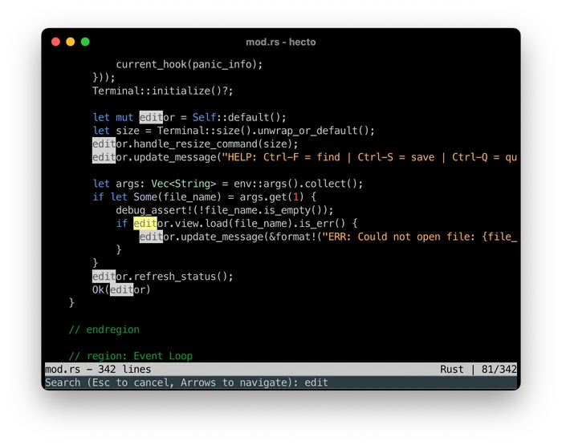

## 目录

- [介绍](hecto.md)
- [第 1 章：环境搭建](hecto-chapter-1.md)
- [第 2 章：进入原始模式](hecto-chapter-2.md)
- [第 3 章：原始输入与输出](hecto-chapter-3.md)
- [第 4 章：文本查看器](hecto-chapter-4.md)
- [第 5 章：文本编辑器](hecto-chapter-5.md)
- [第 6 章：搜索](hecto-chapter-6.md)
- [第 7 章：语法高亮](hecto-chapter-7.md) 📍 你在这里
- [附录](hecto-appendices.md)
- [变更日志](hecto-change-log.md)

## 第 7 章：语法高亮

  
我们的文本编辑器几乎完成了——只差一些语法高亮。

## 任务 32：彩色数字

让我们从尽可能简单地完成一些高亮开始。我们将尝试通过将每个数字字符着色为红色来高亮数字。

为此，我们将遍历字符串中的所有字符，并在它是数字时应用着色。

这里有一个 Rust Playground 来帮助我们：

```rust
fn main() {
    let haystack = String::from("And A-1, A-2, A-1,2,3!");
    for ch in haystack.chars() {
        if ch.is_ascii_digit() {
            println!("Found digit: {}",ch);
        }
    }
}
```

[Rust Playground 链接](https://play.rust-lang.org/?version=stable&mode=debug&edition=2021&gist=7588b267913e26a6efc25ad296da47cd)

这是任务：

- 以最简单的方式实现数字高亮。

**代码审查：** [这是我如何解决的。](https://github.com/pflenker/hecto-tutorial/commit/1eb21ff1877b533fca01f43e8a35696a2bca705b)

## 为高亮搭建架构

在我们深入高亮之前，我们必须先讨论架构方面的考虑。让我先向你阐述问题空间，然后解释我打算在本教程范围内如何解决它。有多种方法可以解决这个问题，请随意选择你自己的方法。

目前，我们简单的高亮功能位于 `Line` 内。这对大多数情况有效，但并非所有情况：有些注释可以跨越多行，像这样：

```rust
// This is a regular comment
/* 
This is a multi line comment
It goes on
And on
until here: */
```

为了正确高亮这一点，我们需要有关于前一行的信息：如果前一行在多行注释内结束，那么当前行就从多行注释内开始。

这在更新高亮信息时也带来了一些挑战：我们无法推断任何更改只影响该行自身的高亮——如果你开始了一个多行注释，所有后续行都需要重新高亮。

此时，重要的是：高亮逻辑需要移出 `Line`。  
我们可以将其移入外围结构体 `Buffer`，并从那里控制高亮，也许将高亮信息本身（在我的代码中：注释）存储在 `Line` 中。

事实上，这就是我在早期版本的 `hecto` 中解决这个问题的方式：

- 我定义了一个枚举来确定高亮类型
- 每个 `Line` 包含一个这些高亮类型的向量，每行中每个字符一个
- 外围结构体的责任是确保这个向量始终与文档本身同步，非常类似于我们目前确保片段向量与 `Line` 内的字符串同步的方式。

这是一个有效、可行的方案。

在这个版本的 `hecto` 中，我将走一条不同的路，这更接近其他文本编辑器的实现方式：我将创建一个只关注高亮的独立结构。它将为每一行存储高亮信息，然后在构建最终的带注释字符串时传递给 `Line`。我的实现将侧重于简单性而非性能，但有了这个设置，以后进行性能调整会更容易——例如，只重新高亮文档直到当前可见屏幕的边缘。

随你选！不过我不认为这两种方法中哪一种明显比另一种更容易实现。

## 搜索结果怎么办？

搜索结果的高亮也应该移出 `Line` 吗？答案是：不一定。如果对“高亮”来说你的意思是“让文本变得多彩”，那么听起来彩色的搜索结果应该和彩色的代码语法一起移动。如果“高亮”对来说你的意思是“语法高亮”，那么听起来搜索结果高亮应该保持原位。`hecto` 不支持多行搜索，语法高亮也不影响搜索结果的高亮，所以这并不太重要。

不过我打算移动它。

## 任务 33：为高亮找个位置

任务相当直接：

- 决定你的高亮前进方向。
- 相应地移动你现有的高亮逻辑。

## 任务 33：代码审查

[这是我如何解决的。](https://github.com/pflenker/hecto-tutorial/commit/45b4b4e6c65ffcb726bf452d625eeb583b1e02be)

我使用了一个新的数据结构：`HashMap`。我这样做是因为我不想推理高亮发生的顺序——也因为我认为这是一个值得介绍的重要数据结构。  
这里有一个 Rust 教程来正式认识它：

```rust
use std::collections::HashMap;

fn main() {
    // 创建一个新的 HashMap
    let mut scores = HashMap::new();

    // 插入一些键值对
    scores.insertfrom("Alice"), 50;
    scores.insertfrom("Bob"), 40;
    scores.insertfrom("Carol"), 100;

    // 通过键访问值
    let alice_score = scores.get("Alice");
    println!("Alice's score: {:?}", alice_score);

    // 检查键是否存在并打印消息
    if let Some(&score) = scores.get("Bob") {
        println!("Bob's score: {}", score);
    } else {
        println!("Bob's score not found");
    }

    // 更新值
    scores.insertfrom("Alice"), 55;
    println!("Alice's new score: {:?}", scores.get("Alice"));

    // 遍历所有键值对
    println!("All scores:");
    for (key, value) in &scores {
        println!("{}: {}", key, value);
    }

    // 移除键值对
    scores.remove("Carol");
    println!("After removing Carol, scores are:");
    for (key, value) in &scores {
        println!("{}: {}", key, value);
    }
}
```

[Rust Playground 链接](https://play.rust-lang.org/?version=stable&mode=debug&edition=2021&gist=d7e08a7b544c6cdf9984002503061294)

## 任务 34：文件类型检测

在我们继续高亮之前，我们将向编辑器添加文件类型检测。这将允许我们为不同类型的文件设置不同的高亮规则。例如，文本文件不应该有任何高亮，而 Rust 文件应该高亮数字、字符串、字符、注释以及许多 Rust 特有的关键字。

让我带你过一遍计划：

- 我们需要一个新的枚举 `FileType`，它有 `PlainText` 和 `Rust` 两个变体。
- 在加载或保存时，我们检查文件名是否以 `.rs` 结尾。如果是，就是 Rust 文件；如果不是，就是纯文本文件。
- 对于这个任务，我们还不改变高亮。我们只是在状态栏的位置指示器旁边显示“Text”或“Rust”，这样对于 Rust 文件看起来像：`Rust | 16/417`

要检查文件类型，我们可以使用 [ends_with](https://doc.rust-lang.org/std/string/struct.String.html#method.ends_with) 函数——或者，既然我们已经在使用 `Path` 或 `PathBuf`，我们可以使用 [extension()](https://doc.rust-lang.org/std/path/struct.PathBuf.html#method.extension) 来获取扩展名。我们可以直接比较该扩展名，或使用 [eq_ignore_ascii_case](https://doc.rust-lang.org/std/primitive.str.html#method.eq_ignore_ascii_case) 来确保我们正确匹配扩展名的大小写。

这是任务：

- 如果文件是 Rust 文件，在状态栏的位置指示器旁边显示 `Rust | `。
- 如果文件是纯文本文件，在状态栏的位置指示器旁边显示 `Text | `。
- 确保在文件保存时正确更新文件类型。

**代码审查：** [这是我如何解决的。](https://github.com/pflenker/hecto-tutorial/commit/28be7022c77610a3071650b08bc3a5df7ebc8962)

## 任务 35：条件高亮

有了这些，我们现在可以继续条件性地高亮数字：如果我们打开的是 Rust 文件，我们希望高亮语法；如果不是，我们只希望高亮搜索结果。

让我们现在实现这一点：

- 打开 Rust 文件时，像之前一样高亮数字。
- 对于其他文本文件，不高亮数字。
- 确保将新文件保存为 Rust 文件时正确触发高亮。

## 任务 35：代码审查

[这是我如何解决的。](https://github.com/pflenker/hecto-tutorial/commit/43fa7f36540e6971c3a247d74c57a2ca49d4cccb#diff-7b05039899d019f967babe4ee53ea3cd9cbf37a682ee09b16bf3d1ba35d64d96R13)

在我的代码中，我想展示一个常见场景：我们有一个通用的*东西*，一个语法高亮器，我们可以有具体的语法高亮器：一个用于 Rust，一个用于 TOML，等等。在 Rust 中，这通常用特质来解决，果然：我为我代码中目前可用的两个高亮器实现了一个名为 `SyntaxHighlighter` 的特质。因此扩展到第三个高亮器应该很容易。

但我引用语法高亮器的结构体成员定义看起来很奇怪，它看起来类似于这样：

```rust
pub struct Highlighter {
    syntax_highlighter: Box<dyn SyntaxHighlighter>,
    //...
}
```

在 Rust 中，字段的类型必须是固定的并且在编译时已知。调用 `highlighter.syntax_highlighter.highlight();` 需要 Rust 知道 `highlight()` 的定义存储在哪里。它只有知道结构体成员的类型才能做到这一点，知道去哪里找到它（即指向它的指针）是不够的。这里的哲学是抽象不应该带来运行时开销，所以对 `highlight()` 的访问不应该需要在运行时进行额外的计算来找出函数定义所在的位置。

不过在这种情况下，我们需要这种运行时开销，这就是 `Box` 的用武之地。我们之前在讨论 panic hook 时遇到过 Box，现在我们自己使用一个。通过使用 `Box<dyn SyntaxHighlighter>`，我们告诉 Rust 我们想要动态分发，意味着在运行时而非编译时，我们需要找出给定特质的特质方法所在的位置。结构体 `Highlighter` 在 `syntax_highlighter` 中存储的不仅仅是一个简单的指针——它存储一个智能指针，指向目标本身，*以及*一个查找表，允许 Rust 在运行时找到具体 `SyntaxHighlighter` 的正确方法。

与 box 交互与与对象本身交互没有太大区别，只是创建 Box 看起来有点不同：

```rust
fn create_syntax_highlighter(file_type: FileType) -> Box<dyn SyntaxHighlighter> {
    match file_type {
        FileType::Rust => Box::<RustSyntaxHighlighter>::default(),
         //...
    }
}
```

## 任务 36：彩色整数和浮点数

好的，让我们开始正确地高亮数字。现在，数字即使作为标识符的一部分也会被高亮，比如 `u32` 中的 32。我们应该只在数字字面量前后是空白或像 `(! " # $ % & ' ( ) * + , - . /` 这样的字符时，才将其识别为数字字面量。

我们目前的方法——遍历所有字符并为每个 ASCII 数字添加一个注释——将不够用。相反，我们需要做的是将字符串拆分为单词，基于上述标点符号以及空白等单词边界。然后我们需要检查每个单词是否是数字，如果是，则添加注释。

幸运的是，`unicode_segmentation` 为我们提供了一种进行拆分的方法，无需我们自己动手。这里有一个 Rust Playground 向你展示如何做到：

```rust
use unicode_segmentation::UnicodeSegmentation;
fn main() {
   let hello = "1 second please, here are some numericals: 1>2 1+1=2; 123 1.23 1_200_3 1e2 0x010 10bdh abc10 1.23.1.23";
   for (index, word) in hello.split_word_bound_indices() {
       println!("{index}: {word}");
   }
}
```

[Rust Playground 链接](https://play.rust-lang.org/?version=stable&mode=debug&edition=2021&gist=fd9acfb055367f031c04212ba64897fb)

这是任务：

- 高亮整数，其中每个字符都是 ASCII 数字。
- 高亮浮点数：这些是恰好包含一个点（`.`）的数字，但前提是它不在数字的开头或结尾。
- 高亮科学记数法，如 `50e10`。`e` 之前的部分可以是浮点数，`e` 之后的部分必须是整数。
- 高亮带有视觉分隔符的整数、浮点数或科学记数法数字，其中 `_` 用作视觉分隔符，但前提是该分隔符不出现在单词的开头或结尾（换句话说：`1_000` 或 `1_000_000` 应该被高亮，`_1_000` 不应该，`1_000_` 也不应该）
- [这里有一个你可以使用的测试文件。](https://raw.githubusercontent.com/pflenker/hecto-tutorial/09689df7e8cdcce798a905d55a84e2222d7e4acf/test-numeric-literal-highlighting.rs)  
	**代码审查：** [这是我的代码。](https://github.com/pflenker/hecto-tutorial/commit/09689df7e8cdcce798a905d55a84e2222d7e4acf)

## 任务 37：彩色十六进制、二进制和八进制字面量

我们还没有高亮 Rust 知道的所有数字字面量——你可以用十六进制、二进制和八进制写数字。

这里有一个简短的 Rust Playground 来介绍它们：

```rust
fn main() {
   let binary = 0b1111;
   let octal = 0o17;
   let hexadecimal = 0xF;
   println!("{binary} | {octal} | {hexadecimal}");
}
```

[Rust Playground 链接](https://play.rust-lang.org/?version=stable&mode=debug&edition=2021&gist=9124fb216fa02d6075cb0d393de5256b)

解析它们很容易：

- 二进制字面量以 `0b` 或 `0B` 开头，后跟 `1` 和 `0`
- 八进制字面量以 `0o` 或 `0O` 开头，后跟数字 `0` 到 `7`
- 十六进制字面量以 `0x` 或 `0X` 开头，后跟 `0` 到 `9` 或 `A` 到 `F`。

Rust 提供了一个便利函数，你提供一个基数，Rust 检查给定字符在给定基数下是否是有效数字：

```rust
fn main() {
let chars = vec!['0','1','2','8','F'];
   
   println!("Char\tbinary?\toctal?\thex?");
   for char in chars {
       println!("{char}\t{}\t{}\t{}", char.is_digit(2),char.is_digit(8),char.is_digit(16));
    
   }
}
```

[Rust Playground 链接](https://play.rust-lang.org/?version=stable&mode=debug&edition=2021&gist=3a47379371a5e6050b534ef91f328024)

让我们也高亮这些。这是任务：

- 高亮十六进制字面量，以 `0x` 或 `0X` 开头，后跟十六进制数字（0-9,A-F）
- 高亮二进制字面量，以 `0b` 或 `0B` 开头，后跟 `1` 和 `0`
- 高亮八进制字面量，以 `0o` 或 `0O` 开头，后跟八进制数字（0-7）
- [这里有一个你可以使用的测试文件。](https://raw.githubusercontent.com/pflenker/hecto-tutorial/d0f6f922de5ea69d78062f3869f6f432512c01e7/test-numeric-literal-highlighting.rs)

**代码审查：** [这是我的代码。](https://github.com/pflenker/hecto-tutorial/commit/d0f6f922de5ea69d78062f3869f6f432512c01e7)

## 任务 38：彩色关键字、类型和字面量

现在我们有了逐词检查字符串的能力，是时候高亮一些单词了！

关键字在手册[这里](https://doc.rust-lang.org/reference/keywords.html)定义，是像 `if`、`else`、`match` 等这样的词。从该列表中，我们暂时忽略 `'static`。让我们为关键字使用蓝色。

我们还想高亮一些常用的类型。这里有一个列表：

- `i8`、`i16`、`i32`、`i64`、`i128`、`isize` 和 `u8`、`u16`、`u32`、`u64`、`u128`、`usize`
- `f32`、`f64`
- `bool`、`char`
- `Option`、`Result`
- `String`、`str`、
- `Vec`、`HashMap`  
	让我们为类型使用绿色。

然后有一些字面量和枚举变体：

- `Some`、`None`、`Ok`、`Err`、`true`、`false`  
	让我们为这些使用紫色。

这是任务：

- 适当地高亮上述关键字。如果你认为有更多值得高亮的东西，请随意修改相应的列表。

**代码审查：** [这是我如何解决的。](https://github.com/pflenker/hecto-tutorial/commit/c47753f46a53a6b0959d1f797adf8c17a20fb6da)

## 任务 39：彩色字符

我们现在需要超越前面步骤的逐词解析：我们想要正确地高亮字符。为此，我们需要高亮两个 `'` 之间的所有内容——我们不会去检查两个 `'` 之间的所有内容是否实际上*是*一个有效字符，所以我们会高亮 `'definitelynotachar'`，尽管它不是一个字符。  
但事情并不像寻找结束的 `'` 然后尝试解析中间的所有内容那么简单，因为 `'` 本身*也*是一个字符！要表示它，我们需要告诉 Rust 这次出现不是用来结束字符的，我们通过在其前面加上 `\`（称为转义字符——不要与我们之前遇到的另一种转义字符混淆）来做到这一点——所以字符 `'` 表示为 `'\''`。对于字符，我们可以假设 `\` 最多出现一次：紧跟在开引号之后。

我们不能再逐词解析了，因为 `'a'` 会出现为三个单词 `'`、`a` 和 `'`。我们将调整策略：不是将单词传递给每个解析函数，而是将剩余字符串的引用传递给它。并且不是返回 `true` 或 `false`，我们将返回一个 `Annotation`——并根据注释的结束索引推进外层循环的迭代器。

换句话说：在解析 `This is a char: 'a'!` 时，我们将遍历该字符串中的单词，直到到达第一个 `'`。然后我们将剩余字符串传递给解析函数：`'a'!`。这个函数将返回一个注释，它在第二个 `'` 的结束字节索引处结束。我们需要调整外层循环，在继续高亮之前推进到这个字节索引。

让我们为字符使用琥珀色。

这是任务：

- 通过高亮开 `'` 和闭 `'` 之间的所有内容来高亮字符。
- 忽略任何转义的 `'`（即 `\'`）
- [这里有一个小的测试文件。](https://raw.githubusercontent.com/pflenker/hecto-tutorial/main-2024-3/test-character-highlighting.rs)

**代码审查：** [这是我的代码](https://github.com/pflenker/hecto-tutorial/commit/b40c015687f37d1c520420eb2a54ea143530cc0a)

## 任务 40：彩色生命周期说明符

现在我们能够高亮字符了，让我们也高亮生命周期说明符。像字符一样，它们也以 `'` 开头，但与字符不同的是，它们没有闭引号。对于我们高亮来说，我们认为 ASCII 字符和数字以及下划线（`_`）是生命周期说明符的一部分，并相应地高亮它。我们在字符高亮函数之后运行此高亮函数，以避免字符被高亮为生命周期说明符。

让我们为生命周期说明符使用青色。

这是任务：

- 高亮生命周期说明符：跟在 `'` 之后的 ASCII 字符、数字或下划线
- 确保字符仍然被正确高亮。
- [这里有一个你可以用于测试的文本文件。](https://raw.githubusercontent.com/pflenker/hecto-tutorial/9327efd8960bcc92753e7fdba3dfee3e1750d575/test-lifetime-specifier-highlighting.rs)

**代码审查**：[这是我的代码。](https://github.com/pflenker/hecto-tutorial/commit/9327efd8960bcc92753e7fdba3dfee3e1750d575)

## 任务 41：彩色单行注释

让我们确保我们的（单行）注释被漂亮地高亮。如你所知，Rust 有两种单行注释：常规注释以两个斜杠（`//`）开头。这两个斜杠之后直到行尾的所有内容都被视为注释。这些用于记录每个函数的内部，面向推理你函数内代码的开发者。  
然后有文档注释，以三个斜杠开头：`///`。这些可以出现在自动生成的文档中，因此面向调用你的函数并与返回值交互的人。按照惯例，三斜杠注释描述此注释后面的代码。如果你想记录文档所在的项目（例如 crate 本身），你可以使用 `//!`。这里有一个使用所有三种注释类型的例子：

```rust
//! # Comments
//! 
//! A file which showcases all kinds of single-line comments in Rust.

/// A sample struct which is documented with this comment.
struct hecto;

impl hecto {
   /// Outputs Hello, World. This comment shows up in the auto-generated documentation around say_hello.
   fn say_hello() {
       println!("Hello, World!"); // using a macro here. This comment doesn't show up in the auto-generated documentation.
   }
}
```

让我们高亮这些。在我看来（但你可能不同意），将注释类型区分高亮没有太大意义，因此一个简单的实现只会检查 `//` 来检测注释并继续。让我们现在实现这个，并将注释高亮为较深的绿色。

- 高亮单行注释。
- 确保注释内不会发生其他高亮。
- 你可以使用任何你的代码文件来测试（它们注释得很详尽，对吧？！）

**代码审查：** [这是我的代码。](https://github.com/pflenker/hecto-tutorial/commit/dc2f1c896fb0aa503576fccd16c6deace8e08ed8)

## 任务 42：彩色多行注释

我们到了本章的后半部分，需要处理一个更复杂的情况：多行注释。  
多行注释以 `/*` 开头，它可以出现在行内的任何位置。该行的整个剩余部分被视为注释，所有后续行，直到包含 `*/` 的那一行——然后，这一行的剩余部分正常高亮。  
一个注意事项是存在嵌套的多行注释，例如：

```rust
/* This is an outer ML comment.
    /* This is an inner one! 
        Once this comment ends... */
 ...the text outside is still part of the comment.
*/
```

这就是我们一次只高亮一行的策略不再足够的地方：后续行的高亮需要前面的行也已经被高亮，我们需要传递我们看到的悬空多行注释开启符的数量。

我们的策略将像这样工作：

- 一旦我们遇到 `/*`，我们继续遍历字符串的剩余部分。
- 我们这样跟踪未关闭的多行注释：
	- 从 1 开始（对于我们遇到的第一个 `/*`）
		- 对于每个后续我们看到的 `/*`，加 1
		- 对于每个后续我们看到的 `*/`，减 1
- 一旦我们到达 0，我们将给定部分注释为注释并继续常规高亮。
- 如果我们在到达最终 `*/` 之前到达字符串末尾，我们将剩余数字存储为我们结构体的成员。
- 在我们开始下一行的常规高亮之前，我们检查是否处于多行注释中，并使用与上面相同的算法继续注释当前行。

这是任务：

- 高亮多行注释。
- 确保正确处理嵌套注释。
- [这里有一个供你使用的测试文件。](https://raw.githubusercontent.com/pflenker/hecto-tutorial/9f9cc0666ebdbe3d76523c22a6000a1908c9ece6/test-ml-highlighting.rs)

**代码审查：** [这是我的代码。](https://github.com/pflenker/hecto-tutorial/commit/9f9cc0666ebdbe3d76523c22a6000a1908c9ece6)

## 任务 43：彩色字符串

我们现在将通过处理字符串来结束我们的语法高亮。字符串以 `"` 开头和结尾。像字符一样，它们可以包含转义的结束分隔符，所以这是一个有效的字符串：`"Look at this: —> \" <— "`。  
像多行注释一样，字符串也*可以*跨越多行！然而，与多行注释不同，没有“嵌套字符串”需要处理。

让我们用橙色高亮它们。

这是任务：

- 高亮字符串。
- 确保正确处理转义引号。
- 确保正确处理多行字符串。
- 确保正确处理多行字符串中的多行注释
- 确保正确处理多行注释中的字符串。
- [这里有一个你可以使用的测试文件。](https://raw.githubusercontent.com/pflenker/hecto-tutorial/4394d21aed81a03b8142280ea084856a51823625/test-string-highlighting.rs)

**代码审查：** [这是我的代码。](https://github.com/pflenker/hecto-tutorial/commit/4394d21aed81a03b8142280ea084856a51823625)

## 任务 44：最后的润色

恭喜！`hecto` 现在功能完整并且（当然！）没有 bug。让我们现在做一些最后的润色。

- 通过运行 `cargo update` 确保我们所有的依赖都是最新的。
- 用 `cargo build --release` 创建一个 release 构建。将可执行文件的大小与常规构建创建的可执行文件进行比较。
- 然后，使用这个 release 构建来更新 `Cargo.toml`——将版本号设置为 `1.0.0`
- 拍拍自己的肩膀。

## 总结与展望

这完成了我们的功能集——以及此时的本教程。我们为 `hecto` 添加了基本的语法高亮，它可以高亮关键字、字符串、多行注释以及更多内容。如果你在寻找如何将 hecto 带得更远的灵感，请查看[附录](hecto-appendices.md)！