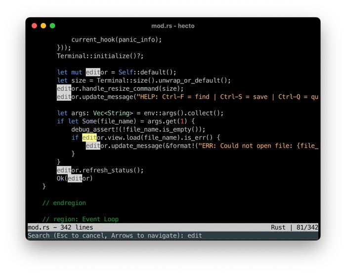

  
**欢迎！** 这是一系列博客文章，教你如何用 Rust 构建一个文本编辑器。

它是对 [antirez 的 kilo](http://antirez.com/news/108) 的 Rust 重实现，也是对 [Paige Ruten 用 C 语言编写的同类教程](https://viewsourcecode.org/snaptoken/kilo/index.html) 的改编重混。整个项目大约有 3000 行 Rust 代码，分布在几个文件中，并带有少量依赖；它实现了你对一个最小编辑器所期待的所有基础功能，此外还包含语法高亮和搜索功能。

这些文章会带你通过多个小步骤构建这个编辑器，并在此过程中学习 Rust。在最开始的步骤中，你会添加、修改或删除几行代码。大多数步骤中，你都能在编译并立即运行程序后**观察到自己所做更改的效果**。一旦你对 Rust 建立了扎实的理解，我就会描述接下来要解决的问题，并给你机会先自己尝试，然后再与我给出的解决方案进行对比。[^1]

我写这个教程时来自工程世界的另一个角落，目的是更深入地理解 Rust。如果你也处在类似的情况，这个教程就是为你准备的。如果你已经了解 Rust，但想弄清文本编辑器的内部细节，这个教程同样适合你。

我会解释沿途的每一步，有时会讲得非常详细，而且并不总是与 Rust 相关。你可以随意略读或跳过这些叙述文字，[^2] 因为本教程的重点是：**你将在学习 Rust 的同时从零开始构建一个文本编辑器！** 你沿途学到的一切都是额外收获，而仅仅通过输入代码更改并观察结果，就已经有很多东西可以学了。

有关教程本身的更多信息（包括遇到困难时该怎么办，以及去哪里寻求帮助），请参阅[附录](hecto-appendices.md)。

如果你准备好了，就前往[第 1 章](hecto-chapter-1.md)吧！

## 目录

- [介绍](hecto.md) 📍 你在这里
- [第 1 章：环境搭建](hecto-chapter-1.md)
- [第 2 章：进入原始模式](hecto-chapter-2.md)
- [第 3 章：原始输入与输出](hecto-chapter-3.md)
- [第 4 章：文本查看器](hecto-chapter-4.md)
- [第 5 章：文本编辑器](hecto-chapter-5.md)
- [第 6 章：搜索](hecto-chapter-6.md)
- [第 7 章：语法高亮](hecto-chapter-7.md)
- [附录](hecto-appendices.md)
- [变更日志](hecto-change-log.md)

---

[^1]: 但如果你只想阅读而不想自己写代码，那也完全没问题。

[^2]: 这个教程很长，而且是有意为之。如果你想用 Rust 构建同样的文本编辑器，但希望少一些叙述、少一些岔题，可以看看 Kofi Otuo 写的 [pound](https://medium.com/@otukof/build-your-text-editor-with-rust-678a463f968b)。不过，等我们进入我为你布置任务的阶段后，你会更容易跳过解释，直接从一个任务进入下一个任务。